# SemiBlock Junior: Stage-1 Design

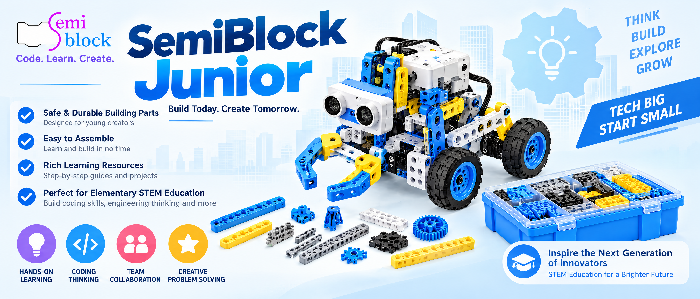

> **Status:** Stage-1 concept for internal review, 26 Oct 2026, semiblock.ai
> **Open next:** [3D viewer: every part, rotatable](viewer/index.html) · [all renders](renders/) · [CAD: STEP, STL and parametric source](cad/)
> Tables marked *generated* are filled from the CAD by `cad/make_docs.py`, so names, sizes and counts always match the 3D models.

---

## 0. The idea on one page

SemiBlock Junior is a construction kit for Hong Kong primary students (P3 to P6) to build robots, cars and machines and program them on semiblock.ai. It keeps what works about LEGO Technic and fixes what breaks in a classroom:

| # | What | Why it matters |
|---|---|---|
| 1 | **Technic-compatible grid.** 8 mm pitch, 4.85 mm holes, standard cross axles. | Schools can mix SemiBlock with the LEGO Technic parts they already own. |
| 2 | **TwistLock.** Push a pin in as usual, give it a ¼ turn, and a window turns from red to green: locked. Turn it back and it pulls out by hand. TwistLock Collars do the same on axles. | Robots survive crashes, drops and the storage box, yet stay easy to rebuild. A teacher can see at a glance what is not locked. |
| 3 | **One port for everything.** The Junior Brain (ESP32-S3) has 6 identical SemiLink-6 ports. Any motor or module works in any port and semiblock.ai detects it. | There are no pin numbers, wiring mistakes or "wrong port" problems. |
| 4 | **60 smart modules.** Every sensor and output sits in a grid-sized housing with a tiny MCU, a keyed latching plug and an ID. | This replaces the 45 loose Arduino boards (with breadboards and jumpers) with safe, robust parts that explain themselves. |
| 5 | **Classroom logistics built in.** Every beam shows its length, every axle has a notch every 8 mm, and colour means function. One SemiKey tool, cable clips, name plates, replaceable cables. | Kits get counted, sorted and shared faster, and fewer parts are lost. |

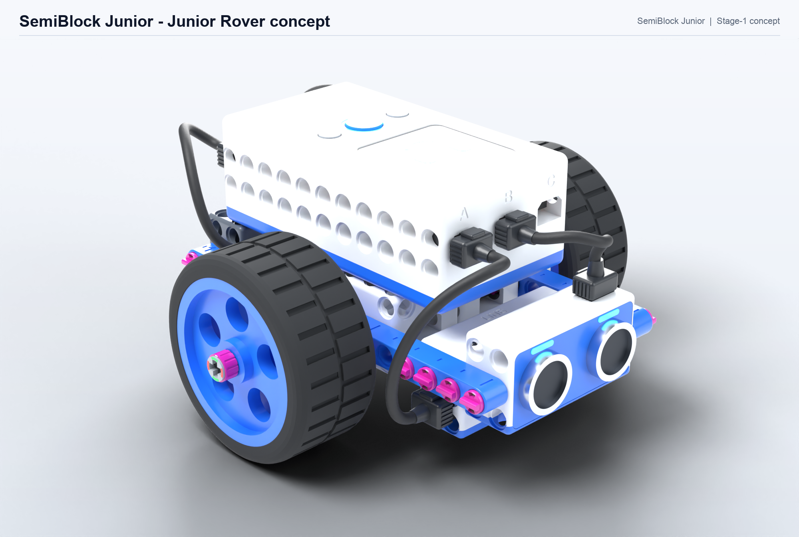

What's in stage 1:

* **140 parts modelled in 3D:** 80 mechanical, hub and motor parts plus 60 smart modules. Each has STEP and STL files, a render and an interactive 3D view.
* A complete driving-base assembly, the Junior Rover, built only from catalogue parts.
* The full sensor and module list, mapped against the 45-in-1 Arduino kit.
* A stage-2 prototype and test plan, plus the decisions the team needs to make.

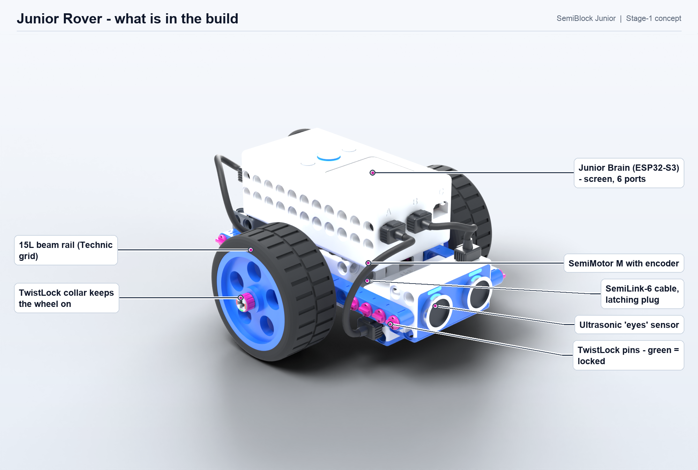

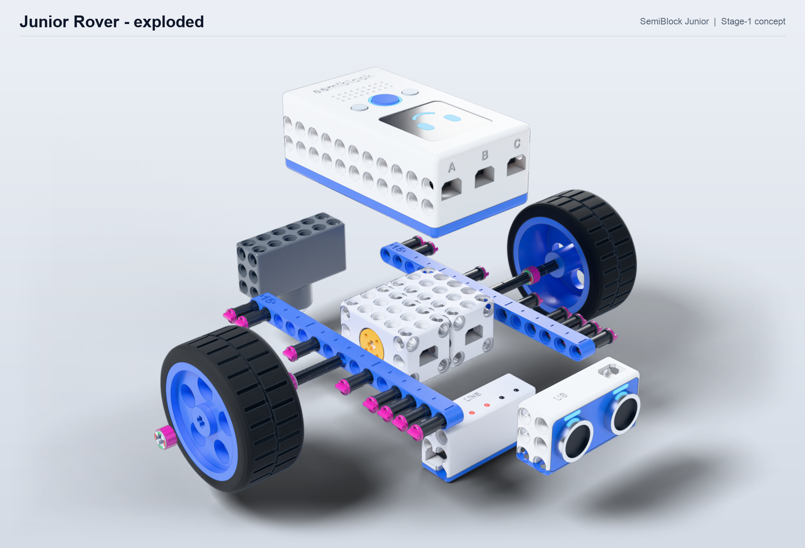

Explore it: [rover in 3D](viewer/index.html#scene=rover) · [exploded](viewer/index.html#scene=rover&explode=0.8) · [all TwistLocks open](viewer/index.html#scene=rover&lock=open).

---

## 1. Who it is for

| | |
|---|---|
| **Students** | P3 to P6, ages 8 to 12. Fine motor skills vary a lot, and small hands find stiff Technic pins hard to pull out. |
| **Teachers** | Often not engineers. One teacher has 25 to 35 students, and a lesson lasts 35 to 70 minutes. |
| **Curriculum hooks** | The upper-primary coding module (EDB, since 2023). Primary Science, which became compulsory at P1 and P4 from 2025/26 with a one-off HK$350k grant per eligible school. STEAM days and robotics competitions. |
| **Reality** | Kits are shared by several classes and robots are stored half-built between weekly lessons. Parts get lost, cables get yanked, and robots fall off tables. |

So the kit must **build fast, stay together, come apart fast, be easy to count, and work without the teacher fixing every connector.**

## 2. Design principles

1. **Lock when you want, free when you don't.** Every joint type has an "open" state for building and a "locked" state for running.
2. **Compatible first.** Same grid as LEGO Technic, so a school's existing investment keeps its value.
3. **Parts explain themselves.** Lengths are printed and countable, and colour means function.
4. **One port, one cable, any module.**
5. **Safe by design.** No mains voltage, no mercury, eye-safe lasers only, torque-limited gears.
6. **Classroom logistics are part of the product.** Tool, inventory, storage, spares.
7. **Everything parametric.** CAD is generated from code (`cad/`), so a dimension change flows to every part, drawing and render.

---

## 3. The SemiBlock grid standard

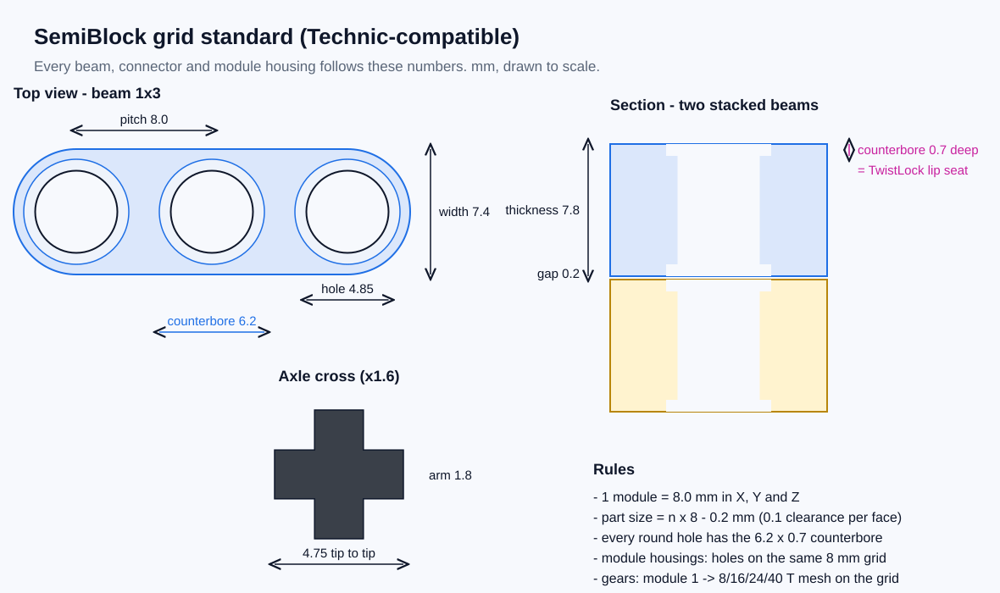

| Dimension | Value | Note |
|---|---|---|
| Pitch (1 module) | 8.0 mm | in X, Y and Z |
| Part outside size | n x 8 - 0.2 mm | 0.1 mm clearance per face |
| Beam thickness / width | 7.8 / 7.4 mm | |
| Round hole | Ø 4.85 mm | pins and axles |
| Counterbore (both faces) | Ø 6.2 x 0.7 mm | **the seat the TwistLock lip catches**, so locks also work in LEGO beams |
| Cross axle | 4.75 mm tip to tip, 1.8 mm arms | |
| Gears | module 1 | 8/16/24/40 T mesh at grid distances |
| Module housings | n x 8 - 0.2 mm, holes on the grid | modules bolt into a build like a beam |

Small changes that help kids are already in the CAD:

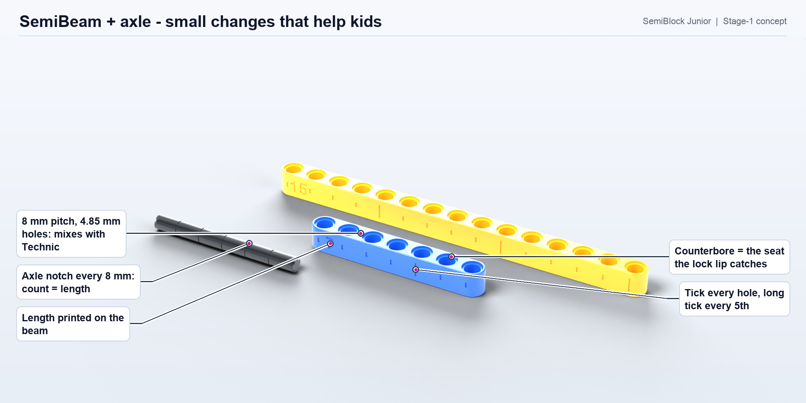

---

## 4. TwistLock, the lock system

### 4.1 The problem with friction pins

A Technic pin is held only by friction. That single number has to do two opposite jobs. It must be tight enough that a robot doesn't fall apart, and loose enough that an 8-year-old can pull the pin out. In class it fails both ways: robots shed parts when they hit a wall or go into the storage box, yet students still need fingernails or a tool to get pins out. Every joint also has a little play, so long arms and chassis wobble.

**TwistLock separates the two jobs.** When open, the pin has low friction and goes in and out easily. When locked, it is held positively and has no play.

### 4.2 Requirements (targets to prove in stage 2)

| Requirement | Target |
|---|---|
| Insert, open | push by thumb, ≤ 10 N |
| Remove, open | 5 to 10 N, gripping the knob (no fingernails) |
| Lock / unlock | ¼ turn by fingertip, ≤ 8 N·mm. SemiKey for extra torque. Clockwise = lock |
| Locked pull-out | ≥ 60 N without damage (a 6 kg pull) |
| Visible state | readable from 1 m: green = locked, red = open (like ISOFIX car-seat indicators) |
| Fits the grid | knob Ø 6.0 mm (2 mm clear of the next knob), ≤ 2.6 mm proud; far side flush |
| Works in LEGO beams | yes, it only needs the standard counterbore |
| Parts / cost | 2 moulded parts, no metal spring |
| Life | ≥ 500 lock cycles, ≥ 2,000 insertions |

### 4.3 Concepts compared

| Concept | How it works | Hand use | Secure | Visible | Fits grid / compatible | Cost | Robust | Verdict |
|---|---|:-:|:-:|:-:|:-:|:-:|:-:|---|
| A. Friction pin (today) | interference + ridges | 2 | 2 | 1 | 5 | 5 | 5 | baseline |
| **B. TwistLock pin** | ¼-turn D-cam blocks split fingers behind the counterbore | **5** | **5** | **5** | **4** | **4** | **4** | **chosen** |
| C. Flip-Lock pin | bike quick-release cam lever pulls a cone into the fingers | 5 | 5 | 5 | 3 | 2 | 2 | keep as a "Pro" option for competition builds |
| D. Slide-Lock beam | a bar inside each beam locks all its pins in one slide | 4 | 4 | 4 | 2 | 2 | 3 | rejected: every beam becomes 2 parts, and it blocks axles |
| E. Push rivet (OLLO / Jimu style) | centre plunger spreads the legs | 3 | 5 | 2 | 3 | 4 | 4 | rejected: needs a tool to remove |
| F. Bayonet hole | rotate the pin behind lugs in the hole | 3 | 2 | 2 | 2 | 5 | 4 | rejected: unlocks itself in pivots |

Scores: 1 = poor, 5 = excellent.

### 4.4 How it works

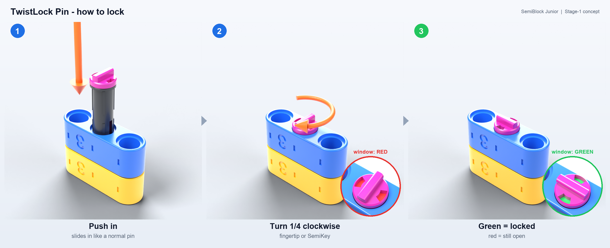

The pin has two moulded parts:

* **Sleeve** (POM): a slip-fit shank with a slot that splits the far end into two fingers, and a **catch lip** (Ø 5.4) with a 45° ramp. A flange (Ø 5.9) sits flush inside the near counterbore. Four small ribs stop the sleeve from spinning while you turn the knob.
* **Core** (POM, magenta): a knob with a wing grip and two 50° arc status windows (big enough to read from about 1 m), a shaft, and a **D-shaped cam** (2.62 mm across the arcs, 1.9 mm across the flats) that sits inside the fingers.
* A pad-printed **status ring** on the flange (red/red/green/green) shows through the windows.

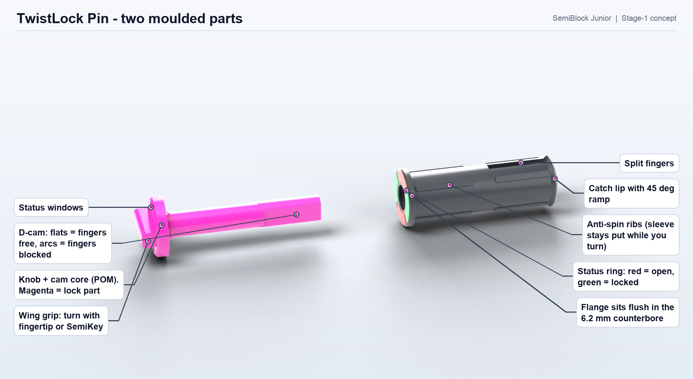

**Open:** the cam flats face the fingers, so each finger can flex 0.35 mm inward. Pulling the pin lets the 45° ramp squeeze the lip down to about Ø 4.8, which passes the Ø 4.85 bore. It comes out like a normal pin, but you can grip the knob.
**Locked:** after a ¼ turn the cam arcs face the fingers and they cannot move inward. The lip stays behind the counterbore step, so the pin cannot be pulled out. A 0.01 mm cam preload also removes joint wobble.

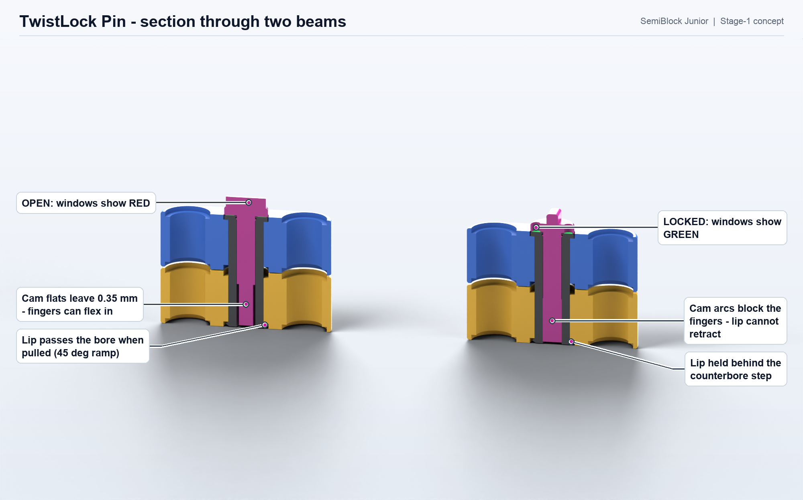

Try it in 3D: [pins cut open](viewer/index.html#scene=tl_demo&lock=open&section=y) (press **Lock all** and watch the cams turn) · [one pin on its own](viewer/index.html#part=SB-TL2).


Details that make it work for kids:

* **Turn direction:** clockwise = lock ("righty-tighty"). A hard stop at 90° and a detent click at each end mean you can feel the lock happen.
* **Anti-spin:** the ribs on the near half give the sleeve more friction torque than the cam needs, so the knob turns and the sleeve does not.
* **Friction or smooth:** a black sleeve has ribs on both halves (rigid joints). A grey sleeve has ribs on the near half only, so the far beam still pivots freely while staying locked axially. This mirrors Technic's black and grey pin colours.
* **Status at a glance:** every lock in the kit is magenta and every locked window is green, so a teacher can scan a robot for red.

### 4.5 The TwistLock family and the "lock the skin" rule

| Part | Use |
|---|---|
| TwistLock Pin 2L / 3L, friction (black) | rigid joints through 2 or 3 layers |
| TwistLock Pin 2L / 3L, smooth (grey) | locked pivots: arms, steering, legs |
| TwistLock Collar ½L / 1L | replaces bushes on axles. Turn the ring ¼ and the oval cam squeezes two jaws onto the axle. Wheels never slide off |

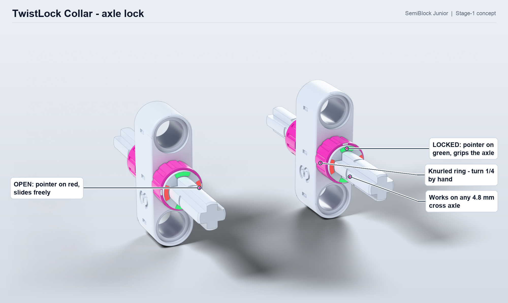

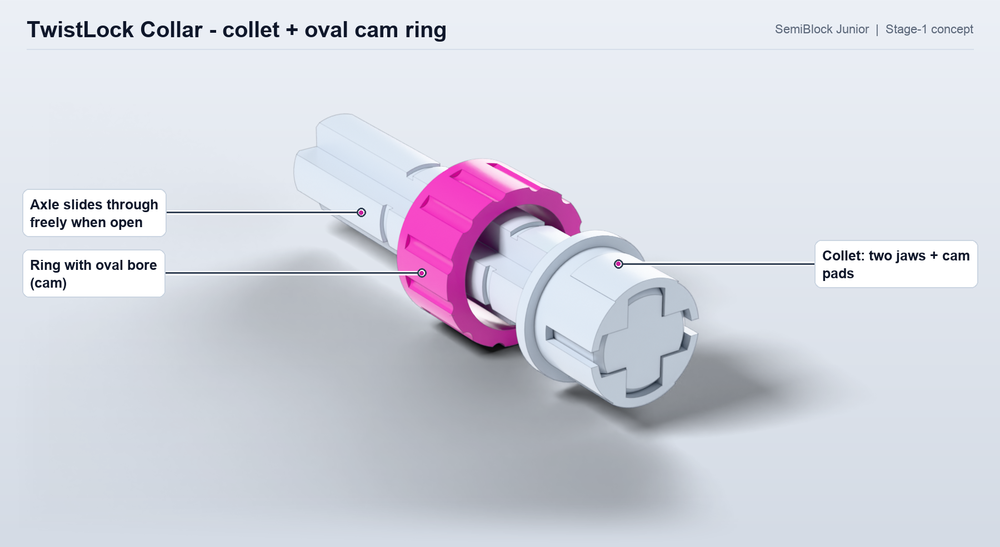

**Lock the skin, trap the core.** Only the outer faces of a build need TwistLocks. Inner joints can use ordinary Quick Pins, which are trapped by the locked layers outside them. The Junior Rover uses 16 TwistLock pins and 4 collars, and everything else is ordinary parts. This keeps the kit cheaper and keeps building fast.

### 4.6 TwistLock key numbers

| Item | Value | Why |
|---|---|---|
| Sleeve shank | Ø 4.8 mm slip fit + 0.12 mm ribs | easy in/out when open, no spin when turning |
| Finger slot / length | 0.9 / 6.8 mm | 0.35 mm finger travel with margin |
| Catch lip | Ø 5.4 mm, 45° back ramp | 0.3 mm catch per side behind a 6.2 mm counterbore |
| Cam | 2.62 mm across arcs / 1.9 mm across flats | blocks fingers when locked / frees 0.35 mm when open |
| Knob | Ø 6.0 mm, 2.6 mm proud, 1.6 mm wing | fingertip grip; 2 mm gap to the next knob |
| Status windows | 2 x 50° arc slots, 1.1 mm wide, over a red/green pad-printed ring | readable from about 1 m |
| Material | POM (acetal) for both parts | fatigue-resistant snap fingers, low friction cam |
| Turn | 90°, clockwise to lock, detent at both ends | tactile, cannot over-turn |

---

## 5. Parts catalogue: every piece

Every part below is a real parametric 3D model in `cad/`, with a STEP file for suppliers, an STL for 3D printing, a rendered picture and an interactive view (click the ID). Contact sheets per family are in [`renders/sheets/`](renders/sheets/).

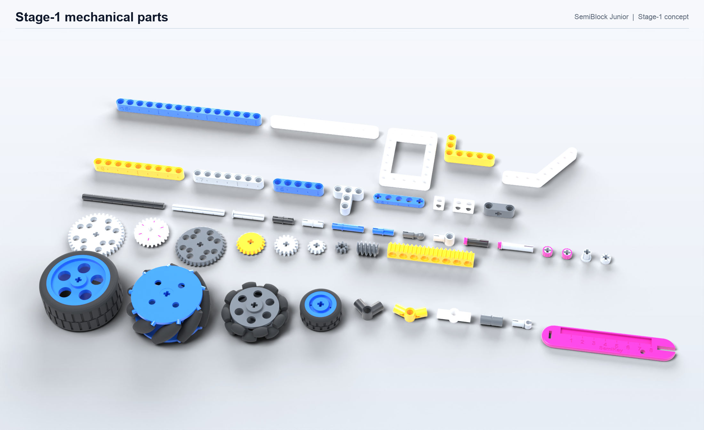

**Core Set (generated):**

<!-- BEGIN:kit -->
| Family | Part types | Pieces in Core Set |
|---|---:|---:|
| Beams | 15 | 100 |
| Connectors | 12 | 66 |
| Pins & bushes | 10 | 170 |
| TwistLock (lock system) | 6 | 104 |
| Axles | 11 | 68 |
| Gears & motion | 11 | 34 |
| Wheels | 6 | 15 |
| Accessories & tools | 3 | 15 |
| Hub, motors & cables | 6 | 13 |
| **Mechanical + hub total** | **80** | **585** |

Smart modules modelled: **60** (P1 launch 23, P2 add-on 28, P3 later 9). Core Set includes 12 of them: Ultrasonic distance, IR obstacle, Line sensor x5, Colour sensor, Light sensor, Big button, Touch pad, Rotary knob, Angle sensor (axle-through), Temp / humidity / pressure, Sound level, RGB LED x4.
<!-- END:kit -->

What's new compared with Technic:

* **TwistLock pins and collars**: the lock system (section 4).
* **SemiCube and Block 1x2x1**: pin holes on several faces, so students can build 3D frames without hunting for special connectors.
* **Clutch gear 24T**: slips before a motor stalls or teeth strip. It protects motors and stops a jammed arm from pinching fingers.
* **Mecanum and omni wheels** in the kit: drive in any direction, a favourite in competitions.
* **Notched axles and printed beam lengths**: count notches or read the number, and check lengths with the SemiKey gauge.
* **Colour means function**: magenta = lock, angle connectors coloured by angle, module base colour by category.
* **Cable clips and name plates**: tidy robots and robots that belong to someone.

<!-- BEGIN:catalog -->
### Beams (15 types)

| 3D | ID | Part | Size (mm) | Core kit | Notes |
|---|---|---|---|---:|---|
| 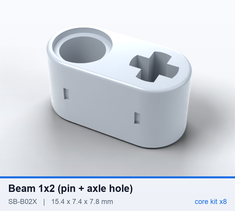 | [`SB-B02X`](viewer/index.html#part=SB-B02X) | Beam 1x2 (pin + axle hole) | 15.4 x 7.4 x 7.8 | 8 | 1 pin hole + 1 axle hole: cranks, levers |
| 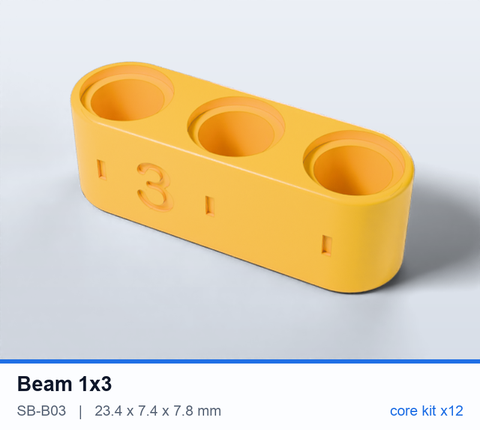 | [`SB-B03`](viewer/index.html#part=SB-B03) | Beam 1x3 | 23.4 x 7.4 x 7.8 | 12 | length engraved on both edges |
| 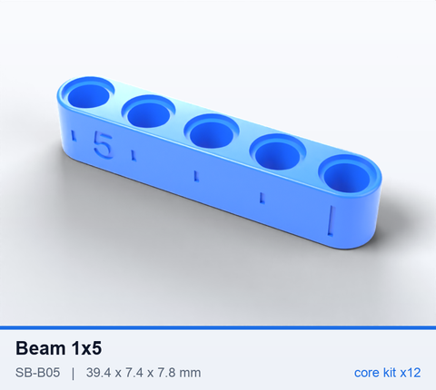 | [`SB-B05`](viewer/index.html#part=SB-B05) | Beam 1x5 | 39.4 x 7.4 x 7.8 | 12 | hole ticks; long tick every 5th hole |
| 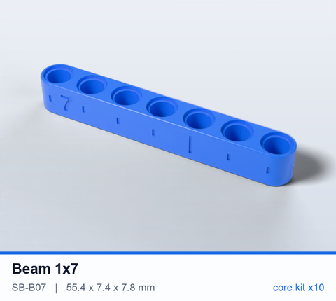 | [`SB-B07`](viewer/index.html#part=SB-B07) | Beam 1x7 | 55.4 x 7.4 x 7.8 | 10 | most-used length |
| 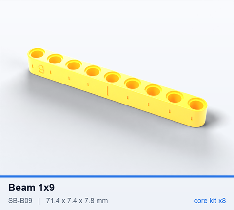 | [`SB-B09`](viewer/index.html#part=SB-B09) | Beam 1x9 | 71.4 x 7.4 x 7.8 | 8 |  |
| 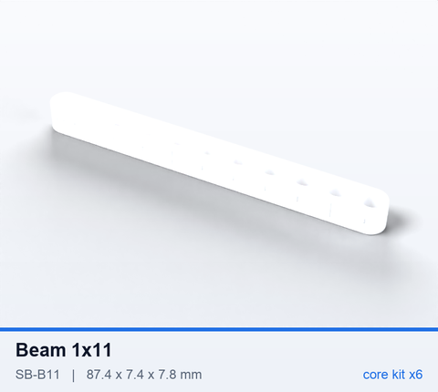 | [`SB-B11`](viewer/index.html#part=SB-B11) | Beam 1x11 | 87.4 x 7.4 x 7.8 | 6 |  |
| 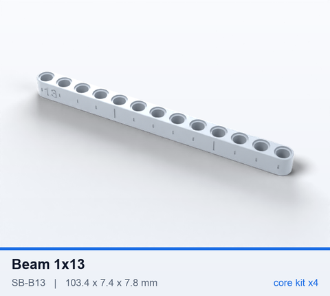 | [`SB-B13`](viewer/index.html#part=SB-B13) | Beam 1x13 | 103.4 x 7.4 x 7.8 | 4 |  |
| 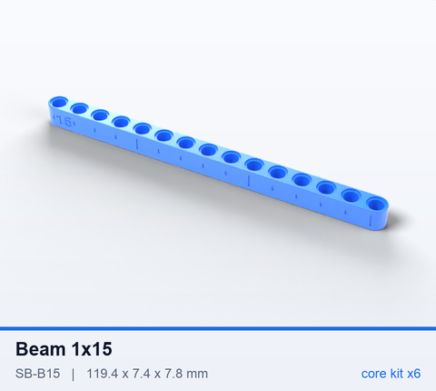 | [`SB-B15`](viewer/index.html#part=SB-B15) | Beam 1x15 | 119.4 x 7.4 x 7.8 | 6 | chassis rails |
| 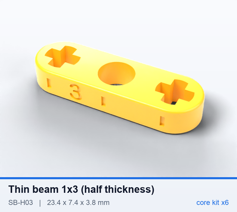 | [`SB-H03`](viewer/index.html#part=SB-H03) | Thin beam 1x3 (half thickness) | 23.4 x 7.4 x 3.8 | 6 | half thickness, axle holes at the ends |
| 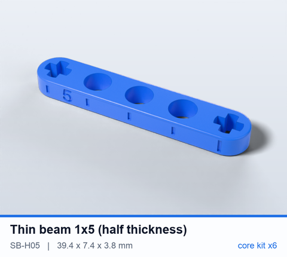 | [`SB-H05`](viewer/index.html#part=SB-H05) | Thin beam 1x5 (half thickness) | 39.4 x 7.4 x 3.8 | 6 | half thickness: linkages, flat panels |
| 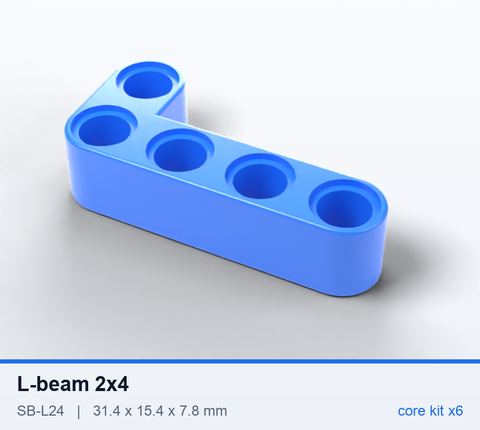 | [`SB-L24`](viewer/index.html#part=SB-L24) | L-beam 2x4 | 31.4 x 15.4 x 7.8 | 6 |  |
| 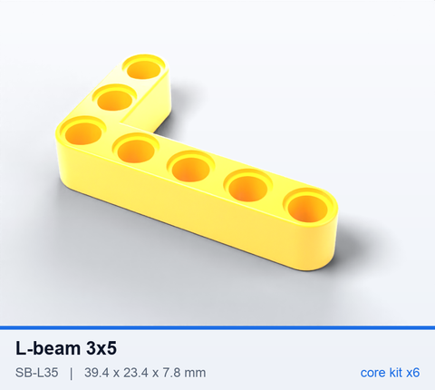 | [`SB-L35`](viewer/index.html#part=SB-L35) | L-beam 3x5 | 39.4 x 23.4 x 7.8 | 6 |  |
| 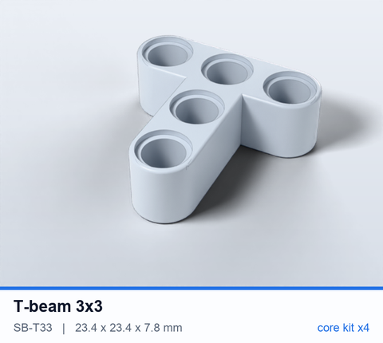 | [`SB-T33`](viewer/index.html#part=SB-T33) | T-beam 3x3 | 23.4 x 23.4 x 7.8 | 4 |  |
| 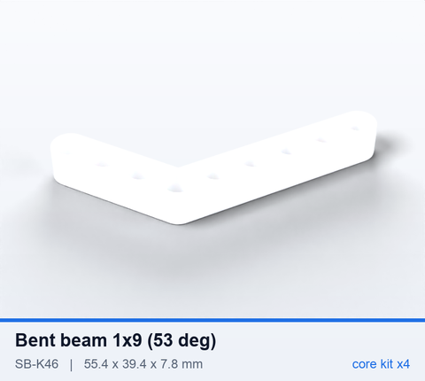 | [`SB-K46`](viewer/index.html#part=SB-K46) | Bent beam 1x9 (53 deg) | 55.4 x 39.4 x 7.8 | 4 | 53 deg bend = 3-4-5 triangle, ends stay on the grid |
| 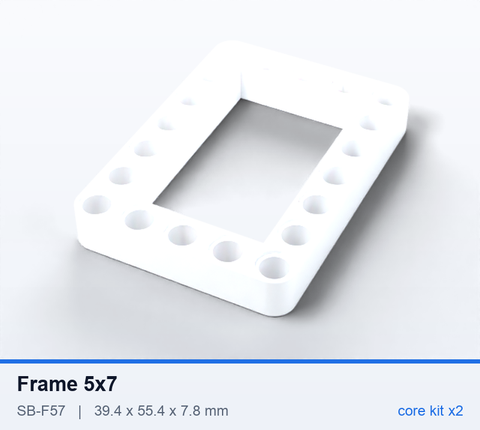 | [`SB-F57`](viewer/index.html#part=SB-F57) | Frame 5x7 | 39.4 x 55.4 x 7.8 | 2 | one-piece rigid chassis frame |

### Connectors (12 types)

| 3D | ID | Part | Size (mm) | Core kit | Notes |
|---|---|---|---|---:|---|
| 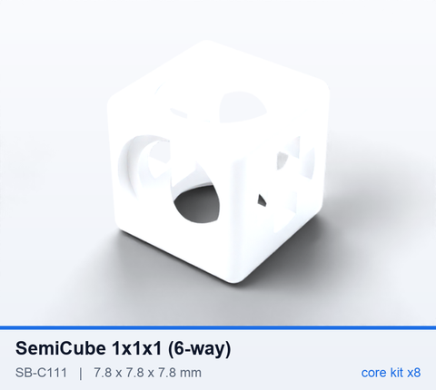 | [`SB-C111`](viewer/index.html#part=SB-C111) | SemiCube 1x1x1 (6-way) | 7.8 x 7.8 x 7.8 | 8 | NEW: 6-way node, builds 3D frames fast |
| 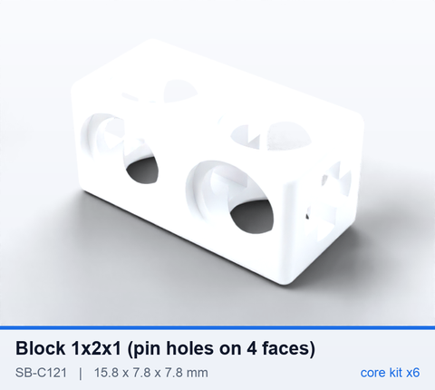 | [`SB-C121`](viewer/index.html#part=SB-C121) | Block 1x2x1 (pin holes on 4 faces) | 15.8 x 7.8 x 7.8 | 6 | NEW: pin holes on 4 faces + axle through |
|  | [`SB-XC12`](viewer/index.html#part=SB-XC12) | Cross block 1x2 | 15.4 x 7.4 x 7.8 | 10 | pin hole + perpendicular axle hole |
| 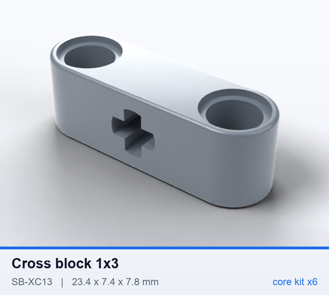 | [`SB-XC13`](viewer/index.html#part=SB-XC13) | Cross block 1x3 | 23.4 x 7.4 x 7.8 | 6 |  |
| 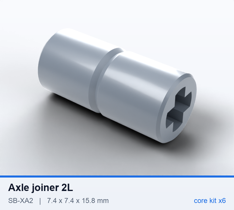 | [`SB-XA2`](viewer/index.html#part=SB-XA2) | Axle joiner 2L | 7.4 x 7.4 x 15.8 | 6 |  |
| 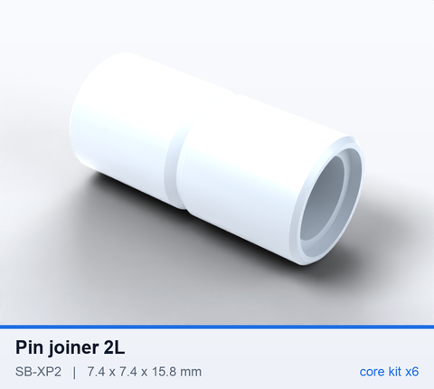 | [`SB-XP2`](viewer/index.html#part=SB-XP2) | Pin joiner 2L | 7.4 x 7.4 x 15.8 | 6 |  |
| 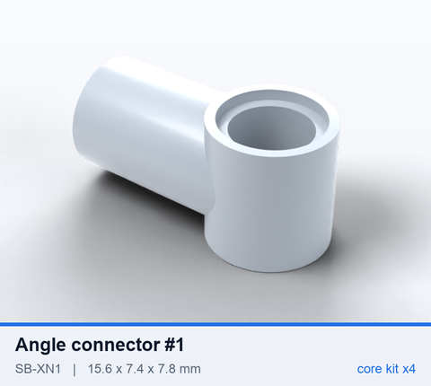 | [`SB-XN1`](viewer/index.html#part=SB-XN1) | Angle connector #1 | 15.6 x 7.4 x 7.8 | 4 | colour = angle, kids match by colour |
| 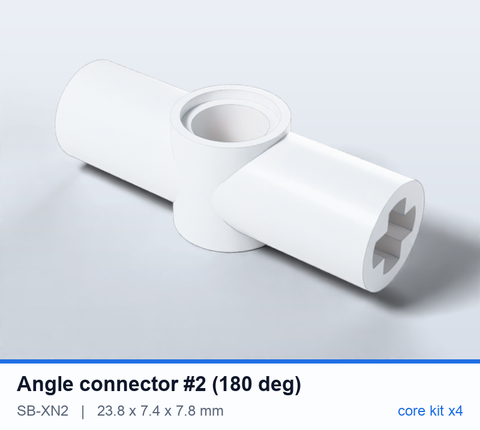 | [`SB-XN2`](viewer/index.html#part=SB-XN2) | Angle connector #2 (180 deg) | 23.8 x 7.4 x 7.8 | 4 | colour = angle, kids match by colour |
| 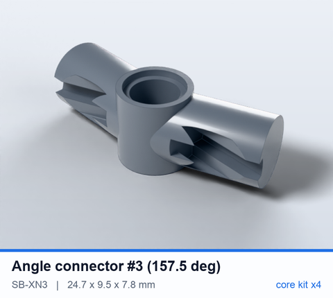 | [`SB-XN3`](viewer/index.html#part=SB-XN3) | Angle connector #3 (157.5 deg) | 24.7 x 9.5 x 7.8 | 4 | colour = angle, kids match by colour |
| 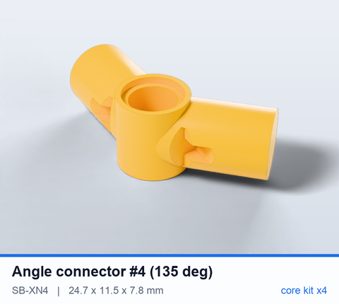 | [`SB-XN4`](viewer/index.html#part=SB-XN4) | Angle connector #4 (135 deg) | 24.7 x 11.5 x 7.8 | 4 | colour = angle, kids match by colour |
| 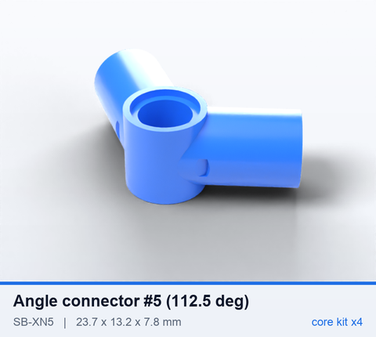 | [`SB-XN5`](viewer/index.html#part=SB-XN5) | Angle connector #5 (112.5 deg) | 23.7 x 13.2 x 7.8 | 4 | colour = angle, kids match by colour |
| 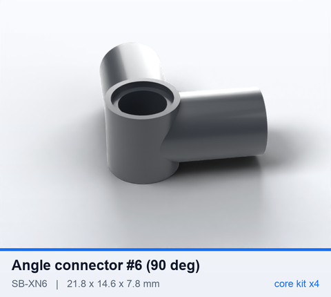 | [`SB-XN6`](viewer/index.html#part=SB-XN6) | Angle connector #6 (90 deg) | 21.8 x 14.6 x 7.8 | 4 | colour = angle, kids match by colour |

### Pins & bushes (10 types)

| 3D | ID | Part | Size (mm) | Core kit | Notes |
|---|---|---|---|---:|---|
| 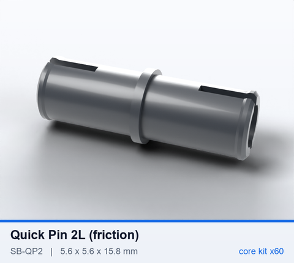 | [`SB-QP2`](viewer/index.html#part=SB-QP2) | Quick Pin 2L (friction) | 5.6 x 5.6 x 15.8 | 60 | Technic-style friction pin |
| 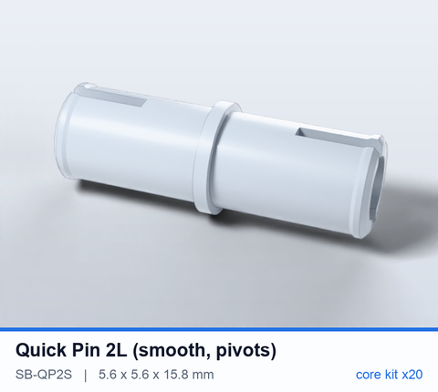 | [`SB-QP2S`](viewer/index.html#part=SB-QP2S) | Quick Pin 2L (smooth, pivots) | 5.6 x 5.6 x 15.8 | 20 | smooth: free pivot |
| 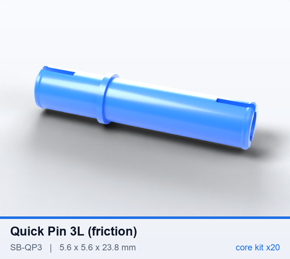 | [`SB-QP3`](viewer/index.html#part=SB-QP3) | Quick Pin 3L (friction) | 5.6 x 5.6 x 23.8 | 20 |  |
| 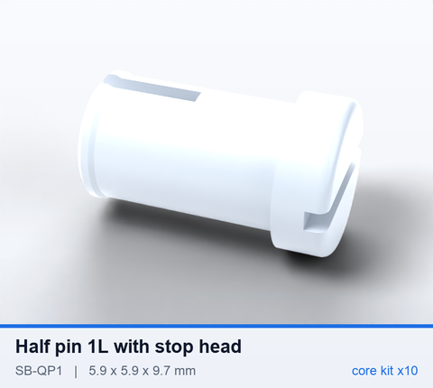 | [`SB-QP1`](viewer/index.html#part=SB-QP1) | Half pin 1L with stop head | 5.9 x 5.9 x 9.7 | 10 |  |
| 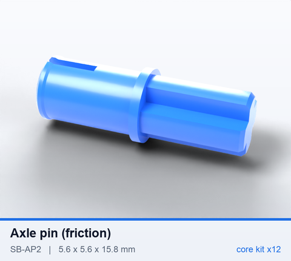 | [`SB-AP2`](viewer/index.html#part=SB-AP2) | Axle pin (friction) | 5.6 x 5.6 x 15.8 | 12 |  |
|  | [`SB-AP2S`](viewer/index.html#part=SB-AP2S) | Axle pin (smooth) | 5.6 x 5.6 x 15.8 | 8 |  |
| 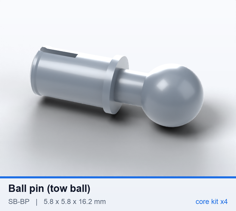 | [`SB-BP`](viewer/index.html#part=SB-BP) | Ball pin (tow ball) | 5.8 x 5.8 x 16.2 | 4 |  |
|  | [`SB-PX`](viewer/index.html#part=SB-PX) | Pin with cross hole | 7.8 x 7.4 x 15.6 | 6 |  |
| 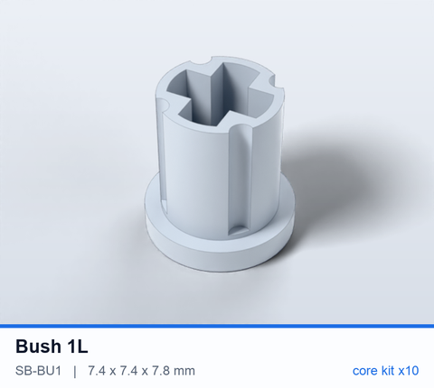 | [`SB-BU1`](viewer/index.html#part=SB-BU1) | Bush 1L | 7.4 x 7.4 x 7.8 | 10 |  |
| 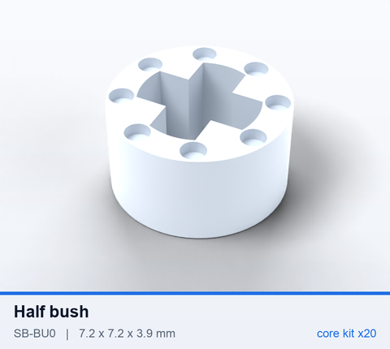 | [`SB-BU0`](viewer/index.html#part=SB-BU0) | Half bush | 7.2 x 7.2 x 3.9 | 20 |  |

### TwistLock (lock system) (6 types)

| 3D | ID | Part | Size (mm) | Core kit | Notes |
|---|---|---|---|---:|---|
|  | [`SB-TL2`](viewer/index.html#part=SB-TL2) | TwistLock Pin 2L (friction) | 6 x 6 x 18.4 | 40 | push in, 1/4 turn = locked, green window |
|  | [`SB-TL2S`](viewer/index.html#part=SB-TL2S) | TwistLock Pin 2L (smooth, pivots) | 6 x 6 x 18.4 | 16 | locked axially but still pivots |
| 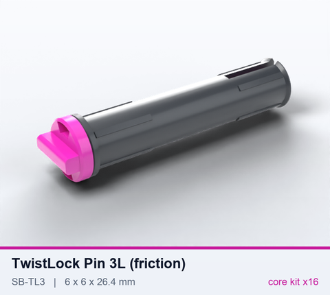 | [`SB-TL3`](viewer/index.html#part=SB-TL3) | TwistLock Pin 3L (friction) | 6 x 6 x 26.4 | 16 | joins 3 layers |
| 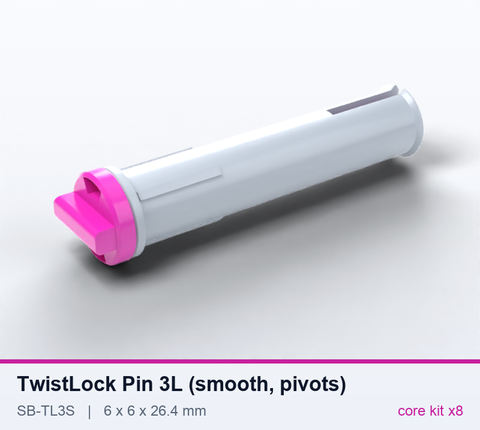 | [`SB-TL3S`](viewer/index.html#part=SB-TL3S) | TwistLock Pin 3L (smooth, pivots) | 6 x 6 x 26.4 | 8 |  |
| 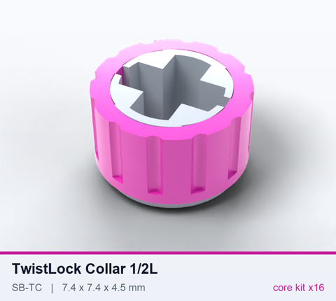 | [`SB-TC`](viewer/index.html#part=SB-TC) | TwistLock Collar 1/2L | 7.4 x 7.4 x 4.5 | 16 | replaces the half bush: wheels never fall off |
| 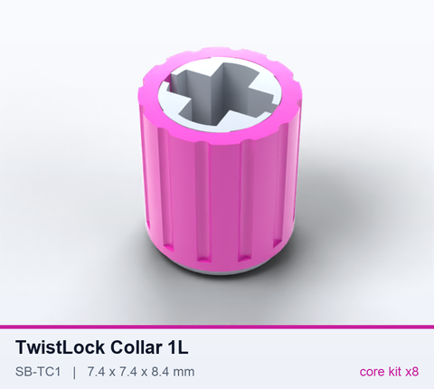 | [`SB-TC1`](viewer/index.html#part=SB-TC1) | TwistLock Collar 1L | 7.4 x 7.4 x 8.4 | 8 | 1L version, more grip |

### Axles (11 types)

| 3D | ID | Part | Size (mm) | Core kit | Notes |
|---|---|---|---|---:|---|
|  | [`SB-A02`](viewer/index.html#part=SB-A02) | Axle 2 | 4.8 x 4.8 x 15.8 | 10 | notch every 8 mm: count notches = length |
|  | [`SB-A03`](viewer/index.html#part=SB-A03) | Axle 3 | 4.8 x 4.8 x 23.8 | 10 |  |
|  | [`SB-A04`](viewer/index.html#part=SB-A04) | Axle 4 | 4.8 x 4.8 x 31.8 | 8 |  |
|  | [`SB-A05`](viewer/index.html#part=SB-A05) | Axle 5 | 4.8 x 4.8 x 39.8 | 8 |  |
|  | [`SB-A06`](viewer/index.html#part=SB-A06) | Axle 6 | 4.8 x 4.8 x 47.8 | 6 |  |
|  | [`SB-A07`](viewer/index.html#part=SB-A07) | Axle 7 | 4.8 x 4.8 x 55.8 | 4 |  |
|  | [`SB-A08`](viewer/index.html#part=SB-A08) | Axle 8 | 4.8 x 4.8 x 63.8 | 4 |  |
|  | [`SB-A10`](viewer/index.html#part=SB-A10) | Axle 10 | 4.8 x 4.8 x 79.8 | 4 |  |
|  | [`SB-A12`](viewer/index.html#part=SB-A12) | Axle 12 | 4.8 x 4.8 x 95.8 | 2 | odd = grey, even = black |
|  | [`SB-A03S`](viewer/index.html#part=SB-A03S) | Axle 3 with stop | 5.9 x 5.9 x 23.8 | 6 |  |
|  | [`SB-A04S`](viewer/index.html#part=SB-A04S) | Axle 4 with stop | 5.9 x 5.9 x 31.8 | 6 |  |

### Gears & motion (11 types)

| 3D | ID | Part | Size (mm) | Core kit | Notes |
|---|---|---|---|---:|---|
|  | [`SB-G08`](viewer/index.html#part=SB-G08) | Gear 8T | 9.6 x 9.6 x 3.7 | 4 |  |
|  | [`SB-G12B`](viewer/index.html#part=SB-G12B) | Double-bevel gear 12T | 13.6 x 13.6 x 4 | 4 | double bevel: parallel or 90 deg |
|  | [`SB-G16`](viewer/index.html#part=SB-G16) | Gear 16T | 17.6 x 17.6 x 3.7 | 4 |  |
|  | [`SB-G20B`](viewer/index.html#part=SB-G20B) | Double-bevel gear 20T | 21.6 x 21.6 x 4 | 4 |  |
|  | [`SB-G24`](viewer/index.html#part=SB-G24) | Gear 24T | 25.6 x 25.6 x 3.7 | 4 |  |
|  | [`SB-G24C`](viewer/index.html#part=SB-G24C) | Clutch gear 24T (slips at safe torque) | 25.6 x 25.6 x 7.8 | 2 | NEW: slips before motors or teeth break |
|  | [`SB-G36B`](viewer/index.html#part=SB-G36B) | Double-bevel gear 36T | 37.6 x 37.6 x 3.9 | 2 |  |
|  | [`SB-G40`](viewer/index.html#part=SB-G40) | Gear 40T | 41.6 x 41.6 x 3.7 | 2 |  |
|  | [`SB-GW`](viewer/index.html#part=SB-GW) | Worm gear | 10.4 x 10.4 x 15.8 | 2 |  |
|  | [`SB-GR4`](viewer/index.html#part=SB-GR4) | Gear rack 1x4 | 31.8 x 7.4 x 9.7 | 4 | pin holes on the side, m = 1 teeth |
|  | [`SB-GR8`](viewer/index.html#part=SB-GR8) | Gear rack 1x8 | 63.8 x 7.4 x 9.7 | 2 |  |

### Wheels (6 types)

| 3D | ID | Part | Size (mm) | Core kit | Notes |
|---|---|---|---|---:|---|
|  | [`SB-W56`](viewer/index.html#part=SB-W56) | Wheel 56 x 26 + tyre | 56 x 56 x 26 | 4 |  |
|  | [`SB-W30`](viewer/index.html#part=SB-W30) | Wheel 30 x 14 + tyre | 30 x 30 x 14 | 4 |  |
|  | [`SB-WO48`](viewer/index.html#part=SB-WO48) | Omni wheel 48 | 48 x 48 x 15.6 | 2 | NEW vs Technic: rolls sideways |
|  | [`SB-WM60L`](viewer/index.html#part=SB-WM60L) | Mecanum wheel 60 (left) | 59.5 x 59.7 x 24.9 | 2 | NEW: drive in any direction (pair L + R) |
|  | [`SB-WM60R`](viewer/index.html#part=SB-WM60R) | Mecanum wheel 60 (right) | 59.5 x 59.7 x 24.2 | 2 |  |
|  | [`SB-CASTER`](viewer/index.html#part=SB-CASTER) | Ball caster block | 15.8 x 47.8 x 39.9 | 1 |  |

### Accessories & tools (3 types)

| 3D | ID | Part | Size (mm) | Core kit | Notes |
|---|---|---|---|---:|---|
|  | [`SB-KEY`](viewer/index.html#part=SB-KEY) | SemiKey multi-tool | 93.8 x 18 x 3.2 | 1 | key + axle gauge + pin lifter + ruler |
|  | [`SB-CC`](viewer/index.html#part=SB-CC) | Cable clip (pin-in) | 5.6 x 5.6 x 13.6 | 12 | NEW: snaps into any hole, tidies cables |
|  | [`SB-N26`](viewer/index.html#part=SB-N26) | Name plate 2x6 (write-on) | 47.8 x 15.8 x 3.8 | 2 | write a name, pin it on |

### Hub, motors & cables (6 types)

| 3D | ID | Part | Size (mm) | Core kit | Notes |
|---|---|---|---|---:|---|
|  | [`SB-HUB`](viewer/index.html#part=SB-HUB) | Junior Brain (ESP32-S3 hub) | 87.8 x 47.8 x 32.4 | 1 | ESP32-S3, 1.54 in screen, 6 ports, IMU, mic, speaker |
|  | [`SB-MOT-M`](viewer/index.html#part=SB-MOT-M) | SemiMotor M (encoder motor) | 39.8 x 23.8 x 23.8 | 2 | encoder: speed + position, both ends have a port |
|  | [`SB-MOT-L`](viewer/index.html#part=SB-MOT-L) | SemiMotor L (encoder motor, high torque) | 55.8 x 23.8 x 23.8 | 1 | high torque, 4 pin holes on the output |
|  | [`SB-SV180`](viewer/index.html#part=SB-SV180) | SemiServo 180 deg (position) | 31.8 x 15.8 x 24.7 | 1 | position servo, axle output |
|  | [`SB-SV360`](viewer/index.html#part=SB-SV360) | SemiServo 360 (continuous) | 31.8 x 15.8 x 24.7 | - | continuous rotation |
|  | [`SB-LINK`](viewer/index.html#part=SB-LINK) | SemiLink-6 plug + cable | 11.2 x 8.4 x 17.5 | 8 | keyed + latching, cable is replaceable |

<!-- END:catalog -->

---

## 6. Electronics


### 6.1 Junior Brain (hub)


| Item | Stage-1 proposal |
|---|---|
| MCU | ESP32-S3 (dual core 240 MHz, Wi-Fi + BLE 5), 16 MB flash, 8 MB PSRAM |
| Runtime | MicroPython + semiblock.ai firmware. Blocks generate MicroPython. Over-the-air updates |
| Screen | 1.54 in 240 x 240 colour IPS |
| Controls | main button with RGB ring, A and B buttons |
| Built-in sensors | 6-axis IMU, MEMS microphone, light sensor, temperature, battery gauge; optional magnetometer |
| Sound | I²S amplifier + speaker (replaces both buzzers of the Arduino kit) |
| Ports | 6 x SemiLink-6 (A to F): motor driver + 3.3 V + data on every port, all short-circuit protected |
| Power | 2S Li-ion (7.4 V, about 2,000 to 2,600 mAh), USB-C charging, protection IC. AA pack as an option for schools that cannot charge |
| Radio | Wi-Fi (upload, IoT lessons), BLE (tablets, Web Bluetooth, gamepads), ESP-NOW (robot to robot) |
| Size | 11 x 6 x 4 modules (88 x 48 x 32 mm) with pin holes on the sides and bottom |

Ports are on the two **end** faces, so cables run along the chassis and stay clear of the wheels, and the long sides stay free for mounting.

### 6.2 SemiLink-6 port and cable


| Pin | Signal | Notes |
|---|---|---|
| 1 | M+ | motor drive from the port's H-bridge (battery voltage, PWM) |
| 2 | M- | |
| 3 | GND | |
| 4 | VCC 3.3 V | about 500 mA per port, current-limited |
| 5 | SDA / TX / encoder A | |
| 6 | SCL / RX / encoder B | |

Connector requirements: **keyed** (the "house" profile cannot go in upside down), **positive latch** (press a tab to release), **≥ 5,000 mating cycles**, strain relief, and **replaceable cables** (10 / 20 / 35 cm). Dupont headers and small wire-to-board connectors (such as the 2.0 mm plugs on Grove-style kits) are made for one-time assembly, not daily plugging by children. Telephone-style latching plugs (LEGO Mindstorms NXT/EV3 used modified RJ12) show a latching 6-pin plug survives classrooms. We propose a custom compact version, and sourcing is a stage-2 decision.

Replaceable cables matter. On most kids' robotics kits the cable is moulded into the motor or sensor, so one damaged cable means replacing the whole part.

### 6.3 Smart module standard

* **Housing:** n x 8 - 0.2 mm in every axis. Blind Technic holes with counterbores on the bottom and sides, each with an internal lock groove so TwistLock pins lock into modules too. A white cover sits on a base coloured by category: **blue** sense, **yellow** output, **teal** connect, **violet** AI, **dark grey** power. A short code is engraved on top (US, LINE, ENV...).
* **Sizes:** S (2x2x1), S3 (2x3x1), M (2x4x1), C (2x3x2, front-facing optics), W (2x6x3, wide), P (4x4x1, panels).
* **Inside:** a low-cost 32-bit MCU (CH32V003 / PY32 class, about US$0.10 to 0.20) handles the raw sensor and speaks the SemiBlock protocol over I²C. That protocol covers ID and type, scaled values, configuration, calibration, a status LED, and firmware updates from semiblock.ai.
* **Chaining:** modules have IN and OUT, so up to 8 can share one port with auto-addressing on plug-in. Outputs that need power (fan, pump) take it from M+/M-.
* **Safe hot-plug:** reverse or short circuits are impossible by design, and a wrong module in a port is simply detected and named.

### 6.4 Motors and servo

| Part | Size (modules) | Stage-1 targets |
|---|---|---|
| SemiMotor M | 5 x 3 x 3 | 150 to 180 rpm no-load, ≥ 8 N·cm, magnetic encoder ≥ 360 counts/rev, absolute zero mark, cross axle output, ports at both ends |
| SemiMotor L | 7 x 3 x 3 | 110 to 130 rpm, ≥ 20 N·cm, output with 4 pin holes for direct beam mounting |
| SemiServo 180 / 360 | 4 x 2 x 3 | position 0 to 180° (≥ 2 kg·cm) or continuous rotation, cross axle output |

---

## 7. Every sensor and module

### 7.1 Built into the Junior Brain (no module needed)

6-axis motion (tilt, shake, spin, free-fall, drive-straight), microphone (loudness, clap, voice), light, temperature, 3 buttons, speaker, RGB light, colour screen, real-time clock (synced over Wi-Fi), battery level, Wi-Fi / BLE / ESP-NOW radio, and flash storage for data logging.

### 7.2 Smart modules (generated)

Phase **P1** = launch (Core Set and Science Pack), **P2** = add-on packs in year 1, **P3** = later or advanced.


<!-- BEGIN:modules -->
### Sensing (distance, light, touch, motion) (29)

| 3D | ID | Module | 中文 | What it does | Candidate chip | Phase | Replaces (45-in-1 kit) |
|---|---|---|---|---|---|---|---|
|  | [`SB-S-US`](viewer/index.html#part=SB-S-US) | Ultrasonic distance | 超聲波測距 | 2-400 cm distance, 'eyes' RGB LEDs | RCWL-9610A + MCU | P1 launch | HC-SR04 超声波模块 |
|  | [`SB-TOF`](viewer/index.html#part=SB-TOF) | ToF laser distance | 激光測距 (ToF) | 4-400 cm, narrow beam, fast | VL53L1X (Class 1 laser, eye-safe) | P2 add-on | new |
|  | [`SB-IRP`](viewer/index.html#part=SB-IRP) | IR obstacle | 紅外避障 | 2-30 cm near/far, digital + analog | IR LED + phototransistor | P1 launch | 避障传感器 / 光遮断 |
|  | [`SB-PIR`](viewer/index.html#part=SB-PIR) | PIR motion | 人體紅外感應 | detects people moving, 3-5 m | AM312 mini PIR | P1 launch | new |
|  | [`SB-RADAR`](viewer/index.html#part=SB-RADAR) | mmWave presence | 毫米波人體存在 | detects people even when still | HLK-LD2410 24 GHz | P3 later | new |
|  | [`SB-ZONE`](viewer/index.html#part=SB-ZONE) | Multi-zone ToF 8x8 | 多區激光測距 | 8x8 depth map up to 4 m | VL53L5CX | P3 later | new |
|  | [`SB-S-LINE`](viewer/index.html#part=SB-S-LINE) | Line sensor x5 | 循跡感應器 x5 | 5-channel line position for line-follow races | 5x ITR20001 + MCU auto-calibrate | P1 launch | 循迹传感器 |
|  | [`SB-COLOR`](viewer/index.html#part=SB-COLOR) | Colour sensor | 顏色感應器 | RGB + clear light, colour sorting, light level | TCS34725 + white LED | P1 launch | new |
|  | [`SB-GEST`](viewer/index.html#part=SB-GEST) | Gesture sensor | 手勢感應器 | up/down/left/right swipes, proximity | APDS-9960 | P2 add-on | new |
|  | [`SB-LUX`](viewer/index.html#part=SB-LUX) | Light sensor | 光度感應器 | ambient light in lux | BH1750 (lux) | P1 launch | 光敏电阻 / 魔术光杯 |
|  | [`SB-UV`](viewer/index.html#part=SB-UV) | UV index | 紫外線感應器 | UV index + ambient light | LTR-390 | P2 add-on | new |
|  | [`SB-FLAME`](viewer/index.html#part=SB-FLAME) | Flame sensor | 火焰感應器 | finds a candle flame (fire-fighting robot) | 3x IR phototransistor 760-1100 nm | P2 add-on | 火焰传感器 |
|  | [`SB-IRT`](viewer/index.html#part=SB-IRT) | IR thermometer | 非接觸測溫 | no-contact temperature -70..380 C | MLX90614 | P2 add-on | new |
|  | [`SB-THERM`](viewer/index.html#part=SB-THERM) | Thermal camera 8x8 | 熱成像鏡頭 | 8x8 heat image, finds warm bodies | AMG8833 | P3 later | new |
|  | [`SB-BTN`](viewer/index.html#part=SB-BTN) | Big button | 大按鈕 | press / release / long-press / count | tactile switch + MCU | P1 launch | 按键开关 |
|  | [`SB-BUMP`](viewer/index.html#part=SB-BUMP) | Bumper switch | 碰撞開關 | robot hits a wall | micro-switch | P1 launch | new |
|  | [`SB-TOUCH`](viewer/index.html#part=SB-TOUCH) | Touch pad | 觸摸感應 | touch / no touch, works through paper | capacitive touch | P1 launch | 人体触摸 |
|  | [`SB-FORCE`](viewer/index.html#part=SB-FORCE) | Force sensor | 力度感應器 | push force 0-10 N | strain gauge + MCU | P2 add-on | new |
|  | [`SB-LOAD`](viewer/index.html#part=SB-LOAD) | Weight (load cell 1 kg) | 稱重感應器 | weighs objects to 1 g | 1 kg load cell + HX711 | P2 add-on | new |
|  | [`SB-POT`](viewer/index.html#part=SB-POT) | Rotary knob | 旋鈕 | 0-100 % turn position | 10k potentiometer | P1 launch | new |
|  | [`SB-ENC`](viewer/index.html#part=SB-ENC) | Rotary encoder | 旋轉編碼器 | endless clicks + push button | EC11 encoder + push | P1 launch | 旋转编码器 |
|  | [`SB-SLIDE`](viewer/index.html#part=SB-SLIDE) | Slide control | 滑桿 | 0-100 % slider position | 60 mm slide pot | P2 add-on | new |
|  | [`SB-JOY`](viewer/index.html#part=SB-JOY) | Joystick | 搖桿 | x / y / push, drive a robot by hand | 2-axis + push | P1 launch | XY摇杆 |
|  | [`SB-KEYPAD`](viewer/index.html#part=SB-KEYPAD) | Keypad 4x3 | 鍵盤 | enter numbers / passwords | 12-key capacitive | P2 add-on | new |
|  | [`SB-IMU`](viewer/index.html#part=SB-IMU) | Motion sensor (6-axis) | 動作感應 (六軸) | tilt, shake, spin of a moving part | ICM-42670 accel + gyro | P2 add-on | 倾斜开关 / 水银开关 / 震动开关 |
|  | [`SB-KNOCK`](viewer/index.html#part=SB-KNOCK) | Knock / vibration | 敲擊 / 震動 | knocks, taps, vibration strength | piezo disc | P2 add-on | 敲击 / 震动开关 |
|  | [`SB-ANGLE`](viewer/index.html#part=SB-ANGLE) | Angle sensor (axle-through) | 角度感應器 | absolute angle of any axle that passes through | AS5600 magnetic encoder | P1 launch | new |
|  | [`SB-MAG`](viewer/index.html#part=SB-MAG) | Magnetic sensor | 磁力感應器 | magnet near/far, N or S, strength | linear Hall + threshold | P1 launch | 霍尔 x2 / 线性霍尔 / 磁簧 x2 |
|  | [`SB-COMPASS`](viewer/index.html#part=SB-COMPASS) | Compass | 電子指南針 | heading 0-360 deg | MMC5603 magnetometer | P2 add-on | new |

### Environment & science (13)

| 3D | ID | Module | 中文 | What it does | Candidate chip | Phase | Replaces (45-in-1 kit) |
|---|---|---|---|---|---|---|---|
|  | [`SB-ENV`](viewer/index.html#part=SB-ENV) | Temp / humidity / pressure | 溫度 / 濕度 / 氣壓 | +-0.2 C, %RH, hPa, altitude | SHT40 + BMP280 | P1 launch | DHT11 温湿度 / 模拟温度 / 数字温度 |
|  | [`SB-PROBE`](viewer/index.html#part=SB-PROBE) | Waterproof temp probe | 防水溫度探頭 | -55..125 C in water, soil, food | DS18B20 stainless probe | P1 launch | 18B20温度传感器 |
|  | [`SB-SOIL`](viewer/index.html#part=SB-SOIL) | Soil moisture | 土壤濕度 | plant needs water? 0-100 % | capacitive (no corrosion) | P1 launch | 土壤湿度 (resistive) |
|  | [`SB-WATER`](viewer/index.html#part=SB-WATER) | Water level / rain | 水位 / 雨滴 | water depth 0-35 mm, rain drops | gold-plated traces | P2 add-on | 水位传感器 |
|  | [`SB-SOUND`](viewer/index.html#part=SB-SOUND) | Sound level | 聲音感應器 | loudness in dB, clap detect | MEMS mic + RMS | P1 launch | 高感度声音 / 小麦克风 |
|  | [`SB-CO2`](viewer/index.html#part=SB-CO2) | CO2 (NDIR) | 二氧化碳 | true CO2 ppm - classroom air | Sensirion SCD40 | P2 add-on | new |
|  | [`SB-AIR`](viewer/index.html#part=SB-AIR) | Air quality (TVOC) | 空氣質素 | TVOC + eCO2 index | ENS160 | P2 add-on | new |
|  | [`SB-PM`](viewer/index.html#part=SB-PM) | Dust PM2.5 | 懸浮粒子 PM2.5 | PM1 / PM2.5 / PM10 ug/m3 | Plantower PMSA003 | P3 later | new |
|  | [`SB-GAS`](viewer/index.html#part=SB-GAS) | Gas / smoke | 氣體 / 煙霧 | smoke / LPG level | MQ-2 (heated, teacher use) | P3 later | new |
|  | [`SB-PH`](viewer/index.html#part=SB-PH) | pH probe | 酸鹼度 | pH 0-14 for chemistry lessons | pH electrode + amp | P3 later | new |
|  | [`SB-TDS`](viewer/index.html#part=SB-TDS) | Water quality (TDS) | 水質 TDS | dissolved solids ppm | TDS probe + amp | P3 later | new |
|  | [`SB-HEART`](viewer/index.html#part=SB-HEART) | Heart rate & SpO2 | 心率 / 血氧 | pulse + oxygen for PE / biology | MAX30102 | P2 add-on | 手指测心跳 |
|  | [`SB-GPS`](viewer/index.html#part=SB-GPS) | GPS | 衛星定位 | position + time outdoors | ATGM336H GPS + BeiDou | P3 later | new |

### AI & voice (2)

| 3D | ID | Module | 中文 | What it does | Candidate chip | Phase | Replaces (45-in-1 kit) |
|---|---|---|---|---|---|---|---|
|  | [`SB-CAM`](viewer/index.html#part=SB-CAM) | AI vision camera | AI 視覺鏡頭 | face, colour, line, tag, QR, object recognition | ESP32-S3 + 2 MP camera | P2 add-on | new |
|  | [`SB-VOICE`](viewer/index.html#part=SB-VOICE) | Offline voice | 離線語音識別 | Cantonese / Mandarin / English commands | ESP32-S3 / CI1302 voice chip | P2 add-on | new |

### Identify & connect (2)

| 3D | ID | Module | 中文 | What it does | Candidate chip | Phase | Replaces (45-in-1 kit) |
|---|---|---|---|---|---|---|---|
|  | [`SB-RFID`](viewer/index.html#part=SB-RFID) | RFID / NFC reader | 拍卡感應 | read cards, stickers, wristbands | PN532 13.56 MHz | P2 add-on | new |
|  | [`SB-IRX`](viewer/index.html#part=SB-IRX) | IR remote send + receive | 紅外收發 | TV / air-con remote codes | 38 kHz IR LED + receiver | P1 launch | 红外发射 / 红外接收 |

### Output (light, sound, motion) (12)

| 3D | ID | Module | 中文 | What it does | Candidate chip | Phase | Replaces (45-in-1 kit) |
|---|---|---|---|---|---|---|---|
|  | [`SB-RGB`](viewer/index.html#part=SB-RGB) | RGB LED x4 | 彩色燈 x4 | any colour, any brightness | 4x WS2812B | P1 launch | 3色LED / 双色LED x2 / 七彩 / RGB |
|  | [`SB-RING`](viewer/index.html#part=SB-RING) | LED ring x12 | 燈環 x12 | spinners, timers, compass display | 12x WS2812B | P2 add-on | new |
|  | [`SB-MATRIX`](viewer/index.html#part=SB-MATRIX) | LED matrix 8x8 | 點陣顯示 | faces, icons, scrolling text | 64x WS2812-2020 | P2 add-on | new |
|  | [`SB-TRAFFIC`](viewer/index.html#part=SB-TRAFFIC) | Traffic light | 交通燈 | red / yellow / green lessons | 3 LEDs | P1 launch | new |
|  | [`SB-OLED`](viewer/index.html#part=SB-OLED) | OLED screen 0.96 in | 顯示屏 | text, numbers, simple graphs | SSD1306 128x64 | P1 launch | new |
|  | [`SB-SEG`](viewer/index.html#part=SB-SEG) | 4-digit display | 數碼管 | big numbers: scores, timers | TM1637 | P2 add-on | new |
|  | [`SB-SPK`](viewer/index.html#part=SB-SPK) | Speaker / MP3 | 喇叭 / 音樂 | play sounds and recorded voice | I2S amp + 8 MB sound flash | P2 add-on | 有源 / 无源蜂鸣器 |
|  | [`SB-FAN`](viewer/index.html#part=SB-FAN) | Fan | 風扇 | wind, cooling, hovercraft | DC motor + soft blades + guard | P1 launch | new |
|  | [`SB-PUMP`](viewer/index.html#part=SB-PUMP) | Water pump | 水泵 | plant watering, fountains | 5 V pump + tubes | P2 add-on | new |
|  | [`SB-VIB`](viewer/index.html#part=SB-VIB) | Vibration motor | 震動馬達 | buzz feedback | coin vibration motor | P2 add-on | new |
|  | [`SB-EMAG`](viewer/index.html#part=SB-EMAG) | Electromagnet | 電磁鐵 | pick up and drop steel parts | 5 V electromagnet | P3 later | new |
|  | [`SB-SWITCH`](viewer/index.html#part=SB-SWITCH) | Power switch (12 V max) | 電源開關 | switch lamps, pumps, LED strips safely | MOSFET, 12 V / 2 A max | P2 add-on | 继电器 (mains relay removed) |

### Power & energy (2)

| 3D | ID | Module | 中文 | What it does | Candidate chip | Phase | Replaces (45-in-1 kit) |
|---|---|---|---|---|---|---|---|
|  | [`SB-SOLAR`](viewer/index.html#part=SB-SOLAR) | Solar panel 1 W | 太陽能板 | energy lessons, solar car | 6 V 1 W panel + charge meter | P2 add-on | new |
|  | [`SB-METER`](viewer/index.html#part=SB-METER) | Energy meter (V/I/W) | 電能錶 | measures voltage, current, power | INA219 | P2 add-on | new |

<!-- END:modules -->

### 7.3 What happened to the 45-in-1 Arduino kit

| # | Arduino kit board | SemiBlock Junior | Why |
|---|---|---|---|
| 1 | 旋转编码器 Rotary encoder | SB-ENC | same, with a big knob |
| 2 | 霍尔磁力 Hall (digital) | SB-MAG | one magnetic module does 5 boards' jobs |
| 3 | 红外发射 IR transmitter | SB-IRX | send + receive in one |
| 4 | 光遮断 Photo-interrupter | motor encoders, SB-IRP | rotation counting is built into every motor |
| 5 | 震动开关 Vibration switch | SB-KNOCK, hub IMU | |
| 6 | 红外接收 IR receiver | SB-IRX | |
| 7 | 18B20 温度 | SB-PROBE, SB-ENV | waterproof probe for science |
| 8 | 手指测心跳 Heartbeat | SB-HEART | adds SpO₂ |
| 9 | 倾斜开关 Tilt switch | hub IMU, SB-IMU | real angles instead of on/off |
| 10 | 3色LED | SB-RGB | |
| 11 | 模拟温度 Thermistor | SB-ENV | calibrated ±0.2 °C |
| 12 | 激光发射头 Laser emitter | **not included** | typical modules are Class 3R, a risk to eyes. Use SB-TOF (Class 1) |
| 13 | 霍尔 Hall (analog) | SB-MAG | |
| 14 | 魔术光杯 Magic light cup | SB-RGB + SB-IMU | |
| 15 | 水银开关 Mercury switch | **not included** | contains mercury; the hub IMU replaces it |
| 16 | 无源蜂鸣器 Passive buzzer | hub speaker, SB-SPK | |
| 17 | 敲击 Knock | SB-KNOCK | |
| 18 | 七彩闪烁LED | SB-RGB | |
| 19 | 有源蜂鸣器 Active buzzer | hub speaker | |
| 20 | 双色LED | SB-RGB | |
| 21 | 迷你磁簧 Mini reed | SB-MAG | |
| 22 | 光敏电阻 Photoresistor | SB-LUX | real lux, not 0 to 1023 |
| 23 | 温湿度 DHT11 | SB-ENV | |
| 24 | 三色RGB | SB-RGB | |
| 25 | 按键开关 Button | SB-BTN | |
| 26 | 小双色LED | SB-RGB | |
| 27 | 高感度声音 Sound | SB-SOUND, hub mic | |
| 28 | 数字温度 Digital temp | SB-ENV | |
| 29 | 线性霍尔 Linear Hall | SB-MAG | |
| 30 | 小麦克风 Microphone | SB-SOUND | |
| 31 | 火焰 Flame | SB-FLAME | |
| 32 | 磁簧开关 Reed switch | SB-MAG | |
| 33 | 人体触摸 Touch | SB-TOUCH | |
| 34 | 循迹 Line tracking | SB-LINE | 5 channels, auto-calibrating |
| 35 | 避障 Obstacle | SB-IRP | |
| 36 | 继电器 Relay (mains-rated) | SB-SWITCH (≤ 12 V) | **no mains voltage in a kids' kit** |
| 37 | XY摇杆 Joystick | SB-JOY | |
| 38 | 水位 Water level | SB-WATER | gold-plated traces |
| 39 | DS1302 时钟 RTC | hub RTC + Wi-Fi time | |
| 40 | 陀螺仪 MPU-6050 | hub IMU, SB-IMU | |
| 41 | 土壤湿度 Soil (resistive) | SB-SOIL (capacitive) | the resistive fork corrodes in days |
| 42 | 降压模块 Buck converter | not needed | power handled by the hub |
| 43 | SD卡读写 SD card | hub flash + semiblock.ai logging | |
| 44 | 超声波 Ultrasonic | SB-US | |
| 45 | 电源模块 Breadboard power | not needed | |

**Result:** 45 loose boards become 23 SemiBlock modules (several boards merge into one) plus hub features. Three boards are dropped for safety (mercury, laser, mains relay), and four are absorbed by the hub (buck, breadboard power, SD card, RTC). On top of that, SemiBlock adds **38 sensing and output functions the kit never had**: ToF, PIR, radar, colour, gesture, UV, IR thermometer, thermal camera, bumper, force, weight, knob, slider, keypad, axle angle, compass, CO₂, TVOC, PM2.5, gas, pH, TDS, GPS, AI camera, offline voice, RFID, LED ring, LED matrix, traffic light, OLED, 4-digit display, speaker, fan, pump, vibration, electromagnet, solar and energy meter.

### 7.4 Deliberately not in the kit

Mains relays or anything above 12 V; Class 2 or higher lasers; mercury switches; resistive soil forks; unprotected lithium cells; bare breadboards and jumpers for P3 and P4 (they remain possible for older students through a "maker adapter" in a later phase). The gas sensor (heated MQ-2) is P3 and teacher-only.

---

## 8. How SemiBlock Junior is better

| | LEGO Technic + SPIKE Prime | Arduino 45-in-1 kit | **SemiBlock Junior** |
|---|---|---|---|
| Joints | friction only | n/a | **friction or TwistLock**, visible status, no play when locked |
| Removing pins | fingernails or a tool | n/a | **grip the knob**; SemiKey if needed |
| Sensor types | 3 in the Prime set (colour, distance, force) + hub gyro | 45 boards, many duplicates | **60 smart modules** + 7 built into the hub |
| Ports | 6 universal ports | raw pins, polarity, breadboard | **6 universal ports, chainable**, auto-detected |
| Cables | moulded into each device | jumper wires | **replaceable, keyed, latching** |
| Programming | LEGO app (Scratch / Python) | Arduino C++ | **semiblock.ai**: blocks ↔ MicroPython, simulator, AI |
| Lengths | count the holes | n/a | **printed lengths, tick marks, notched axles, gauge** |
| Safety | good | mains relay, laser, mercury | **≤ 12 V, Class 1 only, clutch gear** |
| Compatibility | own system | Arduino ecosystem | **Technic grid** + ESP32 / MicroPython ecosystem |
| Open CAD | no | n/a | **STEP and STL for every part**: print spares and custom parts |

Twenty concrete improvements:

1. **TwistLock pins**: lockable, visible, zero play.
2. **TwistLock collars**: wheels and gears stay on axles.
3. **Knob grip**: removal without fingernails.
4. **Lock the skin rule**: only about 10 % of joints need locks, which keeps cost down.
5. **Printed beam lengths and ticks every hole** (long tick every 5th).
6. **Notched axles** plus the **SemiKey axle gauge**.
7. **Colour = function** across the whole kit.
8. **SemiCube and Block 1x2x1** for fast 3D frames.
9. **Clutch gear**: protects motors, gears and fingers.
10. **Mecanum and omni wheels** included.
11. **Cable clips** in any hole.
12. **Name plates** for shared classroom kits.
13. **One universal port** for motors and sensors, with **daisy chaining**.
14. **Smart modules** with an ID, calibration and a status LED.
15. **Hub with a screen**: show values, faces and menus without a computer.
16. **Replaceable cables**, the part that breaks most often.
17. **semiblock.ai integration**: auto-detect, blocks ↔ Python, simulator from the same CAD, data logging.
18. **3D build instructions** generated from this CAD; students can rotate every step.
19. **Photo inventory check**: snap the tray at the end of a lesson and AI counts the parts, and also spots red (unlocked) windows on robots.
20. **Bilingual EN / 繁中 labels** and a Cantonese-capable voice module.

---

## 9. Software and classroom flow

* **Plug and play:** plug a module in and semiblock.ai shows "Port B: Ultrasonic", offering the matching blocks and a live value.
* **Blocks ↔ MicroPython:** primary students start with blocks and the same project opens as Python later.
* **Simulator:** the CAD in this folder becomes the virtual parts, so students can code at home without the kit.
* **Teacher view:** class robots, battery levels, firmware updates, and lesson packs aligned to the coding module and Primary Science topics (forces, energy, plants and water, weather, the human body).
* **Storage:** one box per group with a moulded tray per family, a printed map, and the SemiKey clipped into the lid.

## 10. Safety and compliance (to plan in stage 2)

* Toys: EN 71-1/2/3, ASTM F963 / ISO 8124. Hong Kong Toys and Children's Products Safety Ordinance (Cap. 424). Small-parts warning: 8+.
* Electric toys: EN 62115. Battery: IEC 62133-2 and UN 38.3. Radio: OFCA (HK), CE-RED and FCC for export.
* Materials: ABS (beams, housings), POM (pins, locks, gears), TPE (tyres); RoHS / REACH; no PVC.
* Design rules: ≤ 12 V everywhere, Class 1 lasers only, clutch gear torque limit, rounded edges (all models have fillets), no exposed lithium cells.

## 11. Kits

| Kit | Contents (stage-1 proposal) |
|---|---|
| **Core Set** | mechanical parts as in section 5, Junior Brain, 2 x Motor M, 1 x Motor L, 1 x Servo 180, 12 P1 modules, 8 SemiLink cables, SemiKey, storage box with trays |
| **Science Pack** | ENV, PROBE, SOIL, WATER, SOUND, LUX, UV, CO2, AIR, HEART, METER, SOLAR |
| **AI & IoT Pack** | CAM, VOICE, RFID, OLED, MATRIX, RING, SPK, GPS |
| **Competition Pack** | 4 x mecanum, 2 x omni, 2 x Motor M, extra TwistLock pins and collars, 15L beams and frames |

Pricing: set after supplier quotes in stage 2. The aim is to sit clearly below SPIKE Prime-class sets for a comparable build capacity. The 2-part TwistLock pin is the main new tooling cost.

---

## 12. Stage-2 plan: prototype and prove

| Step | What | Pass criteria |
|---|---|---|
| 1 | Resin-print TwistLock pins and collars at 1:1 (tough resin) and 2:1 (demo). Test in SemiBlock and LEGO beams | locks and unlocks by hand in both beam types |
| 2 | Machine POM samples of the sleeve and core | dimensions within ±0.02 mm |
| 3 | Force tests (push-pull gauge, torque driver) | section 4.2 targets |
| 4 | Life tests: 500 lock cycles, 2,000 insertions | no loss of lock, < 20 % force drop |
| 5 | Robot tests: 10 drops from 1 m, 30 min motor vibration, 60 °C storage | no part comes off a locked robot |
| 6 | Classroom trial: 2 schools x 2 classes (P4 to P6) | build time, lost parts, teacher help needed, robots intact after a week |
| 7 | Electronics EVT: hub board, SemiLink connector samples, module MCU firmware + protocol | hot-plug, chain of 8, auto-detect in semiblock.ai |
| 8 | DFM review and tooling quotes (slides for the finger slot and lip) | cost per TwistLock pin, tool life |

## 13. Decisions needed and risks

| Decision / risk | Recommendation |
|---|---|
| Technic-compatible grid vs our own grid | **Compatible** (protects school investment, faster adoption) |
| Age band: P3 to P6 only, or also P1 to P2? | Start P3 to P6. P1 to P2 may need a larger "Mini" scale |
| Lock torque for P3 hands | validate in the trial; the SemiKey gives a fallback |
| Moulding the 0.9 mm slot and 0.3 mm lip in POM | early DFM with the toolmaker; tune the lip after samples |
| Knob stands 2.6 mm proud | "lock the skin" rule; flush Quick Pins inside |
| Battery: Li-ion vs AA | Li-ion with certified pack, AA option |
| Connector: custom vs off-the-shelf | prototype both; cycle-test with kids |
| 60 modules is a lot to support | launch with the 23 P1 modules; P2/P3 by demand |
| Trademarks | describe as "compatible with LEGO® Technic™" only after legal review; never use LEGO in product names |
| Patents | freedom-to-operate search on quarter-turn cam pins (prior art: panel fasteners, push rivets) |

---

## 14. Files in this folder

| Path | What |
|---|---|
| `SemiBlock-Junior-Design.md` | this document |
| `viewer/index.html` | interactive 3D viewer: every part and assembly, Lock, Explode, Section (open in Chrome, Edge or Safari; works offline) |
| `renders/` | hero renders and callout diagrams; `renders/parts/` one image per part; `renders/sheets/` contact sheets |
| `cad/step/`, `cad/stl/` | STEP (for suppliers / Fusion / SolidWorks) and STL (for printing) for every part, in mm |
| `cad/*.py` | parametric source: `params.py` (all dimensions), `parts.py` (mechanical), `modules.py` (electronics and smart modules), `catalog.py` (the part list), `scenes.py` (assemblies) |

Rebuild everything after changing a dimension:

```bash
# 1. CAD -> STEP / STL / meshes         (FreeCAD 1.x)
/Applications/FreeCAD.app/Contents/Resources/bin/freecadcmd stage-1/cad/build.py
# 2. renders                            (Blender 5.x, Cycles)
/Applications/Blender.app/Contents/MacOS/Blender -b -P stage-1/cad/render_blender.py
# 3. callouts, cards, sheets, diagrams, tables
python3 stage-1/cad/annotate.py && python3 stage-1/cad/diagrams.py && python3 stage-1/cad/make_docs.py
# 4. only if viewer/src/viewer.js changed (three@0.169.0 + esbuild installed with npm)
npx esbuild stage-1/viewer/src/viewer.js --bundle --format=iife --minify --outfile=stage-1/viewer/viewer.bundle.js
```

## Sources

* Technic hole, axle and pin dimensions cross-checked with the open-source [Technic.scad](https://github.com/cfinke/Technic.scad) library (8 mm pitch, 4.85 mm hole, 7.8 mm thickness, 1.8 mm axle spline) and a [Eurobricks thread on pin and axle sizes](https://www.eurobricks.com/forum/forums/topic/75308-lego-pin-and-axle-standard).
* SPIKE Prime set contents (6-port hub, 6-axis gyro, colour / distance / force sensors, 3 motors): [Rapid Online product listing](https://rapidonline.com/lego-education-45678-spike-prime-set-70-6713).
* Hong Kong curriculum: [EDB circular on Primary Science (P1 and P4 from 2025/26, HK$350k grant)](https://www.edb.gov.hk/attachment/en/curriculum-development/kla/science-edu/pri-sci/EDBC23018E.pdf), [LegCo reply on STEAM, coding and AI education (2025)](https://www.info.gov.hk/gia/general/202504/30/P2025043000311.htm).
