# SemiBlock Junior: Stage-2 Design


> **Status:** Stage-2 design for internal review, 27 Oct 2026, semiblock.ai. Builds on [stage 1](../stage-1/SemiBlock-Junior-Design.md): same grid, TwistLock and electronics, now with H-beams, ball bearings and new ways to set angles.
> **Open next:** [3D viewer: every part, rotatable](viewer/index.html) · [all renders](renders/) · [CAD: STEP, STL and parametric source](cad/)
> Tables marked *generated* are filled from the CAD by `cad/make_docs.py`, so names, sizes and counts always match the 3D models.

---

## 0. The idea on one page

### What changed since stage 1

Stage 2 keeps the stage-1 grid, TwistLock, electronics and modules, and changes three things:

| Change | What it means | Section |
|---|---|---|
| **H-beams.** Every beam keeps its Technic outside size, holes and counterbores, but the solid between the holes is now an H: two flanges, a web and a tube round each hole. | 26% less plastic, and walls 1.8 mm thick instead of 3.2 mm, so parts cool in about a third of the time and keep their hole pitch. Every pin, axle, TwistLock and LEGO Technic part still fits. Stiffer per gram lying flat, softer on edge. | 5 |
| **Angles.** Pinned triangles, the new AngleLock hinge (15° steps, locked by one TwistLock), a new 45° bent H-beam and a turntable. | 15°, 30°, 45°, 60°, 90° and the grid-exact 3-4-5 angles, without a special connector for every angle. | 6 |
| **Bearings.** A bearing beam 1x5 with an MR128ZZ steel ball bearing, and a 7x7 turntable on a 6705ZZ bearing, both assembled at the factory. | Wheels and gears spin freely, nothing wears oval, motors no longer carry the robot's weight, and turntables do not wobble. Children never handle a loose bearing. | 7 |
| Thin beams renamed **SB-S03 / SB-S05**. | "H" always means H-beam. | 5.5 |
| **Junior Rover** on 15L H-beam rails, wheel axles in bearing beams. | The hero build shows both ideas. | below |

SemiBlock Junior is a construction kit for Hong Kong primary students (P3 to P6) to build robots, cars and machines and program them on semiblock.ai. It keeps what works about LEGO Technic and fixes what breaks in a classroom:

| # | What | Why it matters |
|---|---|---|
| 1 | **Technic-compatible grid.** 8 mm pitch, 4.85 mm holes, standard cross axles. | Schools can mix SemiBlock with the LEGO Technic parts they already own. |
| 2 | **TwistLock.** Push a pin in as usual, give it a ¼ turn, and a window turns from red to green: locked. Turn it back and it pulls out by hand. TwistLock Collars do the same on axles. | Robots survive crashes, drops and the storage box, yet stay easy to rebuild. A teacher can see at a glance what is not locked. |
| 3 | **One port for everything.** The Junior Brain (ESP32-S3) has 6 identical SemiLink-6 ports. Any motor or module works in any port and semiblock.ai detects it. | There are no pin numbers, wiring mistakes or "wrong port" problems. |
| 4 | **60 smart modules.** Every sensor and output sits in a grid-sized housing with a tiny MCU, a keyed latching plug and an ID. | This replaces the 45 loose Arduino boards (with breadboards and jumpers) with safe, robust parts that explain themselves. |
| 5 | **Classroom logistics built in.** Every beam shows its length, every axle has a notch every 8 mm, and colour means function. One SemiKey tool, cable clips, name plates, replaceable cables. | Kits get counted, sorted and shared faster, and fewer parts are lost. |
| 6 | **Real engineering, kid-sized.** H-section beams, steel ball bearings, a 15° AngleLock hinge and a gear-driven turntable. | Lighter beams that mould better, wheels that spin freely, arms that hold an angle, and the same ideas students see in buildings and machines. |

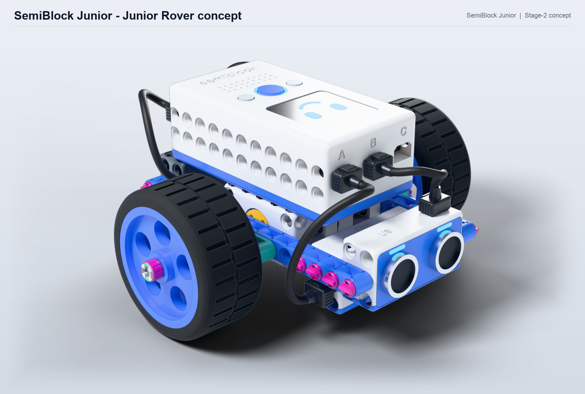

What's in stage 2:

* **144 parts modelled in 3D:** 84 mechanical, hub and motor parts plus 60 smart modules. Each has STEP and STL files, a render, an interactive 3D view, a 2D manufacturing drawing and a FreeCAD file.
* A complete driving-base assembly, the Junior Rover, built only from catalogue parts: H-beam rails, wheel axles in bearing beams.
* The full sensor and module list, mapped against the 45-in-1 Arduino kit.
* The angle toolbox (triangles, AngleLock hinge, bent H-beams, turntable) and the bearing parts, with renders and 3D views.
* A prototype and test plan for stage 3, plus the decisions the team needs to make.

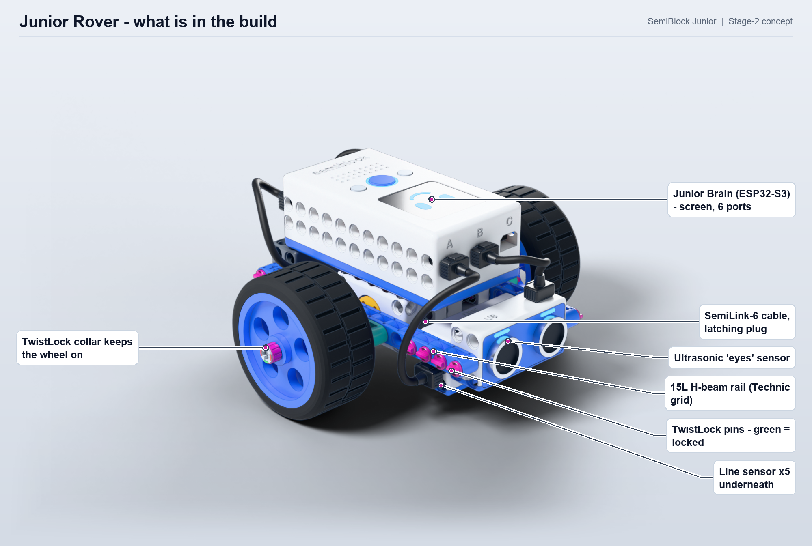

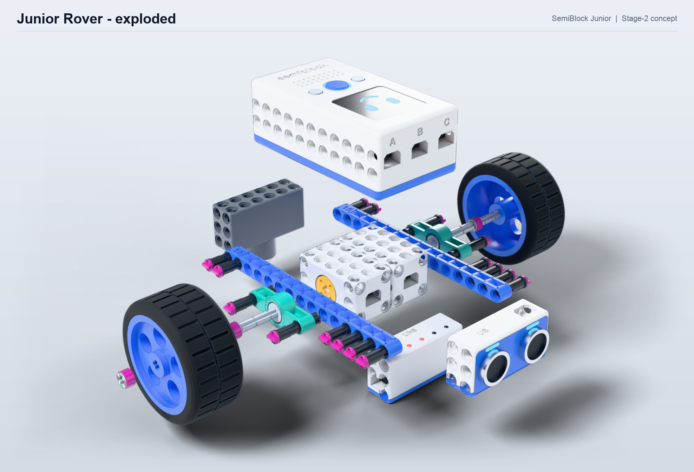

Explore it: [rover in 3D](viewer/index.html#scene=rover) · [exploded](viewer/index.html#scene=rover&explode=0.8) · [all TwistLocks open](viewer/index.html#scene=rover&lock=open).

---

## 1. Who it is for

| | |
|---|---|
| **Students** | P3 to P6, ages 8 to 12. Fine motor skills vary a lot, and small hands find stiff Technic pins hard to pull out. |
| **Teachers** | Often not engineers. One teacher has 25 to 35 students, and a lesson lasts 35 to 70 minutes. |
| **Curriculum hooks** | The upper-primary coding module (EDB, since 2023). Primary Science, which became compulsory at P1 and P4 from 2025/26 with a one-off HK$350k grant per eligible school. STEAM days and robotics competitions. |
| **Reality** | Kits are shared by several classes and robots are stored half-built between weekly lessons. Parts get lost, cables get yanked, and robots fall off tables. |

So the kit must **build fast, stay together, come apart fast, be easy to count, and work without the teacher fixing every connector.**

## 2. Design principles

1. **Lock when you want, free when you don't.** Every joint type has an "open" state for building and a "locked" state for running.
2. **Compatible first.** Same grid as LEGO Technic, so a school's existing investment keeps its value.
3. **Parts explain themselves.** Lengths are printed and countable, and colour means function.
4. **One port, one cable, any module.**
5. **Safe by design.** No mains voltage, no mercury, eye-safe lasers only, torque-limited gears.
6. **Classroom logistics are part of the product.** Tool, inventory, storage, spares.
7. **Everything parametric.** CAD is generated from code (`cad/`), so a dimension change flows to every part, drawing and render.
8. **Real engineering, kid-sized.** H-beams, ball bearings and gear-driven turntables are the same ideas students see in buildings, bridges and machines.

---

## 3. The SemiBlock grid standard

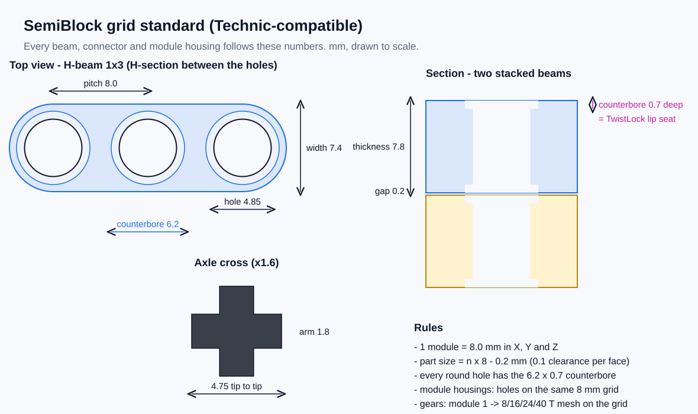

| Dimension | Value | Note |
|---|---|---|
| Pitch (1 module) | 8.0 mm | in X, Y and Z |
| Part outside size | n x 8 - 0.2 mm | 0.1 mm clearance per face |
| Beam thickness / width | 7.8 / 7.4 mm | |
| Beam section | H between the holes: flanges 1.8, web 1.6, Ø6.8 tube round every hole | new in stage 2 (section 5). Outside size unchanged |
| Round hole | Ø 4.85 mm | pins and axles |
| Counterbore (both faces) | Ø 6.2 x 0.7 mm | **the seat the TwistLock lip catches**, so locks also work in LEGO beams |
| Cross axle | 4.75 mm tip to tip, 1.8 mm arms | |
| Gears | module 1 | 8/16/24/40 T mesh at grid distances |
| Module housings | n x 8 - 0.2 mm, holes on the grid | modules bolt into a build like a beam |
| Axle bearing | MR128ZZ (8 x 12 x 3.5) in a bearing beam 1x5, axle on the grid | new in stage 2 (section 7) |

Small changes that help kids are already in the CAD:

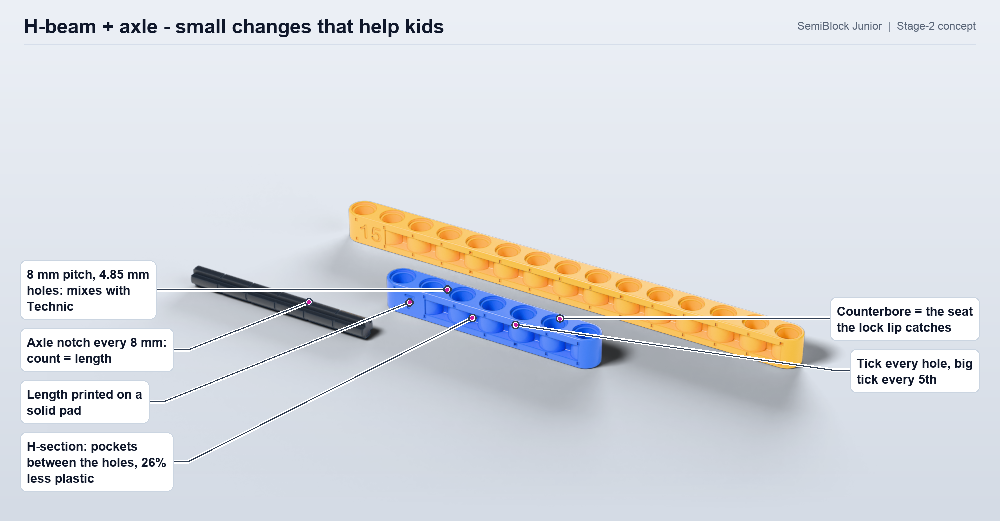

---

## 4. TwistLock, the lock system

### 4.1 The problem with friction pins

A Technic pin is held only by friction. That single number has to do two opposite jobs. It must be tight enough that a robot doesn't fall apart, and loose enough that an 8-year-old can pull the pin out. In class it fails both ways: robots shed parts when they hit a wall or go into the storage box, yet students still need fingernails or a tool to get pins out. Every joint also has a little play, so long arms and chassis wobble.

**TwistLock separates the two jobs.** When open, the pin has low friction and goes in and out easily. When locked, it is held positively and has no play.

### 4.2 Requirements (targets to prove in stage 3)

| Requirement | Target |
|---|---|
| Insert, open | push by thumb, ≤ 10 N |
| Remove, open | 5 to 10 N, gripping the knob (no fingernails) |
| Lock / unlock | ¼ turn by fingertip, ≤ 8 N·mm. SemiKey for extra torque. Clockwise = lock |
| Locked pull-out | ≥ 60 N without damage (a 6 kg pull) |
| Visible state | readable from 1 m: green = locked, red = open (like ISOFIX car-seat indicators) |
| Fits the grid | knob Ø 6.0 mm (2 mm clear of the next knob), ≤ 2.6 mm proud; far side flush |
| Works in LEGO beams | yes, it only needs the standard counterbore |
| Parts / cost | 2 moulded parts, no metal spring |
| Life | ≥ 500 lock cycles, ≥ 2,000 insertions |

### 4.3 Concepts compared

| Concept | How it works | Hand use | Secure | Visible | Fits grid / compatible | Cost | Robust | Verdict |
|---|---|:-:|:-:|:-:|:-:|:-:|:-:|---|
| A. Friction pin (today) | interference + ridges | 2 | 2 | 1 | 5 | 5 | 5 | baseline |
| **B. TwistLock pin** | ¼-turn D-cam blocks split fingers behind the counterbore | **5** | **5** | **5** | **4** | **4** | **4** | **chosen** |
| C. Flip-Lock pin | bike quick-release cam lever pulls a cone into the fingers | 5 | 5 | 5 | 3 | 2 | 2 | keep as a "Pro" option for competition builds |
| D. Slide-Lock beam | a bar inside each beam locks all its pins in one slide | 4 | 4 | 4 | 2 | 2 | 3 | rejected: every beam becomes 2 parts, and it blocks axles |
| E. Push rivet (OLLO / Jimu style) | centre plunger spreads the legs | 3 | 5 | 2 | 3 | 4 | 4 | rejected: needs a tool to remove |
| F. Bayonet hole | rotate the pin behind lugs in the hole | 3 | 2 | 2 | 2 | 5 | 4 | rejected: unlocks itself in pivots |

Scores: 1 = poor, 5 = excellent.

### 4.4 How it works

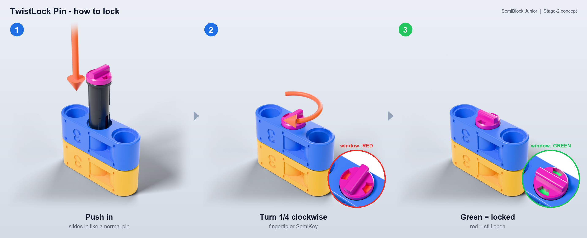

The pin has two moulded parts:

* **Sleeve** (POM): a slip-fit shank with a slot that splits the far end into two fingers, and a **catch lip** (Ø 5.4) with a 45° ramp. A flange (Ø 5.9) sits flush inside the near counterbore. Four small ribs stop the sleeve from spinning while you turn the knob.
* **Core** (POM, magenta): a knob with a wing grip and two 50° arc status windows (big enough to read from about 1 m), a shaft, and a **D-shaped cam** (2.62 mm across the arcs, 1.9 mm across the flats) that sits inside the fingers.
* A pad-printed **status ring** on the flange (red/red/green/green) shows through the windows.

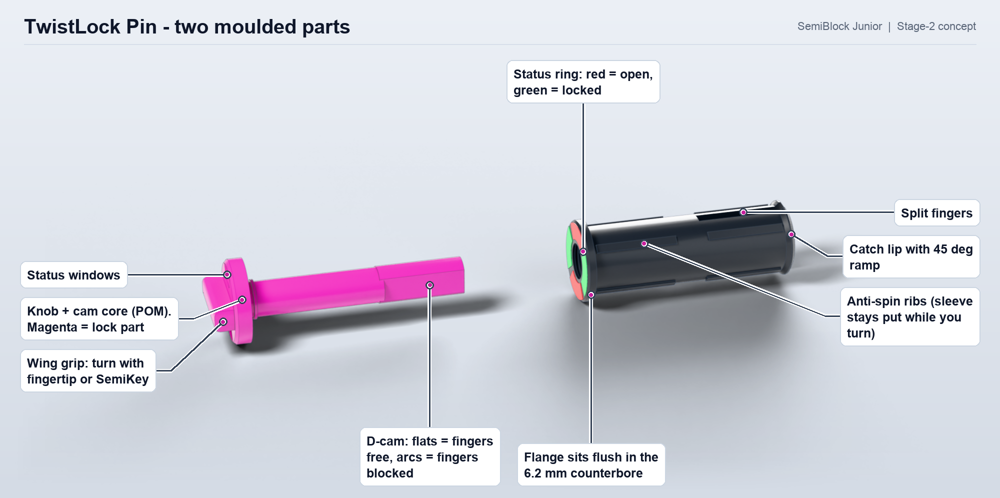

**Open:** the cam flats face the fingers, so each finger can flex 0.35 mm inward. Pulling the pin lets the 45° ramp squeeze the lip down to about Ø 4.8, which passes the Ø 4.85 bore. It comes out like a normal pin, but you can grip the knob.
**Locked:** after a ¼ turn the cam arcs face the fingers and they cannot move inward. The lip stays behind the counterbore step, so the pin cannot be pulled out. A 0.01 mm cam preload also removes joint wobble.

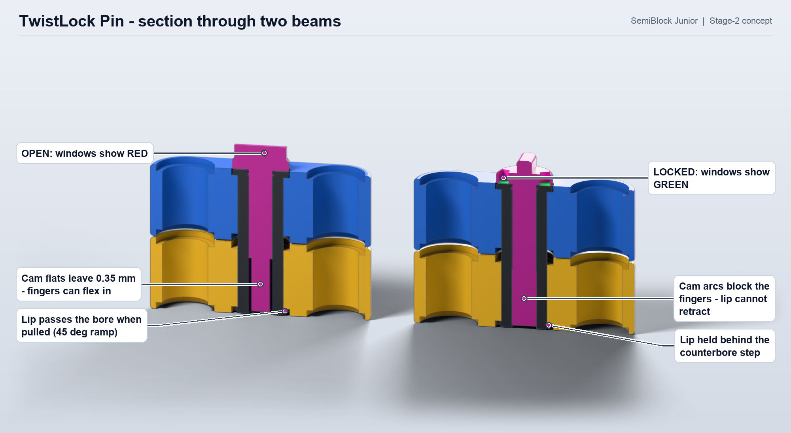

Try it in 3D: [pins cut open](viewer/index.html#scene=tl_demo&lock=open&section=y) (press **Lock all** and watch the cams turn) · [one pin on its own](viewer/index.html#part=SB-TL2).

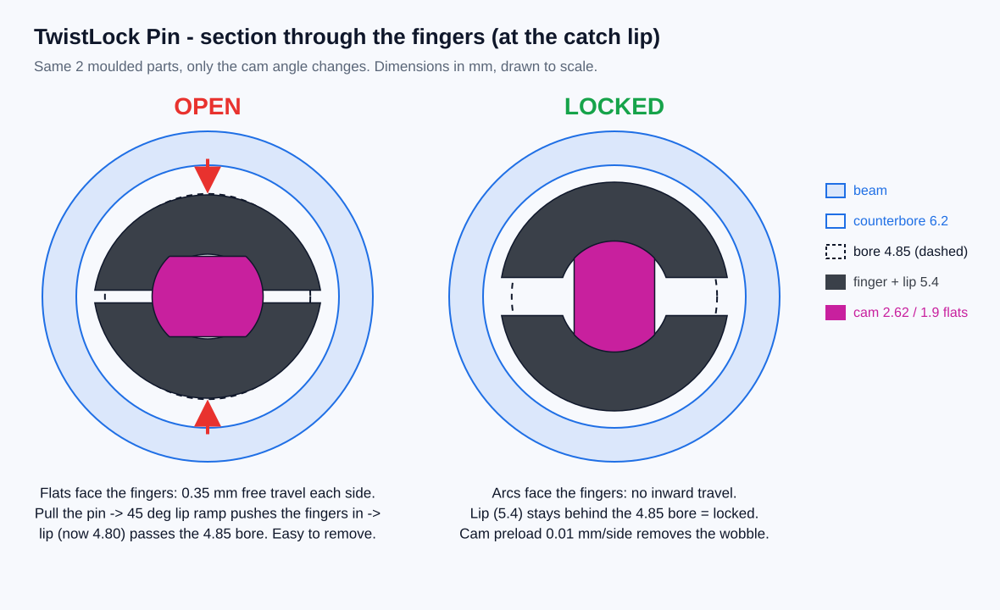

Details that make it work for kids:

* **Turn direction:** clockwise = lock ("righty-tighty"). A hard stop at 90° and a detent click at each end mean you can feel the lock happen.
* **Anti-spin:** the ribs on the near half give the sleeve more friction torque than the cam needs, so the knob turns and the sleeve does not.
* **Friction or smooth:** a black sleeve has ribs on both halves (rigid joints). A grey sleeve has ribs on the near half only, so the far beam still pivots freely while staying locked axially. This mirrors Technic's black and grey pin colours.
* **Status at a glance:** every lock in the kit is magenta and every locked window is green, so a teacher can scan a robot for red.

### 4.5 The TwistLock family and the "lock the skin" rule

| Part | Use |
|---|---|
| TwistLock Pin 2L / 3L, friction (black) | rigid joints through 2 or 3 layers |
| TwistLock Pin 2L / 3L, smooth (grey) | locked pivots: arms, steering, legs |
| TwistLock Collar ½L / 1L | replaces bushes on axles. Turn the ring ¼ and the oval cam squeezes two jaws onto the axle. Wheels never slide off |

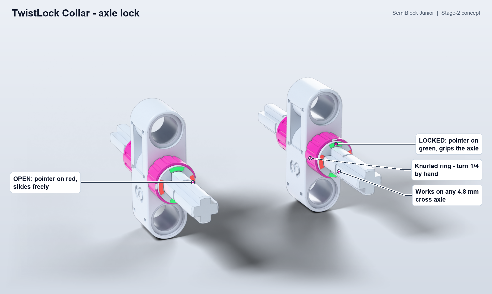

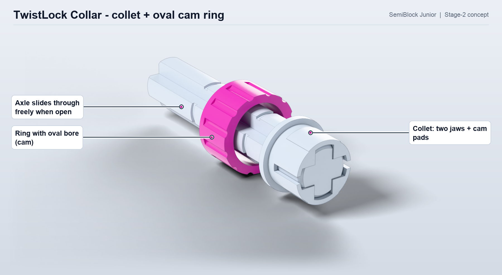

**Lock the skin, trap the core.** Only the outer faces of a build need TwistLocks. Inner joints can use ordinary Quick Pins, which are trapped by the locked layers outside them. The Junior Rover uses 16 TwistLock pins (4 of them 3L, through the bearing beams) and 4 collars, and everything else is ordinary parts. This keeps the kit cheaper and keeps building fast.

### 4.6 TwistLock key numbers

| Item | Value | Why |
|---|---|---|
| Sleeve shank | Ø 4.8 mm slip fit + 0.12 mm ribs | easy in/out when open, no spin when turning |
| Finger slot / length | 0.9 / 6.8 mm | 0.35 mm finger travel with margin |
| Catch lip | Ø 5.4 mm, 45° back ramp | 0.3 mm catch per side behind a 6.2 mm counterbore |
| Cam | 2.62 mm across arcs / 1.9 mm across flats | blocks fingers when locked / frees 0.35 mm when open |
| Knob | Ø 6.0 mm, 2.6 mm proud, 1.6 mm wing | fingertip grip; 2 mm gap to the next knob |
| Status windows | 2 x 50° arc slots, 1.1 mm wide, over a red/green pad-printed ring | readable from about 1 m |
| Material | POM (acetal) for both parts | fatigue-resistant snap fingers, low friction cam |
| Turn | 90°, clockwise to lock, detent at both ends | tactile, cannot over-turn |

---

## 5. H-beams

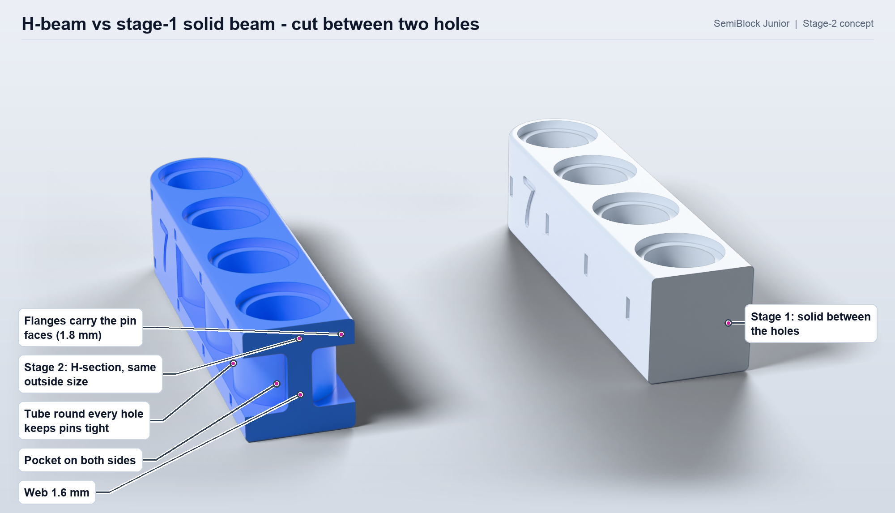

### 5.1 Why an H

Steel buildings and bridges use H-beams because the material furthest from the centre, the two flanges, does most of the work in bending. The web in the middle only holds the flanges apart, so it can be thin. Stage 2 applies the same idea to every beam, between its holes.

For the kit this buys three things:

* **Less plastic.** A 1x15 H-beam uses 26% less plastic than the stage-1 solid beam (3.2 instead of 4.4 cm³).
* **Better parts out of the mould.** The thickest wall drops from 3.2 mm (the solid between two holes) to 1.8 mm. Cooling time grows with the square of the wall, so each shot cools in about a third of the time. Thin, even walls also shrink less, which keeps the 8 mm hole pitch (◆) on size.
* **A lesson in the hand.** "Which way up is the beam stronger?" becomes a real experiment (5.4).

### 5.2 What stays the same

The outside size (7.8 x 7.4 mm), the 8 mm pitch, the Ø4.85 holes and the Ø6.2 x 0.7 counterbores on both faces are unchanged. The top and bottom faces, where pins go in, are full flanges, so beams stack face to face and TwistLock lips catch exactly as before. Every pin, axle, TwistLock and LEGO Technic part fits.

Because the fit is unchanged, the beams keep their stage-1 part numbers at Rev B (section 17).

### 5.3 The section

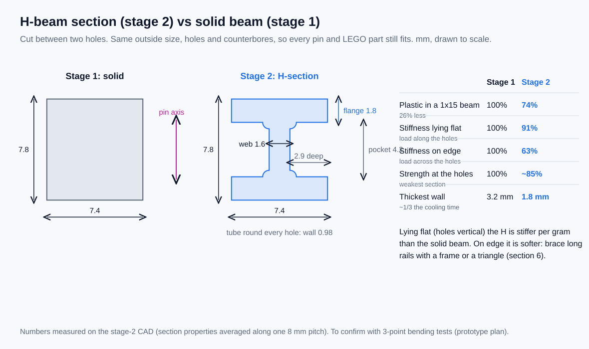

| Feature | Value | Why |
|---|---|---|
| Flanges (the two pin faces) | 1.8 mm | the 0.7 mm counterbore leaves 1.1 mm under the TwistLock lip |
| Web | 1.6 mm, centred | holds the flanges apart |
| Tube round every hole | Ø6.8 (wall 0.98) | pins and axles are held over the full 7.8 mm, as in a solid beam |
| Pockets | 2.9 deep x 4.2 high, R0.5 corners, both sides | where the plastic is saved |
| Label pad | solid between holes 1 and 2 | room for the engraved length |
| Hole ticks | notches on the flange edges, bigger every 5th hole | counting stays easy |

Measured on the CAD, with section properties averaged along one 8 mm pitch:

| | Stage-1 solid | Stage-2 H |
|---|---:|---:|
| Plastic in a 1x15 | 100% | 74% |
| Bending stiffness lying flat (load along the holes) | 100% | 91% |
| Bending stiffness on edge (load across the holes) | 100% | 63% |
| Strength at a hole (the weakest section) | 100% | about 85% |

### 5.4 The trade-off: which way up

An H is strong one way and softer the other. Lying flat, with the load along the pin holes, the H-beam keeps 91% of the stiffness with 74% of the plastic, so it is stiffer per gram than the solid beam. On edge it keeps 63%.

Where a long beam carries load on edge, as the rover rails or a crane jib do:

* tie it into a triangle (6.2): a triangle carries load along its beams, not across them;
* or pair two beams with a frame or blocks so they work like one deep beam.

In class this is a ready-made experiment. Hang the same weight from the middle of a 15L H-beam lying flat, then on edge, and measure the sag with the SemiKey ruler.

### 5.5 The H-beam family

All the stage-1 beam shapes are H-beams in stage 2:

* straight 1x2 (pin + axle hole) up to 1x15;
* L 2x4 and 3x5, and T 3x3;
* bent 1x9 (53°), and the 5x7 frame.

A **bent 1x7 at 45°** is new. The half-thickness thin beams are too thin for an H, so they stay solid. They are renamed **SB-S03** and **SB-S05** so that "H" never means two things.

### 5.6 Moulding

A solid beam comes straight out of a two-plate mould. The H's side pockets need two side actions (slides), one each side, so each cavity costs more. In return, the cycle is shorter and the parts are lighter. The tool maker should quote both in the DFM review (section 16).

---

## 6. Building at any angle

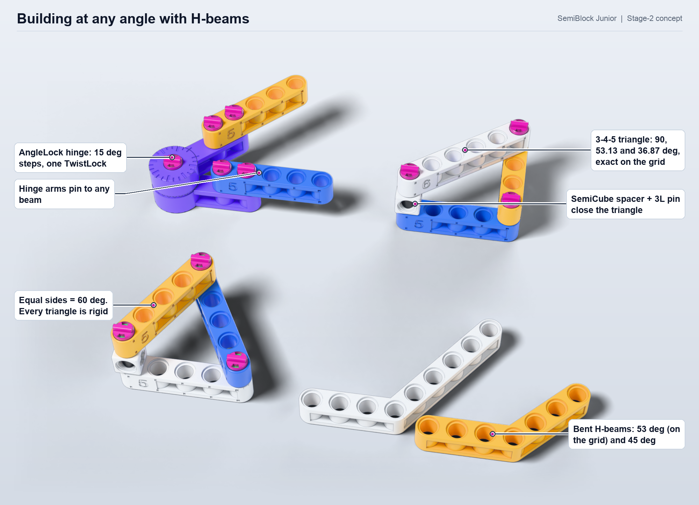

Pins and holes on an 8 mm grid make 90° easy and every other angle hard. Stage 2 gives four ways to set an angle, from free to motor-driven. Try them in 3D: [angle toolbox](viewer/index.html#scene=angles).

### 6.1 Options compared

| Option | How | Angles | Rigid | Extra parts | Verdict |
|---|---|---|---|---|---|
| **A. Triangles** | three beams pinned at the corners | exact: 90°, 53.13°, 36.87° (3-4-5) and more; nearly any angle by choosing lengths | yes | none | **core**: and it teaches why structures use triangles |
| **B. Bent H-beams** | one moulded part | 53° (on the grid), 45° (new) | yes | 1 per bend | **core**: cheapest for the common angles |
| **C. AngleLock hinge** | two identical toothed halves + 1 TwistLock | every 15°: 15, 30, 45, 60, 75, 90 … | yes, when locked | 2 halves + 1 pin | **new**: arms, ramps, legs, solar panels |
| **D. Axle angle connectors** | stage-1 #1 to #6 | 90°, 112.5°, 135°, 157.5°, 180° | on axles | 1 | kept |
| **E. Turntable** | ball bearing + 40T rim | any angle, motor-driven | held by the motor or a pin | 1 | **new**: radar scanners, arm bases, sun trackers |
| F. Friction hinge | clamp two smooth discs | any | slips under load, and you cannot see if it is tight | 2 | rejected for now (section 16) |
| G. Slotted beams + clamps | slide a clamp along a slot | any position | needs a screw to hold | 2+ | rejected: a screwdriver in every kit |

### 6.2 Triangles: free and exact

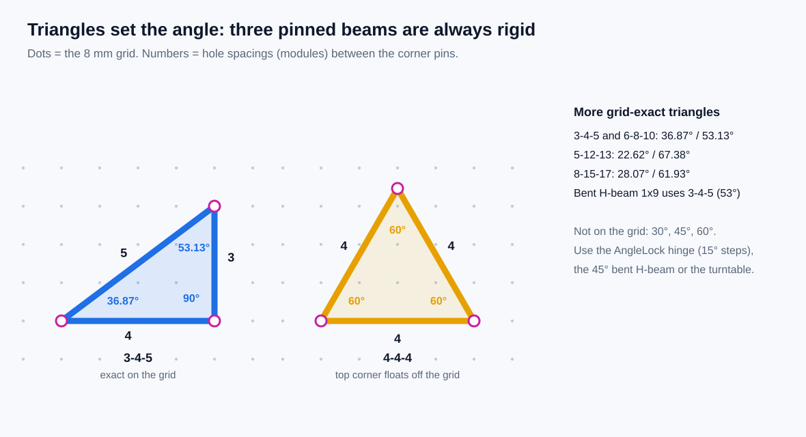

Three beams pinned at their corners form a triangle. A triangle cannot change shape without bending a beam, so the lengths set the angles:

| Hole spacings (modules) | Beams | Angles | On the grid? |
|---|---|---|---|
| 3-4-5 | 1x4, 1x5, 1x6 | 90°, 53.13°, 36.87° | yes, every corner |
| 6-8-10 | 1x7, 1x9, 1x11 | the same, twice the size | yes |
| 5-12-13 | 1x6, 1x13, 1x14 | 90°, 67.38°, 22.62° | yes |
| 4-4-4 | three 1x5 | 60°, 60°, 60° | the top corner floats off the grid |

A triangle uses three layers. Two beams meet at each corner, so one corner joins layer 0 to layer 2. Close it with a SemiCube as a spacer and a 3L TwistLock pin. The bent 1x9 H-beam is the 3-4-5 triangle's 53° corner in one part.

### 6.3 AngleLock hinge: 15° steps

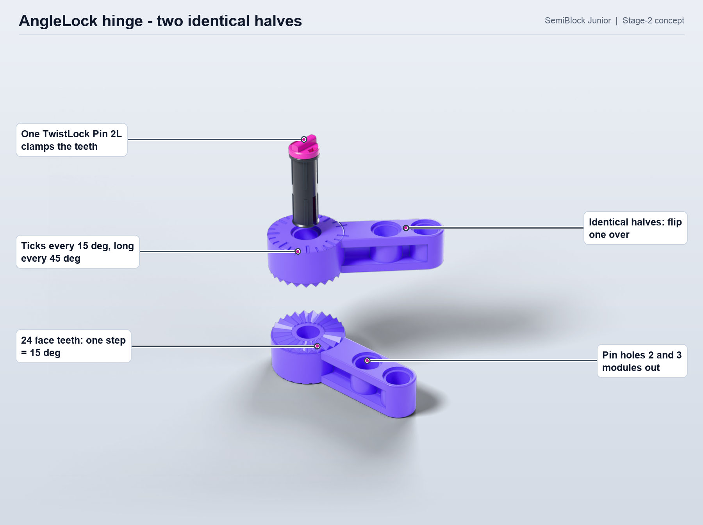

Two identical halves meet face to face, one flipped over. Each half has a ring of 24 Hirth teeth (the coupling used in machine-tool turrets), so the halves lock together at any multiple of 15°. A TwistLock Pin 2L through the pivot clamps the teeth together. Ticks on the outer face mark every 15°, with a long tick every 45°, so a student sets an angle by counting ticks.

To set or change the angle:

1. Unlock the pin.
2. Lift the top half about 1 mm, then turn it.
3. Push it back down and lock the pin.

| Item | Value | Why |
|---|---|---|
| Teeth | 24, 90° tooth, flanks meet on the axis | identical halves mesh at every 15° step |
| Crest phase | 3.75° from the arm | the flipped twin then meshes at 0°, 15°, 30° … (not 7.5°) |
| Pivot | Ø4.85 hole, lip seat on each outer face | standard TwistLock Pin 2L |
| Arm holes | 2 and 3 modules from the pivot | pin it to any beam with two pins |
| Material | POM, violet (SB-C09) | tough teeth; violet means "angle part" |
| Holding torque | ≥ 0.3 N·m before the teeth skip (target) | from the TwistLock's 60 N locked pull-out |

In the CAD, the two halves overlap by 0.002 mm³ (zero within rounding) at every 15° step and clash at 7.5°, so the steps really are 15°.

### 6.4 Bent H-beams

The bent 1x9 (53°) keeps both ends on the grid because it is the 3-4-5 triangle. The new bent 1x7 (45°) is the angle children ask for most. Its far end is off the grid, so use it for arms and ramps, not to close a frame.

### 6.5 Which one to use

| I need… | Use |
|---|---|
| a rigid 90° corner | an L or T H-beam, or a 3-4-5 triangle as a brace |
| a frame that must not sag | triangles |
| 45° or 53° in one part | a bent H-beam |
| an arm at 30°, 60° or any 15° step, adjustable | the AngleLock hinge |
| an axle frame in 22.5° steps | axle angle connectors #1 to #6 |
| something that turns to an angle under program control | the turntable + a motor, or a servo |

---

## 7. Bearings

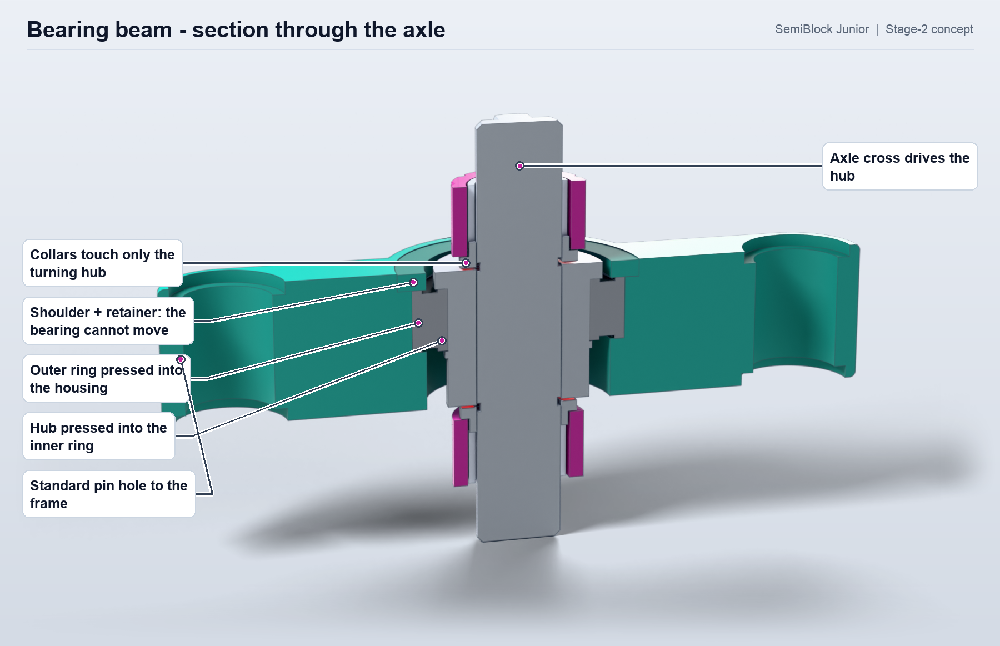

### 7.1 Why bearings

In a Technic kit every axle turns in a plastic hole. The cross axle touches the hole on its four tips, so friction is high. The hole wears oval within months of classroom use, and the wheel starts to wobble. On a driven wheel, the robot's weight also rests on the motor's output.

A ball bearing removes all three problems: rolling friction is tiny, nothing wears, and the bearing carries the load. It also opens a new lesson. Spin a wheel on a bearing and on a plain hole, and time how long each keeps turning (energy and friction in Primary Science).

### 7.2 Why a bearing needs its own part

The smallest standard bearing that can carry a cross axle is the MR128ZZ, with an 8 mm bore (a cross hub fits inside) and a 12 mm outside diameter. That is wider than a beam (7.4 mm), and its housing covers the holes one module away in every direction. So bearings live in two dedicated parts, both on the 8 mm grid:

| Part | Bearing | Fits the grid | Use |
|---|---|---|---|
| **Bearing beam 1x5** (SB-BR5) | MR128ZZ, 8 x 12 x 3.5 mm, chrome steel, shielded | bearing on the middle hole; pins in holes 1 and 5, 2 modules each side | any axle: wheels, gear trains, pulleys, fans |
| **Turntable 7x7** (SB-TT7) | 6705ZZ, 25 x 32 x 4 mm, thin section | base pins on 24 holes round the frame; the rotor has pin holes and an axle hole on the grid | arm bases, radar scanners, cranes, sun trackers |

### 7.3 Bearing beam 1x5

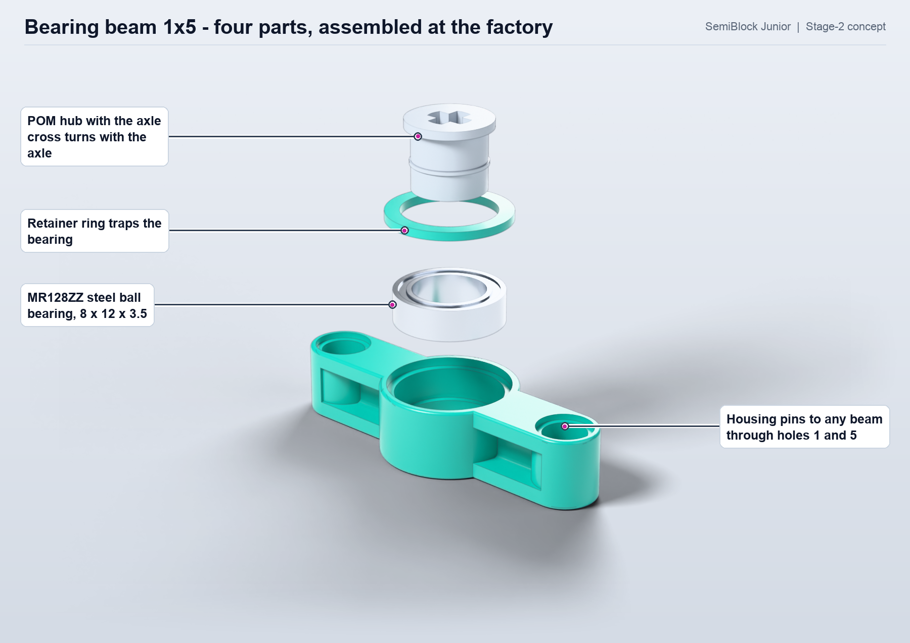

Four parts, pressed together at the factory:

* **Housing** (PA66 with 30% glass fibre, teal): a 1x5 H-beam with a round boss. Glass-filled nylon does not creep, so the press fit stays tight for years. Teal means "bearing" across the kit.
* **Bearing** MR128ZZ, pressed in by its outer ring onto a shoulder.
* **Retainer ring** (POM), pressed in on top, so the bearing cannot come out.
* **Axle hub** (POM), with an axle cross inside. It is pressed into the bearing by its inner ring until a snap bead clicks under it.

The hub's ends sit flush with the beam faces, and the housing steps back round them. So a collar, bush or gear on the axle touches only the hub, which turns with it, and nothing rubs.

The rover has one on each wheel axle, pinned to the rail with two 3L TwistLocks. See it in 3D: [rover exploded](viewer/index.html#scene=rover&explode=0.8) · [bearing beam](viewer/index.html#scene=bearing&explode=0.8).

### 7.4 Turntable 7x7

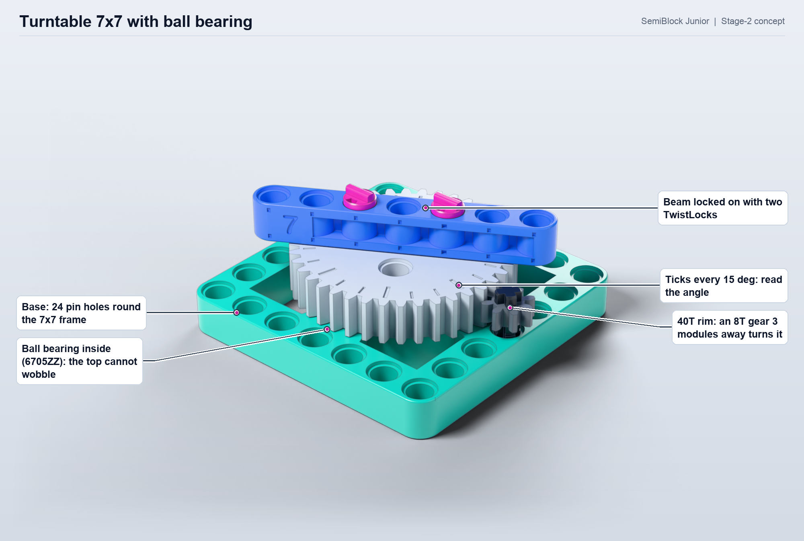

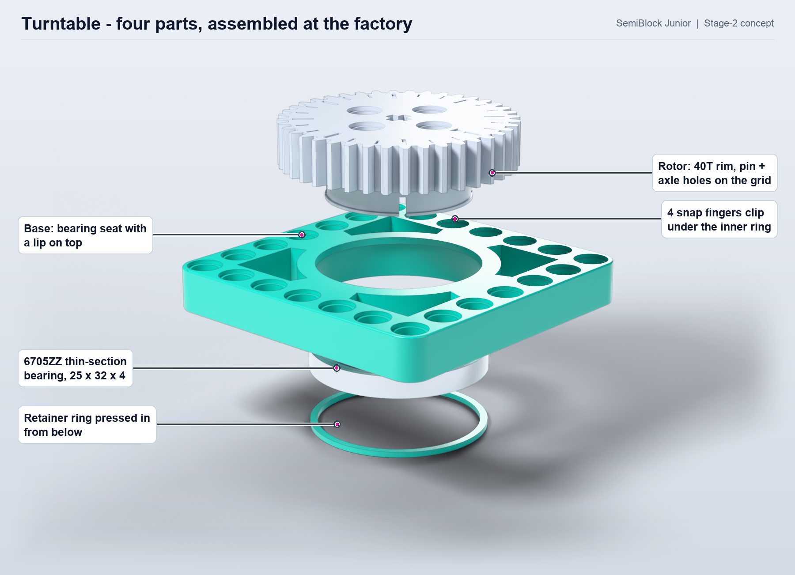

* **Base** (PA66-GF30, teal, 1 module thick): 24 pin holes round a 7x7 frame, and a bearing seat with a lip on top.
* **6705ZZ thin-section bearing**, pressed in from below and held by a retainer ring.
* **Rotor** (POM, 1 module thick): a 40T gear rim, an axle hole and 4 pin holes on the grid, ticks every 15° and an arrow at 0°. Four snap fingers clip under the bearing's inner ring.

The rotor's 40 teeth mesh with an 8T gear 3 modules (24 mm) from the centre. That is exactly the base's middle edge hole, so a motor below drives the turntable at 5:1. The bearing takes the tilting load that makes plastic turntables wobble. See it in 3D: [turntable](viewer/index.html#scene=turntable).

### 7.5 Key numbers

| Item | Value | Why |
|---|---|---|
| Bearing seat, bearing beam | Ø11.96 +0.02/0 ◆ | 0.02 to 0.06 mm press fit on the 12.00 outer ring |
| Hub on the inner ring | Ø8.02 ±0.01 ◆ | 0.01 to 0.03 mm press fit on the 8.00 bore |
| Shoulder and retainer bore | Ø10.4 | touches the outer ring only |
| Turntable seat / hub | Ø31.96 +0.03/0 ◆ / Ø25.02 ±0.01 ◆ | the same rule for the 6705ZZ |
| Assembly rule | press each ring only through itself | force never passes through the balls |
| Checks | 100% spin by finger; samples: push-out ≥ 50 N (hub), ≥ 80 N (bearing, rotor) | proposed, to confirm in stage 3 |
| Bearing grade | chrome steel, ZZ shields, light grease, ABEC-1 | low cost, quiet, sealed against dust |

Both bearings are standard parts that many suppliers in China make. Schools never handle a loose one, because each bearing is captive in its part.

---

## 8. Parts catalogue: every piece

Every part below is a real parametric 3D model in `cad/`, with a STEP file for suppliers, an STL for 3D printing, a rendered picture and an interactive view (click the ID). Contact sheets per family are in [`renders/sheets/`](renders/sheets/).

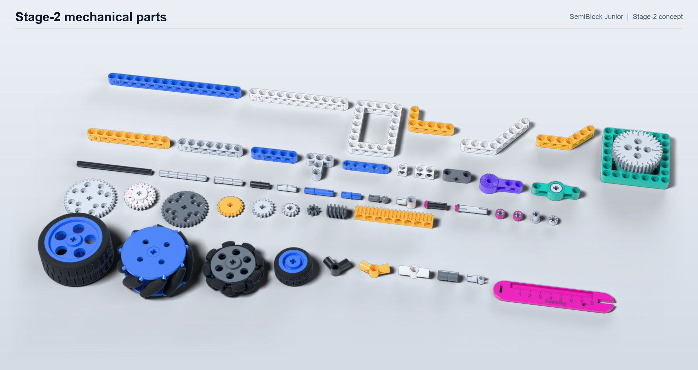

**Core Set (generated):**

<!-- BEGIN:kit -->
| Family | Part types | Pieces in Core Set |
|---|---:|---:|
| H-beams | 16 | 104 |
| Connectors | 13 | 74 |
| Pins & bushes | 10 | 170 |
| TwistLock (lock system) | 6 | 104 |
| Axles | 11 | 68 |
| Gears & motion | 11 | 34 |
| Bearings | 2 | 5 |
| Wheels | 6 | 15 |
| Accessories & tools | 3 | 15 |
| Hub, motors & cables | 6 | 13 |
| **Mechanical + hub total** | **84** | **602** |

Smart modules modelled: **60** (P1 launch 23, P2 add-on 28, P3 later 9). Core Set includes 12 of them: Ultrasonic distance, IR obstacle, Line sensor x5, Colour sensor, Light sensor, Big button, Touch pad, Rotary knob, Angle sensor (axle-through), Temp / humidity / pressure, Sound level, RGB LED x4.
<!-- END:kit -->

What's new compared with Technic:

* **H-beams**: Technic fit with an H-section between the holes, 26% less plastic (section 5).
* **AngleLock hinge** (15° steps) and the **45° bent H-beam** (section 6).
* **Bearing beam and turntable** on steel ball bearings (section 7).
* **TwistLock pins and collars**: the lock system (section 4).
* **SemiCube and Block 1x2x1**: pin holes on several faces, so students can build 3D frames without hunting for special connectors.
* **Clutch gear 24T**: slips before a motor stalls or teeth strip. It protects motors and stops a jammed arm from pinching fingers.
* **Mecanum and omni wheels** in the kit: drive in any direction, a favourite in competitions.
* **Notched axles and printed beam lengths**: count notches or read the number, and check lengths with the SemiKey gauge.
* **Colour means function**: magenta = lock, violet = angle hinge, teal = bearing, angle connectors coloured by angle, module base colour by category.
* **Cable clips and name plates**: tidy robots and robots that belong to someone.

<!-- BEGIN:catalog -->
### H-beams (16 types)

| 3D | ID | Part | Size (mm) | Core kit | Notes | Files |
|---|---|---|---|---:|---|---|
| 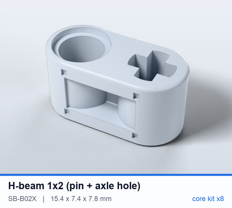 | [`SB-B02X`](viewer/index.html#part=SB-B02X) | H-beam 1x2 (pin + axle hole) | 15.4 x 7.4 x 7.8 | 8 | 1 pin hole + 1 axle hole: cranks, levers | [PDF](drawings/SB-B02X.pdf) · [FCStd](cad/fcstd/SB-B02X.FCStd) · [STEP](cad/step/SB-B02X.step) |
| 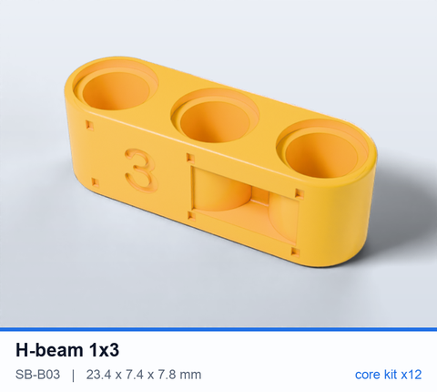 | [`SB-B03`](viewer/index.html#part=SB-B03) | H-beam 1x3 | 23.4 x 7.4 x 7.8 | 12 | length engraved on both edges | [PDF](drawings/SB-B03.pdf) · [FCStd](cad/fcstd/SB-B03.FCStd) · [STEP](cad/step/SB-B03.step) |
| 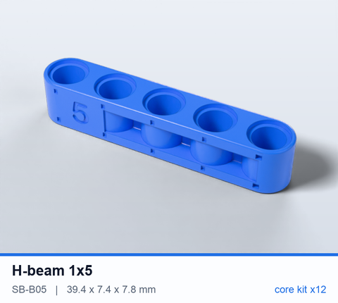 | [`SB-B05`](viewer/index.html#part=SB-B05) | H-beam 1x5 | 39.4 x 7.4 x 7.8 | 12 | hole ticks; long tick every 5th hole | [PDF](drawings/SB-B05.pdf) · [FCStd](cad/fcstd/SB-B05.FCStd) · [STEP](cad/step/SB-B05.step) |
| 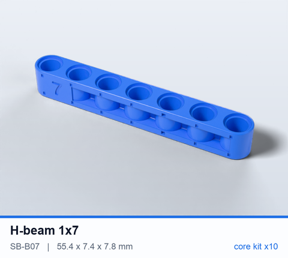 | [`SB-B07`](viewer/index.html#part=SB-B07) | H-beam 1x7 | 55.4 x 7.4 x 7.8 | 10 | most-used length | [PDF](drawings/SB-B07.pdf) · [FCStd](cad/fcstd/SB-B07.FCStd) · [STEP](cad/step/SB-B07.step) |
| 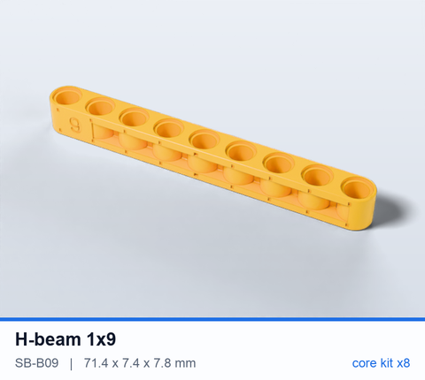 | [`SB-B09`](viewer/index.html#part=SB-B09) | H-beam 1x9 | 71.4 x 7.4 x 7.8 | 8 |  | [PDF](drawings/SB-B09.pdf) · [FCStd](cad/fcstd/SB-B09.FCStd) · [STEP](cad/step/SB-B09.step) |
| 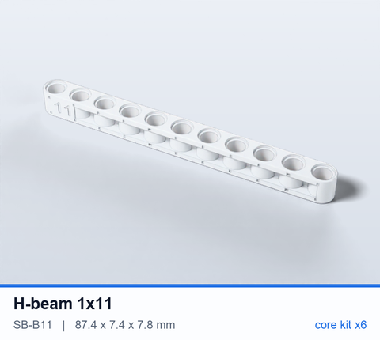 | [`SB-B11`](viewer/index.html#part=SB-B11) | H-beam 1x11 | 87.4 x 7.4 x 7.8 | 6 |  | [PDF](drawings/SB-B11.pdf) · [FCStd](cad/fcstd/SB-B11.FCStd) · [STEP](cad/step/SB-B11.step) |
| 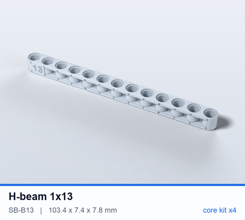 | [`SB-B13`](viewer/index.html#part=SB-B13) | H-beam 1x13 | 103.4 x 7.4 x 7.8 | 4 |  | [PDF](drawings/SB-B13.pdf) · [FCStd](cad/fcstd/SB-B13.FCStd) · [STEP](cad/step/SB-B13.step) |
| 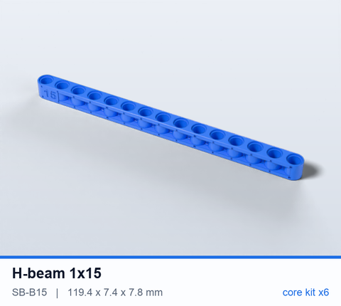 | [`SB-B15`](viewer/index.html#part=SB-B15) | H-beam 1x15 | 119.4 x 7.4 x 7.8 | 6 | chassis rails | [PDF](drawings/SB-B15.pdf) · [FCStd](cad/fcstd/SB-B15.FCStd) · [STEP](cad/step/SB-B15.step) |
| 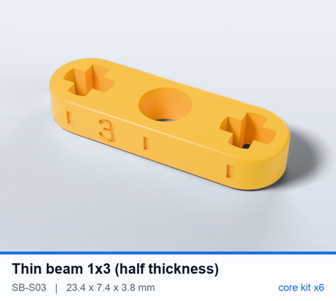 | [`SB-S03`](viewer/index.html#part=SB-S03) | Thin beam 1x3 (half thickness) | 23.4 x 7.4 x 3.8 | 6 | half thickness (stays solid), axle holes at the ends | [PDF](drawings/SB-S03.pdf) · [FCStd](cad/fcstd/SB-S03.FCStd) · [STEP](cad/step/SB-S03.step) |
| 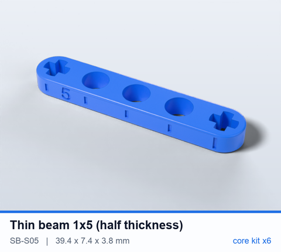 | [`SB-S05`](viewer/index.html#part=SB-S05) | Thin beam 1x5 (half thickness) | 39.4 x 7.4 x 3.8 | 6 | half thickness: linkages, flat panels | [PDF](drawings/SB-S05.pdf) · [FCStd](cad/fcstd/SB-S05.FCStd) · [STEP](cad/step/SB-S05.step) |
| 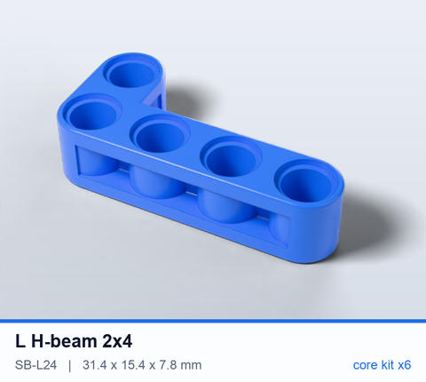 | [`SB-L24`](viewer/index.html#part=SB-L24) | L H-beam 2x4 | 31.4 x 15.4 x 7.8 | 6 |  | [PDF](drawings/SB-L24.pdf) · [FCStd](cad/fcstd/SB-L24.FCStd) · [STEP](cad/step/SB-L24.step) |
| 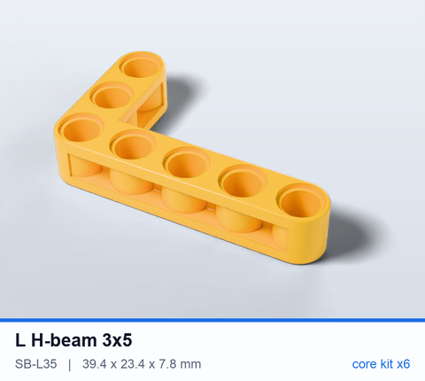 | [`SB-L35`](viewer/index.html#part=SB-L35) | L H-beam 3x5 | 39.4 x 23.4 x 7.8 | 6 |  | [PDF](drawings/SB-L35.pdf) · [FCStd](cad/fcstd/SB-L35.FCStd) · [STEP](cad/step/SB-L35.step) |
| 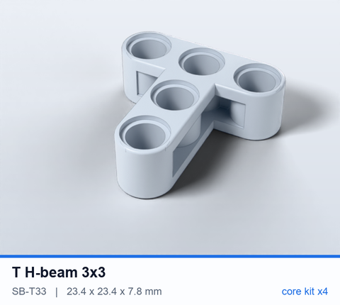 | [`SB-T33`](viewer/index.html#part=SB-T33) | T H-beam 3x3 | 23.4 x 23.4 x 7.8 | 4 |  | [PDF](drawings/SB-T33.pdf) · [FCStd](cad/fcstd/SB-T33.FCStd) · [STEP](cad/step/SB-T33.step) |
| 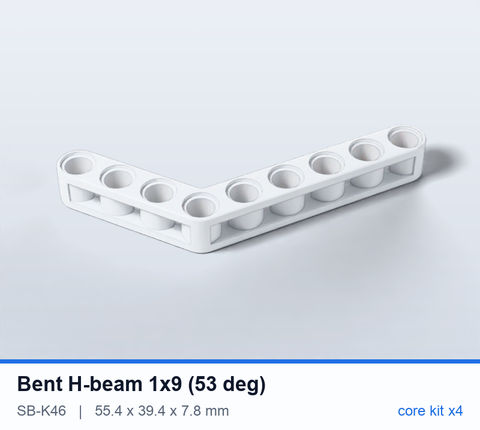 | [`SB-K46`](viewer/index.html#part=SB-K46) | Bent H-beam 1x9 (53 deg) | 55.4 x 39.4 x 7.8 | 4 | 53 deg bend = 3-4-5 triangle, ends stay on the grid | [PDF](drawings/SB-K46.pdf) · [FCStd](cad/fcstd/SB-K46.FCStd) · [STEP](cad/step/SB-K46.step) |
| 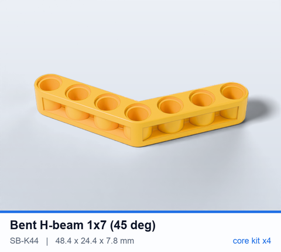 | [`SB-K44`](viewer/index.html#part=SB-K44) | Bent H-beam 1x7 (45 deg) | 48.4 x 24.4 x 7.8 | 4 | NEW: 45 deg, the angle kids ask for most | [PDF](drawings/SB-K44.pdf) · [FCStd](cad/fcstd/SB-K44.FCStd) · [STEP](cad/step/SB-K44.step) |
| 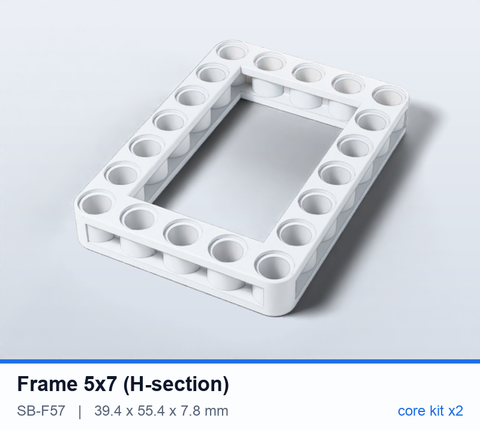 | [`SB-F57`](viewer/index.html#part=SB-F57) | Frame 5x7 (H-section) | 39.4 x 55.4 x 7.8 | 2 | one-piece rigid chassis frame | [PDF](drawings/SB-F57.pdf) · [FCStd](cad/fcstd/SB-F57.FCStd) · [STEP](cad/step/SB-F57.step) |

### Connectors (13 types)

| 3D | ID | Part | Size (mm) | Core kit | Notes | Files |
|---|---|---|---|---:|---|---|
| 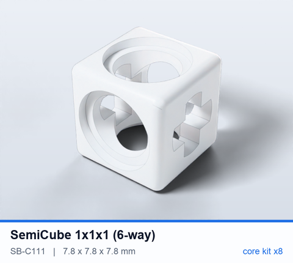 | [`SB-C111`](viewer/index.html#part=SB-C111) | SemiCube 1x1x1 (6-way) | 7.8 x 7.8 x 7.8 | 8 | NEW: 6-way node, builds 3D frames fast | [PDF](drawings/SB-C111.pdf) · [FCStd](cad/fcstd/SB-C111.FCStd) · [STEP](cad/step/SB-C111.step) |
| 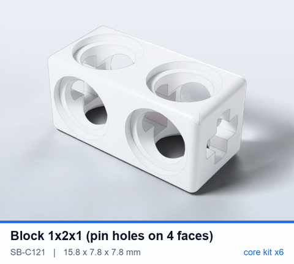 | [`SB-C121`](viewer/index.html#part=SB-C121) | Block 1x2x1 (pin holes on 4 faces) | 15.8 x 7.8 x 7.8 | 6 | NEW: pin holes on 4 faces + axle through | [PDF](drawings/SB-C121.pdf) · [FCStd](cad/fcstd/SB-C121.FCStd) · [STEP](cad/step/SB-C121.step) |
| 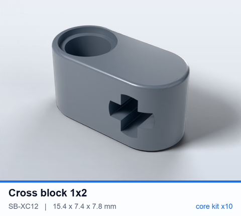 | [`SB-XC12`](viewer/index.html#part=SB-XC12) | Cross block 1x2 | 15.4 x 7.4 x 7.8 | 10 | pin hole + perpendicular axle hole | [PDF](drawings/SB-XC12.pdf) · [FCStd](cad/fcstd/SB-XC12.FCStd) · [STEP](cad/step/SB-XC12.step) |
| 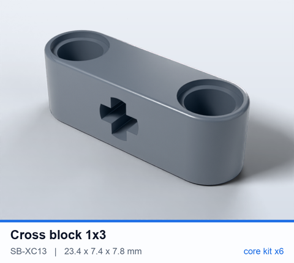 | [`SB-XC13`](viewer/index.html#part=SB-XC13) | Cross block 1x3 | 23.4 x 7.4 x 7.8 | 6 |  | [PDF](drawings/SB-XC13.pdf) · [FCStd](cad/fcstd/SB-XC13.FCStd) · [STEP](cad/step/SB-XC13.step) |
| 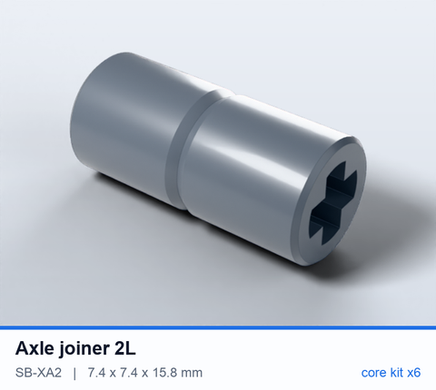 | [`SB-XA2`](viewer/index.html#part=SB-XA2) | Axle joiner 2L | 7.4 x 7.4 x 15.8 | 6 |  | [PDF](drawings/SB-XA2.pdf) · [FCStd](cad/fcstd/SB-XA2.FCStd) · [STEP](cad/step/SB-XA2.step) |
| 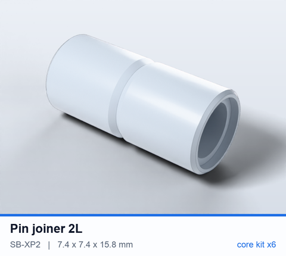 | [`SB-XP2`](viewer/index.html#part=SB-XP2) | Pin joiner 2L | 7.4 x 7.4 x 15.8 | 6 |  | [PDF](drawings/SB-XP2.pdf) · [FCStd](cad/fcstd/SB-XP2.FCStd) · [STEP](cad/step/SB-XP2.step) |
| 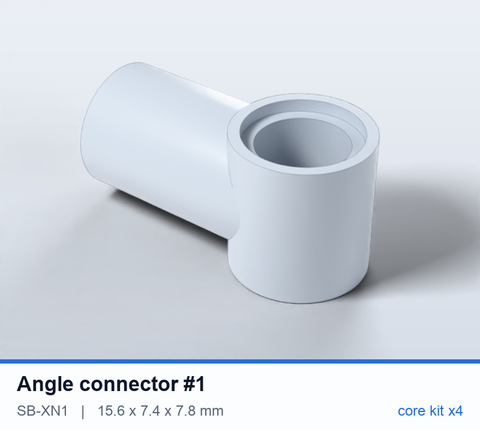 | [`SB-XN1`](viewer/index.html#part=SB-XN1) | Angle connector #1 | 15.6 x 7.4 x 7.8 | 4 | colour = angle, kids match by colour | [PDF](drawings/SB-XN1.pdf) · [FCStd](cad/fcstd/SB-XN1.FCStd) · [STEP](cad/step/SB-XN1.step) |
|  | [`SB-XN2`](viewer/index.html#part=SB-XN2) | Angle connector #2 (180 deg) | 23.8 x 7.4 x 7.8 | 4 | colour = angle, kids match by colour | [PDF](drawings/SB-XN2.pdf) · [FCStd](cad/fcstd/SB-XN2.FCStd) · [STEP](cad/step/SB-XN2.step) |
|  | [`SB-XN3`](viewer/index.html#part=SB-XN3) | Angle connector #3 (157.5 deg) | 24.7 x 9.5 x 7.8 | 4 | colour = angle, kids match by colour | [PDF](drawings/SB-XN3.pdf) · [FCStd](cad/fcstd/SB-XN3.FCStd) · [STEP](cad/step/SB-XN3.step) |
|  | [`SB-XN4`](viewer/index.html#part=SB-XN4) | Angle connector #4 (135 deg) | 24.7 x 11.5 x 7.8 | 4 | colour = angle, kids match by colour | [PDF](drawings/SB-XN4.pdf) · [FCStd](cad/fcstd/SB-XN4.FCStd) · [STEP](cad/step/SB-XN4.step) |
| 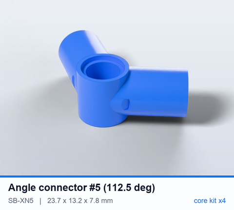 | [`SB-XN5`](viewer/index.html#part=SB-XN5) | Angle connector #5 (112.5 deg) | 23.7 x 13.2 x 7.8 | 4 | colour = angle, kids match by colour | [PDF](drawings/SB-XN5.pdf) · [FCStd](cad/fcstd/SB-XN5.FCStd) · [STEP](cad/step/SB-XN5.step) |
| 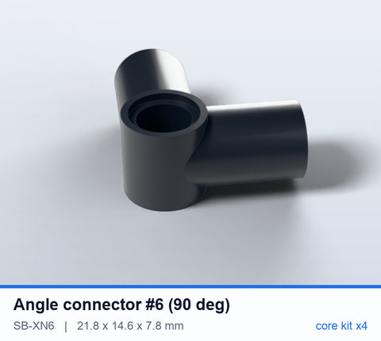 | [`SB-XN6`](viewer/index.html#part=SB-XN6) | Angle connector #6 (90 deg) | 21.8 x 14.6 x 7.8 | 4 | colour = angle, kids match by colour | [PDF](drawings/SB-XN6.pdf) · [FCStd](cad/fcstd/SB-XN6.FCStd) · [STEP](cad/step/SB-XN6.step) |
| 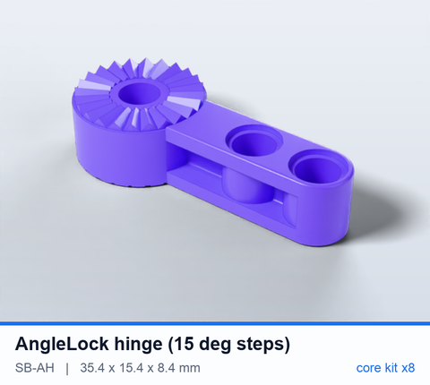 | [`SB-AH`](viewer/index.html#part=SB-AH) | AngleLock hinge (15 deg steps) | 35.4 x 15.4 x 8.4 | 8 | NEW: 2 identical halves, 24 teeth = 15 deg steps, 1 TwistLock locks it | [PDF](drawings/SB-AH.pdf) · [FCStd](cad/fcstd/SB-AH.FCStd) · [STEP](cad/step/SB-AH.step) |

### Pins & bushes (10 types)

| 3D | ID | Part | Size (mm) | Core kit | Notes | Files |
|---|---|---|---|---:|---|---|
| 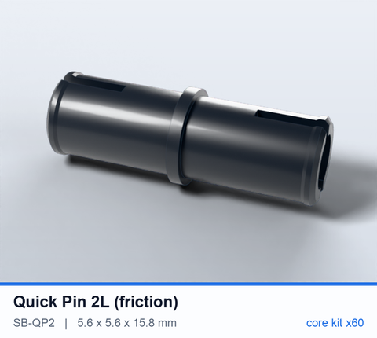 | [`SB-QP2`](viewer/index.html#part=SB-QP2) | Quick Pin 2L (friction) | 5.6 x 5.6 x 15.8 | 60 | Technic-style friction pin | [PDF](drawings/SB-QP2.pdf) · [FCStd](cad/fcstd/SB-QP2.FCStd) · [STEP](cad/step/SB-QP2.step) |
|  | [`SB-QP2S`](viewer/index.html#part=SB-QP2S) | Quick Pin 2L (smooth, pivots) | 5.6 x 5.6 x 15.8 | 20 | smooth: free pivot | [PDF](drawings/SB-QP2S.pdf) · [FCStd](cad/fcstd/SB-QP2S.FCStd) · [STEP](cad/step/SB-QP2S.step) |
| 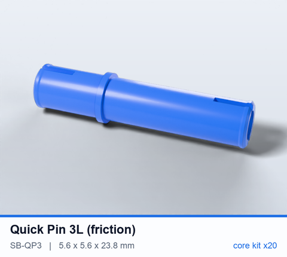 | [`SB-QP3`](viewer/index.html#part=SB-QP3) | Quick Pin 3L (friction) | 5.6 x 5.6 x 23.8 | 20 |  | [PDF](drawings/SB-QP3.pdf) · [FCStd](cad/fcstd/SB-QP3.FCStd) · [STEP](cad/step/SB-QP3.step) |
| 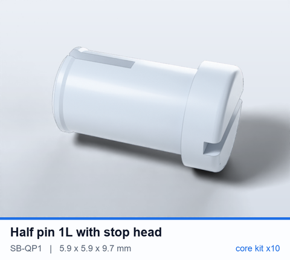 | [`SB-QP1`](viewer/index.html#part=SB-QP1) | Half pin 1L with stop head | 5.9 x 5.9 x 9.7 | 10 |  | [PDF](drawings/SB-QP1.pdf) · [FCStd](cad/fcstd/SB-QP1.FCStd) · [STEP](cad/step/SB-QP1.step) |
|  | [`SB-AP2`](viewer/index.html#part=SB-AP2) | Axle pin (friction) | 5.6 x 5.6 x 15.8 | 12 |  | [PDF](drawings/SB-AP2.pdf) · [FCStd](cad/fcstd/SB-AP2.FCStd) · [STEP](cad/step/SB-AP2.step) |
|  | [`SB-AP2S`](viewer/index.html#part=SB-AP2S) | Axle pin (smooth) | 5.6 x 5.6 x 15.8 | 8 |  | [PDF](drawings/SB-AP2S.pdf) · [FCStd](cad/fcstd/SB-AP2S.FCStd) · [STEP](cad/step/SB-AP2S.step) |
|  | [`SB-BP`](viewer/index.html#part=SB-BP) | Ball pin (tow ball) | 5.8 x 5.8 x 16.2 | 4 |  | [PDF](drawings/SB-BP.pdf) · [FCStd](cad/fcstd/SB-BP.FCStd) · [STEP](cad/step/SB-BP.step) |
|  | [`SB-PX`](viewer/index.html#part=SB-PX) | Pin with cross hole | 7.8 x 7.4 x 15.6 | 6 |  | [PDF](drawings/SB-PX.pdf) · [FCStd](cad/fcstd/SB-PX.FCStd) · [STEP](cad/step/SB-PX.step) |
|  | [`SB-BU1`](viewer/index.html#part=SB-BU1) | Bush 1L | 7.4 x 7.4 x 7.8 | 10 |  | [PDF](drawings/SB-BU1.pdf) · [FCStd](cad/fcstd/SB-BU1.FCStd) · [STEP](cad/step/SB-BU1.step) |
|  | [`SB-BU0`](viewer/index.html#part=SB-BU0) | Half bush | 7.2 x 7.2 x 3.9 | 20 |  | [PDF](drawings/SB-BU0.pdf) · [FCStd](cad/fcstd/SB-BU0.FCStd) · [STEP](cad/step/SB-BU0.step) |

### TwistLock (lock system) (6 types)

| 3D | ID | Part | Size (mm) | Core kit | Notes | Files |
|---|---|---|---|---:|---|---|
|  | [`SB-TL2`](viewer/index.html#part=SB-TL2) | TwistLock Pin 2L (friction) | 6 x 6 x 18.4 | 40 | push in, 1/4 turn = locked, green window | [PDF](drawings/SB-TL2.pdf) · [FCStd](cad/fcstd/SB-TL2.FCStd) · [STEP](cad/step/SB-TL2.step) |
|  | [`SB-TL2S`](viewer/index.html#part=SB-TL2S) | TwistLock Pin 2L (smooth, pivots) | 6 x 6 x 18.4 | 16 | locked axially but still pivots | [PDF](drawings/SB-TL2S.pdf) · [FCStd](cad/fcstd/SB-TL2S.FCStd) · [STEP](cad/step/SB-TL2S.step) |
|  | [`SB-TL3`](viewer/index.html#part=SB-TL3) | TwistLock Pin 3L (friction) | 6 x 6 x 26.4 | 16 | joins 3 layers | [PDF](drawings/SB-TL3.pdf) · [FCStd](cad/fcstd/SB-TL3.FCStd) · [STEP](cad/step/SB-TL3.step) |
|  | [`SB-TL3S`](viewer/index.html#part=SB-TL3S) | TwistLock Pin 3L (smooth, pivots) | 6 x 6 x 26.4 | 8 |  | [PDF](drawings/SB-TL3S.pdf) · [FCStd](cad/fcstd/SB-TL3S.FCStd) · [STEP](cad/step/SB-TL3S.step) |
|  | [`SB-TC`](viewer/index.html#part=SB-TC) | TwistLock Collar 1/2L | 7.4 x 7.4 x 4.5 | 16 | replaces the half bush: wheels never fall off | [PDF](drawings/SB-TC.pdf) · [FCStd](cad/fcstd/SB-TC.FCStd) · [STEP](cad/step/SB-TC.step) |
|  | [`SB-TC1`](viewer/index.html#part=SB-TC1) | TwistLock Collar 1L | 7.4 x 7.4 x 8.4 | 8 | 1L version, more grip | [PDF](drawings/SB-TC1.pdf) · [FCStd](cad/fcstd/SB-TC1.FCStd) · [STEP](cad/step/SB-TC1.step) |

### Axles (11 types)

| 3D | ID | Part | Size (mm) | Core kit | Notes | Files |
|---|---|---|---|---:|---|---|
|  | [`SB-A02`](viewer/index.html#part=SB-A02) | Axle 2 | 4.8 x 4.8 x 15.8 | 10 | notch every 8 mm: count notches = length | [PDF](drawings/SB-A02.pdf) · [FCStd](cad/fcstd/SB-A02.FCStd) · [STEP](cad/step/SB-A02.step) |
|  | [`SB-A03`](viewer/index.html#part=SB-A03) | Axle 3 | 4.8 x 4.8 x 23.8 | 10 |  | [PDF](drawings/SB-A03.pdf) · [FCStd](cad/fcstd/SB-A03.FCStd) · [STEP](cad/step/SB-A03.step) |
|  | [`SB-A04`](viewer/index.html#part=SB-A04) | Axle 4 | 4.8 x 4.8 x 31.8 | 8 |  | [PDF](drawings/SB-A04.pdf) · [FCStd](cad/fcstd/SB-A04.FCStd) · [STEP](cad/step/SB-A04.step) |
|  | [`SB-A05`](viewer/index.html#part=SB-A05) | Axle 5 | 4.8 x 4.8 x 39.8 | 8 |  | [PDF](drawings/SB-A05.pdf) · [FCStd](cad/fcstd/SB-A05.FCStd) · [STEP](cad/step/SB-A05.step) |
|  | [`SB-A06`](viewer/index.html#part=SB-A06) | Axle 6 | 4.8 x 4.8 x 47.8 | 6 |  | [PDF](drawings/SB-A06.pdf) · [FCStd](cad/fcstd/SB-A06.FCStd) · [STEP](cad/step/SB-A06.step) |
|  | [`SB-A07`](viewer/index.html#part=SB-A07) | Axle 7 | 4.8 x 4.8 x 55.8 | 4 |  | [PDF](drawings/SB-A07.pdf) · [FCStd](cad/fcstd/SB-A07.FCStd) · [STEP](cad/step/SB-A07.step) |
|  | [`SB-A08`](viewer/index.html#part=SB-A08) | Axle 8 | 4.8 x 4.8 x 63.8 | 4 |  | [PDF](drawings/SB-A08.pdf) · [FCStd](cad/fcstd/SB-A08.FCStd) · [STEP](cad/step/SB-A08.step) |
|  | [`SB-A10`](viewer/index.html#part=SB-A10) | Axle 10 | 4.8 x 4.8 x 79.8 | 4 |  | [PDF](drawings/SB-A10.pdf) · [FCStd](cad/fcstd/SB-A10.FCStd) · [STEP](cad/step/SB-A10.step) |
|  | [`SB-A12`](viewer/index.html#part=SB-A12) | Axle 12 | 4.8 x 4.8 x 95.8 | 2 | odd = grey, even = black | [PDF](drawings/SB-A12.pdf) · [FCStd](cad/fcstd/SB-A12.FCStd) · [STEP](cad/step/SB-A12.step) |
|  | [`SB-A03S`](viewer/index.html#part=SB-A03S) | Axle 3 with stop | 5.9 x 5.9 x 23.8 | 6 |  | [PDF](drawings/SB-A03S.pdf) · [FCStd](cad/fcstd/SB-A03S.FCStd) · [STEP](cad/step/SB-A03S.step) |
|  | [`SB-A04S`](viewer/index.html#part=SB-A04S) | Axle 4 with stop | 5.9 x 5.9 x 31.8 | 6 |  | [PDF](drawings/SB-A04S.pdf) · [FCStd](cad/fcstd/SB-A04S.FCStd) · [STEP](cad/step/SB-A04S.step) |

### Gears & motion (11 types)

| 3D | ID | Part | Size (mm) | Core kit | Notes | Files |
|---|---|---|---|---:|---|---|
|  | [`SB-G08`](viewer/index.html#part=SB-G08) | Gear 8T | 9.6 x 9.6 x 3.7 | 4 |  | [PDF](drawings/SB-G08.pdf) · [FCStd](cad/fcstd/SB-G08.FCStd) · [STEP](cad/step/SB-G08.step) |
|  | [`SB-G12B`](viewer/index.html#part=SB-G12B) | Double-bevel gear 12T | 13.6 x 13.6 x 4 | 4 | double bevel: parallel or 90 deg | [PDF](drawings/SB-G12B.pdf) · [FCStd](cad/fcstd/SB-G12B.FCStd) · [STEP](cad/step/SB-G12B.step) |
|  | [`SB-G16`](viewer/index.html#part=SB-G16) | Gear 16T | 17.6 x 17.6 x 3.7 | 4 |  | [PDF](drawings/SB-G16.pdf) · [FCStd](cad/fcstd/SB-G16.FCStd) · [STEP](cad/step/SB-G16.step) |
|  | [`SB-G20B`](viewer/index.html#part=SB-G20B) | Double-bevel gear 20T | 21.6 x 21.6 x 4 | 4 |  | [PDF](drawings/SB-G20B.pdf) · [FCStd](cad/fcstd/SB-G20B.FCStd) · [STEP](cad/step/SB-G20B.step) |
|  | [`SB-G24`](viewer/index.html#part=SB-G24) | Gear 24T | 25.6 x 25.6 x 3.7 | 4 |  | [PDF](drawings/SB-G24.pdf) · [FCStd](cad/fcstd/SB-G24.FCStd) · [STEP](cad/step/SB-G24.step) |
|  | [`SB-G24C`](viewer/index.html#part=SB-G24C) | Clutch gear 24T (slips at safe torque) | 25.6 x 25.6 x 7.8 | 2 | NEW: slips before motors or teeth break | [PDF](drawings/SB-G24C.pdf) · [FCStd](cad/fcstd/SB-G24C.FCStd) · [STEP](cad/step/SB-G24C.step) |
|  | [`SB-G36B`](viewer/index.html#part=SB-G36B) | Double-bevel gear 36T | 37.6 x 37.6 x 3.9 | 2 |  | [PDF](drawings/SB-G36B.pdf) · [FCStd](cad/fcstd/SB-G36B.FCStd) · [STEP](cad/step/SB-G36B.step) |
|  | [`SB-G40`](viewer/index.html#part=SB-G40) | Gear 40T | 41.6 x 41.6 x 3.7 | 2 |  | [PDF](drawings/SB-G40.pdf) · [FCStd](cad/fcstd/SB-G40.FCStd) · [STEP](cad/step/SB-G40.step) |
|  | [`SB-GW`](viewer/index.html#part=SB-GW) | Worm gear | 10.4 x 10.4 x 15.8 | 2 |  | [PDF](drawings/SB-GW.pdf) · [FCStd](cad/fcstd/SB-GW.FCStd) · [STEP](cad/step/SB-GW.step) |
|  | [`SB-GR4`](viewer/index.html#part=SB-GR4) | Gear rack 1x4 | 31.8 x 7.4 x 9.7 | 4 | pin holes on the side, m = 1 teeth | [PDF](drawings/SB-GR4.pdf) · [FCStd](cad/fcstd/SB-GR4.FCStd) · [STEP](cad/step/SB-GR4.step) |
|  | [`SB-GR8`](viewer/index.html#part=SB-GR8) | Gear rack 1x8 | 63.8 x 7.4 x 9.7 | 2 |  | [PDF](drawings/SB-GR8.pdf) · [FCStd](cad/fcstd/SB-GR8.FCStd) · [STEP](cad/step/SB-GR8.step) |

### Bearings (2 types)

| 3D | ID | Part | Size (mm) | Core kit | Notes | Files |
|---|---|---|---|---:|---|---|
|  | [`SB-BR5`](viewer/index.html#part=SB-BR5) | Bearing beam 1x5 (ball bearing) | 39.4 x 15.2 x 7.8 | 4 | NEW: axle turns on a steel ball bearing (MR128ZZ) | [PDF](drawings/SB-BR5.pdf) · [FCStd](cad/fcstd/SB-BR5.FCStd) · [STEP](cad/step/SB-BR5.step) |
|  | [`SB-TT7`](viewer/index.html#part=SB-TT7) | Turntable 7x7 with ball bearing | 55.8 x 55.8 x 15.8 | 1 | NEW: 6705ZZ bearing, 40T rim for an 8T drive, 15 deg ticks | [PDF](drawings/SB-TT7.pdf) · [FCStd](cad/fcstd/SB-TT7.FCStd) · [STEP](cad/step/SB-TT7.step) |

### Wheels (6 types)

| 3D | ID | Part | Size (mm) | Core kit | Notes | Files |
|---|---|---|---|---:|---|---|
|  | [`SB-W56`](viewer/index.html#part=SB-W56) | Wheel 56 x 26 + tyre | 56 x 56 x 26 | 4 |  | [PDF](drawings/SB-W56.pdf) · [FCStd](cad/fcstd/SB-W56.FCStd) · [STEP](cad/step/SB-W56.step) |
|  | [`SB-W30`](viewer/index.html#part=SB-W30) | Wheel 30 x 14 + tyre | 30 x 30 x 14 | 4 |  | [PDF](drawings/SB-W30.pdf) · [FCStd](cad/fcstd/SB-W30.FCStd) · [STEP](cad/step/SB-W30.step) |
|  | [`SB-WO48`](viewer/index.html#part=SB-WO48) | Omni wheel 48 | 48 x 48 x 15.6 | 2 | NEW vs Technic: rolls sideways | [PDF](drawings/SB-WO48.pdf) · [FCStd](cad/fcstd/SB-WO48.FCStd) · [STEP](cad/step/SB-WO48.step) |
|  | [`SB-WM60L`](viewer/index.html#part=SB-WM60L) | Mecanum wheel 60 (left) | 59.5 x 59.7 x 24.9 | 2 | NEW: drive in any direction (pair L + R) | [PDF](drawings/SB-WM60L.pdf) · [FCStd](cad/fcstd/SB-WM60L.FCStd) · [STEP](cad/step/SB-WM60L.step) |
|  | [`SB-WM60R`](viewer/index.html#part=SB-WM60R) | Mecanum wheel 60 (right) | 59.5 x 59.7 x 24.2 | 2 |  | [PDF](drawings/SB-WM60R.pdf) · [FCStd](cad/fcstd/SB-WM60R.FCStd) · [STEP](cad/step/SB-WM60R.step) |
|  | [`SB-CASTER`](viewer/index.html#part=SB-CASTER) | Ball caster block | 15.8 x 47.8 x 39.9 | 1 |  | [PDF](drawings/SB-CASTER.pdf) · [FCStd](cad/fcstd/SB-CASTER.FCStd) · [STEP](cad/step/SB-CASTER.step) |

### Accessories & tools (3 types)

| 3D | ID | Part | Size (mm) | Core kit | Notes | Files |
|---|---|---|---|---:|---|---|
|  | [`SB-KEY`](viewer/index.html#part=SB-KEY) | SemiKey multi-tool | 93.8 x 18 x 3.2 | 1 | key + axle gauge + pin lifter + ruler | [PDF](drawings/SB-KEY.pdf) · [FCStd](cad/fcstd/SB-KEY.FCStd) · [STEP](cad/step/SB-KEY.step) |
|  | [`SB-CC`](viewer/index.html#part=SB-CC) | Cable clip (pin-in) | 5.6 x 5.6 x 13.6 | 12 | NEW: snaps into any hole, tidies cables | [PDF](drawings/SB-CC.pdf) · [FCStd](cad/fcstd/SB-CC.FCStd) · [STEP](cad/step/SB-CC.step) |
|  | [`SB-N26`](viewer/index.html#part=SB-N26) | Name plate 2x6 (write-on) | 47.8 x 15.8 x 3.8 | 2 | write a name, pin it on | [PDF](drawings/SB-N26.pdf) · [FCStd](cad/fcstd/SB-N26.FCStd) · [STEP](cad/step/SB-N26.step) |

### Hub, motors & cables (6 types)

| 3D | ID | Part | Size (mm) | Core kit | Notes | Files |
|---|---|---|---|---:|---|---|
|  | [`SB-HUB`](viewer/index.html#part=SB-HUB) | Junior Brain (ESP32-S3 hub) | 87.8 x 47.8 x 32.4 | 1 | ESP32-S3, 1.54 in screen, 6 ports, IMU, mic, speaker | [PDF](drawings/SB-HUB.pdf) · [FCStd](cad/fcstd/SB-HUB.FCStd) · [STEP](cad/step/SB-HUB.step) |
|  | [`SB-MOT-M`](viewer/index.html#part=SB-MOT-M) | SemiMotor M (encoder motor) | 39.8 x 23.8 x 23.8 | 2 | encoder: speed + position, both ends have a port | [PDF](drawings/SB-MOT-M.pdf) · [FCStd](cad/fcstd/SB-MOT-M.FCStd) · [STEP](cad/step/SB-MOT-M.step) |
|  | [`SB-MOT-L`](viewer/index.html#part=SB-MOT-L) | SemiMotor L (encoder motor, high torque) | 55.8 x 23.8 x 23.8 | 1 | high torque, 4 pin holes on the output | [PDF](drawings/SB-MOT-L.pdf) · [FCStd](cad/fcstd/SB-MOT-L.FCStd) · [STEP](cad/step/SB-MOT-L.step) |
|  | [`SB-SV180`](viewer/index.html#part=SB-SV180) | SemiServo 180 deg (position) | 31.8 x 15.8 x 24.7 | 1 | position servo, axle output | [PDF](drawings/SB-SV180.pdf) · [FCStd](cad/fcstd/SB-SV180.FCStd) · [STEP](cad/step/SB-SV180.step) |
|  | [`SB-SV360`](viewer/index.html#part=SB-SV360) | SemiServo 360 (continuous) | 31.8 x 15.8 x 24.7 | - | continuous rotation | [PDF](drawings/SB-SV360.pdf) · [FCStd](cad/fcstd/SB-SV360.FCStd) · [STEP](cad/step/SB-SV360.step) |
|  | [`SB-LINK`](viewer/index.html#part=SB-LINK) | SemiLink-6 plug + cable | 11.2 x 8.4 x 17.5 | 8 | keyed + latching, cable is replaceable | [PDF](drawings/SB-LINK.pdf) · [FCStd](cad/fcstd/SB-LINK.FCStd) · [STEP](cad/step/SB-LINK.step) |

<!-- END:catalog -->

---

## 9. Electronics


### 9.1 Junior Brain (hub)


| Item | Proposal |
|---|---|
| MCU | ESP32-S3 (dual core 240 MHz, Wi-Fi + BLE 5), 16 MB flash, 8 MB PSRAM |
| Runtime | MicroPython + semiblock.ai firmware. Blocks generate MicroPython. Over-the-air updates |
| Screen | 1.54 in 240 x 240 colour IPS |
| Controls | main button with RGB ring, A and B buttons |
| Built-in sensors | 6-axis IMU, MEMS microphone, light sensor, temperature, battery gauge; optional magnetometer |
| Sound | I²S amplifier + speaker (replaces both buzzers of the Arduino kit) |
| Ports | 6 x SemiLink-6 (A to F): motor driver + 3.3 V + data on every port, all short-circuit protected |
| Power | 2S Li-ion (7.4 V, about 2,000 to 2,600 mAh), USB-C charging, protection IC. AA pack as an option for schools that cannot charge |
| Radio | Wi-Fi (upload, IoT lessons), BLE (tablets, Web Bluetooth, gamepads), ESP-NOW (robot to robot) |
| Size | 11 x 6 x 4 modules (88 x 48 x 32 mm) with pin holes on the sides and bottom |

Ports are on the two **end** faces, so cables run along the chassis and stay clear of the wheels, and the long sides stay free for mounting.

### 9.2 SemiLink-6 port and cable


| Pin | Signal | Notes |
|---|---|---|
| 1 | M+ | motor drive from the port's H-bridge (battery voltage, PWM) |
| 2 | M- | |
| 3 | GND | |
| 4 | VCC 3.3 V | about 500 mA per port, current-limited |
| 5 | SDA / TX / encoder A | |
| 6 | SCL / RX / encoder B | |

Connector requirements: **keyed** (the "house" profile cannot go in upside down), **positive latch** (press a tab to release), **≥ 5,000 mating cycles**, strain relief, and **replaceable cables** (10 / 20 / 35 cm). Dupont headers and small wire-to-board connectors (such as the 2.0 mm plugs on Grove-style kits) are made for one-time assembly, not daily plugging by children. Telephone-style latching plugs (LEGO Mindstorms NXT/EV3 used modified RJ12) show a latching 6-pin plug survives classrooms. We propose a custom compact version, and sourcing is a stage-3 decision.

Replaceable cables matter. On most kids' robotics kits the cable is moulded into the motor or sensor, so one damaged cable means replacing the whole part.

### 9.3 Smart module standard

* **Housing:** n x 8 - 0.2 mm in every axis. Blind Technic holes with counterbores on the bottom and sides, each with an internal lock groove so TwistLock pins lock into modules too. A white cover sits on a base coloured by category: **blue** sense, **yellow** output, **teal** connect, **violet** AI, **dark grey** power. A short code is engraved on top (US, LINE, ENV...).
* **Sizes:** S (2x2x1), S3 (2x3x1), M (2x4x1), C (2x3x2, front-facing optics), W (2x6x3, wide), P (4x4x1, panels).
* **Inside:** a low-cost 32-bit MCU (CH32V003 / PY32 class, about US$0.10 to 0.20) handles the raw sensor and speaks the SemiBlock protocol over I²C. That protocol covers ID and type, scaled values, configuration, calibration, a status LED, and firmware updates from semiblock.ai.
* **Chaining:** modules have IN and OUT, so up to 8 can share one port with auto-addressing on plug-in. Outputs that need power (fan, pump) take it from M+/M-.
* **Safe hot-plug:** reverse or short circuits are impossible by design, and a wrong module in a port is simply detected and named.

### 9.4 Motors and servo

| Part | Size (modules) | Targets |
|---|---|---|
| SemiMotor M | 5 x 3 x 3 | 150 to 180 rpm no-load, ≥ 8 N·cm, magnetic encoder ≥ 360 counts/rev, absolute zero mark, cross axle output, ports at both ends |
| SemiMotor L | 7 x 3 x 3 | 110 to 130 rpm, ≥ 20 N·cm, output with 4 pin holes for direct beam mounting |
| SemiServo 180 / 360 | 4 x 2 x 3 | position 0 to 180° (≥ 2 kg·cm) or continuous rotation, cross axle output |

---

## 10. Every sensor and module

### 10.1 Built into the Junior Brain (no module needed)

6-axis motion (tilt, shake, spin, free-fall, drive-straight), microphone (loudness, clap, voice), light, temperature, 3 buttons, speaker, RGB light, colour screen, real-time clock (synced over Wi-Fi), battery level, Wi-Fi / BLE / ESP-NOW radio, and flash storage for data logging.

### 10.2 Smart modules (generated)

Phase **P1** = launch (Core Set and Science Pack), **P2** = add-on packs in year 1, **P3** = later or advanced.


<!-- BEGIN:modules -->
### Sensing (distance, light, touch, motion) (29)

| 3D | ID | Module | What it does | Candidate chip | Phase | Replaces (45-in-1 kit) | Files |
|---|---|---|---|---|---|---|---|
|  | [`SB-US`](viewer/index.html#part=SB-US) | Ultrasonic distance | 2-400 cm distance, 'eyes' RGB LEDs | RCWL-9610A + MCU | P1 launch | HC-SR04 ultrasonic module | [PDF](drawings/SB-US.pdf) · [FCStd](cad/fcstd/SB-US.FCStd) · [STEP](cad/step/SB-US.step) |
|  | [`SB-TOF`](viewer/index.html#part=SB-TOF) | ToF laser distance | 4-400 cm, narrow beam, fast | VL53L1X (Class 1 laser, eye-safe) | P2 add-on | new | [PDF](drawings/SB-TOF.pdf) · [FCStd](cad/fcstd/SB-TOF.FCStd) · [STEP](cad/step/SB-TOF.step) |
|  | [`SB-IRP`](viewer/index.html#part=SB-IRP) | IR obstacle | 2-30 cm near/far, digital + analog | IR LED + phototransistor | P1 launch | obstacle-avoidance sensor / photo-interrupter | [PDF](drawings/SB-IRP.pdf) · [FCStd](cad/fcstd/SB-IRP.FCStd) · [STEP](cad/step/SB-IRP.step) |
|  | [`SB-PIR`](viewer/index.html#part=SB-PIR) | PIR motion | detects people moving, 3-5 m | AM312 mini PIR | P1 launch | new | [PDF](drawings/SB-PIR.pdf) · [FCStd](cad/fcstd/SB-PIR.FCStd) · [STEP](cad/step/SB-PIR.step) |
|  | [`SB-RADAR`](viewer/index.html#part=SB-RADAR) | mmWave presence | detects people even when still | HLK-LD2410 24 GHz | P3 later | new | [PDF](drawings/SB-RADAR.pdf) · [FCStd](cad/fcstd/SB-RADAR.FCStd) · [STEP](cad/step/SB-RADAR.step) |
|  | [`SB-ZONE`](viewer/index.html#part=SB-ZONE) | Multi-zone ToF 8x8 | 8x8 depth map up to 4 m | VL53L5CX | P3 later | new | [PDF](drawings/SB-ZONE.pdf) · [FCStd](cad/fcstd/SB-ZONE.FCStd) · [STEP](cad/step/SB-ZONE.step) |
|  | [`SB-LINE`](viewer/index.html#part=SB-LINE) | Line sensor x5 | 5-channel line position for line-follow races | 5x ITR20001 + MCU auto-calibrate | P1 launch | line-tracking sensor | [PDF](drawings/SB-LINE.pdf) · [FCStd](cad/fcstd/SB-LINE.FCStd) · [STEP](cad/step/SB-LINE.step) |
|  | [`SB-COLOR`](viewer/index.html#part=SB-COLOR) | Colour sensor | RGB + clear light, colour sorting, light level | TCS34725 + white LED | P1 launch | new | [PDF](drawings/SB-COLOR.pdf) · [FCStd](cad/fcstd/SB-COLOR.FCStd) · [STEP](cad/step/SB-COLOR.step) |
|  | [`SB-GEST`](viewer/index.html#part=SB-GEST) | Gesture sensor | up/down/left/right swipes, proximity | APDS-9960 | P2 add-on | new | [PDF](drawings/SB-GEST.pdf) · [FCStd](cad/fcstd/SB-GEST.FCStd) · [STEP](cad/step/SB-GEST.step) |
|  | [`SB-LUX`](viewer/index.html#part=SB-LUX) | Light sensor | ambient light in lux | BH1750 (lux) | P1 launch | photoresistor / magic light cup | [PDF](drawings/SB-LUX.pdf) · [FCStd](cad/fcstd/SB-LUX.FCStd) · [STEP](cad/step/SB-LUX.step) |
|  | [`SB-UV`](viewer/index.html#part=SB-UV) | UV index | UV index + ambient light | LTR-390 | P2 add-on | new | [PDF](drawings/SB-UV.pdf) · [FCStd](cad/fcstd/SB-UV.FCStd) · [STEP](cad/step/SB-UV.step) |
|  | [`SB-FLAME`](viewer/index.html#part=SB-FLAME) | Flame sensor | finds a candle flame (fire-fighting robot) | 3x IR phototransistor 760-1100 nm | P2 add-on | flame sensor | [PDF](drawings/SB-FLAME.pdf) · [FCStd](cad/fcstd/SB-FLAME.FCStd) · [STEP](cad/step/SB-FLAME.step) |
|  | [`SB-IRT`](viewer/index.html#part=SB-IRT) | IR thermometer | no-contact temperature -70..380 C | MLX90614 | P2 add-on | new | [PDF](drawings/SB-IRT.pdf) · [FCStd](cad/fcstd/SB-IRT.FCStd) · [STEP](cad/step/SB-IRT.step) |
|  | [`SB-THERM`](viewer/index.html#part=SB-THERM) | Thermal camera 8x8 | 8x8 heat image, finds warm bodies | AMG8833 | P3 later | new | [PDF](drawings/SB-THERM.pdf) · [FCStd](cad/fcstd/SB-THERM.FCStd) · [STEP](cad/step/SB-THERM.step) |
|  | [`SB-BTN`](viewer/index.html#part=SB-BTN) | Big button | press / release / long-press / count | tactile switch + MCU | P1 launch | push-button switch | [PDF](drawings/SB-BTN.pdf) · [FCStd](cad/fcstd/SB-BTN.FCStd) · [STEP](cad/step/SB-BTN.step) |
|  | [`SB-BUMP`](viewer/index.html#part=SB-BUMP) | Bumper switch | robot hits a wall | micro-switch | P1 launch | new | [PDF](drawings/SB-BUMP.pdf) · [FCStd](cad/fcstd/SB-BUMP.FCStd) · [STEP](cad/step/SB-BUMP.step) |
|  | [`SB-TOUCH`](viewer/index.html#part=SB-TOUCH) | Touch pad | touch / no touch, works through paper | capacitive touch | P1 launch | touch sensor | [PDF](drawings/SB-TOUCH.pdf) · [FCStd](cad/fcstd/SB-TOUCH.FCStd) · [STEP](cad/step/SB-TOUCH.step) |
|  | [`SB-FORCE`](viewer/index.html#part=SB-FORCE) | Force sensor | push force 0-10 N | strain gauge + MCU | P2 add-on | new | [PDF](drawings/SB-FORCE.pdf) · [FCStd](cad/fcstd/SB-FORCE.FCStd) · [STEP](cad/step/SB-FORCE.step) |
|  | [`SB-LOAD`](viewer/index.html#part=SB-LOAD) | Weight (load cell 1 kg) | weighs objects to 1 g | 1 kg load cell + HX711 | P2 add-on | new | [PDF](drawings/SB-LOAD.pdf) · [FCStd](cad/fcstd/SB-LOAD.FCStd) · [STEP](cad/step/SB-LOAD.step) |
|  | [`SB-POT`](viewer/index.html#part=SB-POT) | Rotary knob | 0-100 % turn position | 10k potentiometer | P1 launch | new | [PDF](drawings/SB-POT.pdf) · [FCStd](cad/fcstd/SB-POT.FCStd) · [STEP](cad/step/SB-POT.step) |
|  | [`SB-ENC`](viewer/index.html#part=SB-ENC) | Rotary encoder | endless clicks + push button | EC11 encoder + push | P1 launch | rotary encoder | [PDF](drawings/SB-ENC.pdf) · [FCStd](cad/fcstd/SB-ENC.FCStd) · [STEP](cad/step/SB-ENC.step) |
|  | [`SB-SLIDE`](viewer/index.html#part=SB-SLIDE) | Slide control | 0-100 % slider position | 60 mm slide pot | P2 add-on | new | [PDF](drawings/SB-SLIDE.pdf) · [FCStd](cad/fcstd/SB-SLIDE.FCStd) · [STEP](cad/step/SB-SLIDE.step) |
|  | [`SB-JOY`](viewer/index.html#part=SB-JOY) | Joystick | x / y / push, drive a robot by hand | 2-axis + push | P1 launch | XY joystick | [PDF](drawings/SB-JOY.pdf) · [FCStd](cad/fcstd/SB-JOY.FCStd) · [STEP](cad/step/SB-JOY.step) |
|  | [`SB-KEYPAD`](viewer/index.html#part=SB-KEYPAD) | Keypad 4x3 | enter numbers / passwords | 12-key capacitive | P2 add-on | new | [PDF](drawings/SB-KEYPAD.pdf) · [FCStd](cad/fcstd/SB-KEYPAD.FCStd) · [STEP](cad/step/SB-KEYPAD.step) |
|  | [`SB-IMU`](viewer/index.html#part=SB-IMU) | Motion sensor (6-axis) | tilt, shake, spin of a moving part | ICM-42670 accel + gyro | P2 add-on | tilt switch / mercury switch / vibration switch | [PDF](drawings/SB-IMU.pdf) · [FCStd](cad/fcstd/SB-IMU.FCStd) · [STEP](cad/step/SB-IMU.step) |
|  | [`SB-KNOCK`](viewer/index.html#part=SB-KNOCK) | Knock / vibration | knocks, taps, vibration strength | piezo disc | P2 add-on | knock sensor / vibration switch | [PDF](drawings/SB-KNOCK.pdf) · [FCStd](cad/fcstd/SB-KNOCK.FCStd) · [STEP](cad/step/SB-KNOCK.step) |
|  | [`SB-ANGLE`](viewer/index.html#part=SB-ANGLE) | Angle sensor (axle-through) | absolute angle of any axle that passes through | AS5600 magnetic encoder | P1 launch | new | [PDF](drawings/SB-ANGLE.pdf) · [FCStd](cad/fcstd/SB-ANGLE.FCStd) · [STEP](cad/step/SB-ANGLE.step) |
|  | [`SB-MAG`](viewer/index.html#part=SB-MAG) | Magnetic sensor | magnet near/far, N or S, strength | linear Hall + threshold | P1 launch | Hall x2 / linear Hall / reed switch x2 | [PDF](drawings/SB-MAG.pdf) · [FCStd](cad/fcstd/SB-MAG.FCStd) · [STEP](cad/step/SB-MAG.step) |
|  | [`SB-COMPASS`](viewer/index.html#part=SB-COMPASS) | Compass | heading 0-360 deg | MMC5603 magnetometer | P2 add-on | new | [PDF](drawings/SB-COMPASS.pdf) · [FCStd](cad/fcstd/SB-COMPASS.FCStd) · [STEP](cad/step/SB-COMPASS.step) |

### Environment & science (13)

| 3D | ID | Module | What it does | Candidate chip | Phase | Replaces (45-in-1 kit) | Files |
|---|---|---|---|---|---|---|---|
|  | [`SB-ENV`](viewer/index.html#part=SB-ENV) | Temp / humidity / pressure | +-0.2 C, %RH, hPa, altitude | SHT40 + BMP280 | P1 launch | DHT11 temp + humidity / analog temp / digital temp | [PDF](drawings/SB-ENV.pdf) · [FCStd](cad/fcstd/SB-ENV.FCStd) · [STEP](cad/step/SB-ENV.step) |
|  | [`SB-PROBE`](viewer/index.html#part=SB-PROBE) | Waterproof temp probe | -55..125 C in water, soil, food | DS18B20 stainless probe | P1 launch | DS18B20 temperature sensor | [PDF](drawings/SB-PROBE.pdf) · [FCStd](cad/fcstd/SB-PROBE.FCStd) · [STEP](cad/step/SB-PROBE.step) |
|  | [`SB-SOIL`](viewer/index.html#part=SB-SOIL) | Soil moisture | plant needs water? 0-100 % | capacitive (no corrosion) | P1 launch | soil moisture (resistive) | [PDF](drawings/SB-SOIL.pdf) · [FCStd](cad/fcstd/SB-SOIL.FCStd) · [STEP](cad/step/SB-SOIL.step) |
|  | [`SB-WATER`](viewer/index.html#part=SB-WATER) | Water level / rain | water depth 0-35 mm, rain drops | gold-plated traces | P2 add-on | water level sensor | [PDF](drawings/SB-WATER.pdf) · [FCStd](cad/fcstd/SB-WATER.FCStd) · [STEP](cad/step/SB-WATER.step) |
|  | [`SB-SOUND`](viewer/index.html#part=SB-SOUND) | Sound level | loudness in dB, clap detect | MEMS mic + RMS | P1 launch | high-sensitivity sound / small microphone | [PDF](drawings/SB-SOUND.pdf) · [FCStd](cad/fcstd/SB-SOUND.FCStd) · [STEP](cad/step/SB-SOUND.step) |
|  | [`SB-CO2`](viewer/index.html#part=SB-CO2) | CO2 (NDIR) | true CO2 ppm - classroom air | Sensirion SCD40 | P2 add-on | new | [PDF](drawings/SB-CO2.pdf) · [FCStd](cad/fcstd/SB-CO2.FCStd) · [STEP](cad/step/SB-CO2.step) |
|  | [`SB-AIR`](viewer/index.html#part=SB-AIR) | Air quality (TVOC) | TVOC + eCO2 index | ENS160 | P2 add-on | new | [PDF](drawings/SB-AIR.pdf) · [FCStd](cad/fcstd/SB-AIR.FCStd) · [STEP](cad/step/SB-AIR.step) |
|  | [`SB-PM`](viewer/index.html#part=SB-PM) | Dust PM2.5 | PM1 / PM2.5 / PM10 ug/m3 | Plantower PMSA003 | P3 later | new | [PDF](drawings/SB-PM.pdf) · [FCStd](cad/fcstd/SB-PM.FCStd) · [STEP](cad/step/SB-PM.step) |
|  | [`SB-GAS`](viewer/index.html#part=SB-GAS) | Gas / smoke | smoke / LPG level | MQ-2 (heated, teacher use) | P3 later | new | [PDF](drawings/SB-GAS.pdf) · [FCStd](cad/fcstd/SB-GAS.FCStd) · [STEP](cad/step/SB-GAS.step) |
|  | [`SB-PH`](viewer/index.html#part=SB-PH) | pH probe | pH 0-14 for chemistry lessons | pH electrode + amp | P3 later | new | [PDF](drawings/SB-PH.pdf) · [FCStd](cad/fcstd/SB-PH.FCStd) · [STEP](cad/step/SB-PH.step) |
|  | [`SB-TDS`](viewer/index.html#part=SB-TDS) | Water quality (TDS) | dissolved solids ppm | TDS probe + amp | P3 later | new | [PDF](drawings/SB-TDS.pdf) · [FCStd](cad/fcstd/SB-TDS.FCStd) · [STEP](cad/step/SB-TDS.step) |
|  | [`SB-HEART`](viewer/index.html#part=SB-HEART) | Heart rate & SpO2 | pulse + oxygen for PE / biology | MAX30102 | P2 add-on | finger heartbeat sensor | [PDF](drawings/SB-HEART.pdf) · [FCStd](cad/fcstd/SB-HEART.FCStd) · [STEP](cad/step/SB-HEART.step) |
|  | [`SB-GPS`](viewer/index.html#part=SB-GPS) | GPS | position + time outdoors | ATGM336H GPS + BeiDou | P3 later | new | [PDF](drawings/SB-GPS.pdf) · [FCStd](cad/fcstd/SB-GPS.FCStd) · [STEP](cad/step/SB-GPS.step) |

### AI & voice (2)

| 3D | ID | Module | What it does | Candidate chip | Phase | Replaces (45-in-1 kit) | Files |
|---|---|---|---|---|---|---|---|
|  | [`SB-CAM`](viewer/index.html#part=SB-CAM) | AI vision camera | face, colour, line, tag, QR, object recognition | ESP32-S3 + 2 MP camera | P2 add-on | new | [PDF](drawings/SB-CAM.pdf) · [FCStd](cad/fcstd/SB-CAM.FCStd) · [STEP](cad/step/SB-CAM.step) |
|  | [`SB-VOICE`](viewer/index.html#part=SB-VOICE) | Offline voice | Cantonese / Mandarin / English commands | ESP32-S3 / CI1302 voice chip | P2 add-on | new | [PDF](drawings/SB-VOICE.pdf) · [FCStd](cad/fcstd/SB-VOICE.FCStd) · [STEP](cad/step/SB-VOICE.step) |

### Identify & connect (2)

| 3D | ID | Module | What it does | Candidate chip | Phase | Replaces (45-in-1 kit) | Files |
|---|---|---|---|---|---|---|---|
|  | [`SB-RFID`](viewer/index.html#part=SB-RFID) | RFID / NFC reader | read cards, stickers, wristbands | PN532 13.56 MHz | P2 add-on | new | [PDF](drawings/SB-RFID.pdf) · [FCStd](cad/fcstd/SB-RFID.FCStd) · [STEP](cad/step/SB-RFID.step) |
|  | [`SB-IRX`](viewer/index.html#part=SB-IRX) | IR remote send + receive | TV / air-con remote codes | 38 kHz IR LED + receiver | P1 launch | IR transmitter / IR receiver | [PDF](drawings/SB-IRX.pdf) · [FCStd](cad/fcstd/SB-IRX.FCStd) · [STEP](cad/step/SB-IRX.step) |

### Output (light, sound, motion) (12)

| 3D | ID | Module | What it does | Candidate chip | Phase | Replaces (45-in-1 kit) | Files |
|---|---|---|---|---|---|---|---|
|  | [`SB-RGB`](viewer/index.html#part=SB-RGB) | RGB LED x4 | any colour, any brightness | 4x WS2812B | P1 launch | 3-colour LED / 2-colour LED x2 / 7-colour flash LED / RGB LED | [PDF](drawings/SB-RGB.pdf) · [FCStd](cad/fcstd/SB-RGB.FCStd) · [STEP](cad/step/SB-RGB.step) |
|  | [`SB-RING`](viewer/index.html#part=SB-RING) | LED ring x12 | spinners, timers, compass display | 12x WS2812B | P2 add-on | new | [PDF](drawings/SB-RING.pdf) · [FCStd](cad/fcstd/SB-RING.FCStd) · [STEP](cad/step/SB-RING.step) |
|  | [`SB-MATRIX`](viewer/index.html#part=SB-MATRIX) | LED matrix 8x8 | faces, icons, scrolling text | 64x WS2812-2020 | P2 add-on | new | [PDF](drawings/SB-MATRIX.pdf) · [FCStd](cad/fcstd/SB-MATRIX.FCStd) · [STEP](cad/step/SB-MATRIX.step) |
|  | [`SB-TRAFFIC`](viewer/index.html#part=SB-TRAFFIC) | Traffic light | red / yellow / green lessons | 3 LEDs | P1 launch | new | [PDF](drawings/SB-TRAFFIC.pdf) · [FCStd](cad/fcstd/SB-TRAFFIC.FCStd) · [STEP](cad/step/SB-TRAFFIC.step) |
|  | [`SB-OLED`](viewer/index.html#part=SB-OLED) | OLED screen 0.96 in | text, numbers, simple graphs | SSD1306 128x64 | P1 launch | new | [PDF](drawings/SB-OLED.pdf) · [FCStd](cad/fcstd/SB-OLED.FCStd) · [STEP](cad/step/SB-OLED.step) |
|  | [`SB-SEG`](viewer/index.html#part=SB-SEG) | 4-digit display | big numbers: scores, timers | TM1637 | P2 add-on | new | [PDF](drawings/SB-SEG.pdf) · [FCStd](cad/fcstd/SB-SEG.FCStd) · [STEP](cad/step/SB-SEG.step) |
|  | [`SB-SPK`](viewer/index.html#part=SB-SPK) | Speaker / MP3 | play sounds and recorded voice | I2S amp + 8 MB sound flash | P2 add-on | active / passive buzzer | [PDF](drawings/SB-SPK.pdf) · [FCStd](cad/fcstd/SB-SPK.FCStd) · [STEP](cad/step/SB-SPK.step) |
|  | [`SB-FAN`](viewer/index.html#part=SB-FAN) | Fan | wind, cooling, hovercraft | DC motor + soft blades + guard | P1 launch | new | [PDF](drawings/SB-FAN.pdf) · [FCStd](cad/fcstd/SB-FAN.FCStd) · [STEP](cad/step/SB-FAN.step) |
|  | [`SB-PUMP`](viewer/index.html#part=SB-PUMP) | Water pump | plant watering, fountains | 5 V pump + tubes | P2 add-on | new | [PDF](drawings/SB-PUMP.pdf) · [FCStd](cad/fcstd/SB-PUMP.FCStd) · [STEP](cad/step/SB-PUMP.step) |
|  | [`SB-VIB`](viewer/index.html#part=SB-VIB) | Vibration motor | buzz feedback | coin vibration motor | P2 add-on | new | [PDF](drawings/SB-VIB.pdf) · [FCStd](cad/fcstd/SB-VIB.FCStd) · [STEP](cad/step/SB-VIB.step) |
|  | [`SB-EMAG`](viewer/index.html#part=SB-EMAG) | Electromagnet | pick up and drop steel parts | 5 V electromagnet | P3 later | new | [PDF](drawings/SB-EMAG.pdf) · [FCStd](cad/fcstd/SB-EMAG.FCStd) · [STEP](cad/step/SB-EMAG.step) |
|  | [`SB-SWITCH`](viewer/index.html#part=SB-SWITCH) | Power switch (12 V max) | switch lamps, pumps, LED strips safely | MOSFET, 12 V / 2 A max | P2 add-on | relay (mains relay removed) | [PDF](drawings/SB-SWITCH.pdf) · [FCStd](cad/fcstd/SB-SWITCH.FCStd) · [STEP](cad/step/SB-SWITCH.step) |

### Power & energy (2)

| 3D | ID | Module | What it does | Candidate chip | Phase | Replaces (45-in-1 kit) | Files |
|---|---|---|---|---|---|---|---|
|  | [`SB-SOLAR`](viewer/index.html#part=SB-SOLAR) | Solar panel 1 W | energy lessons, solar car | 6 V 1 W panel + charge meter | P2 add-on | new | [PDF](drawings/SB-SOLAR.pdf) · [FCStd](cad/fcstd/SB-SOLAR.FCStd) · [STEP](cad/step/SB-SOLAR.step) |
|  | [`SB-METER`](viewer/index.html#part=SB-METER) | Energy meter (V/I/W) | measures voltage, current, power | INA219 | P2 add-on | new | [PDF](drawings/SB-METER.pdf) · [FCStd](cad/fcstd/SB-METER.FCStd) · [STEP](cad/step/SB-METER.step) |

<!-- END:modules -->

### 10.3 Deliberately not in the kit

Mains relays or anything above 12 V; Class 2 or higher lasers; mercury switches; resistive soil forks; unprotected lithium cells; bare breadboards and jumpers for P3 and P4 (they remain possible for older students through a "maker adapter" in a later phase). The gas sensor (heated MQ-2) is P3 and teacher-only.

---

## 11. How SemiBlock Junior is better

| | LEGO Technic + SPIKE Prime | Arduino 45-in-1 kit | **SemiBlock Junior** |
|---|---|---|---|
| Joints | friction only | n/a | **friction or TwistLock**, visible status, no play when locked |
| Beams | solid liftarms | n/a | **H-beams**: same fit, 26% less plastic, stiffer per gram lying flat |
| Bearings | plastic axle in a plastic hole | n/a | **steel ball bearings** on axles and the turntable, factory-fitted |
| Angles | bent liftarms, axle angle connectors | n/a | the same, plus a **15° AngleLock hinge** and triangle rules |
| Removing pins | fingernails or a tool | n/a | **grip the knob**; SemiKey if needed |
| Sensor types | 3 in the Prime set (colour, distance, force) + hub gyro | 45 boards, many duplicates | **60 smart modules** + 7 built into the hub |
| Ports | 6 universal ports | raw pins, polarity, breadboard | **6 universal ports, chainable**, auto-detected |
| Cables | moulded into each device | jumper wires | **replaceable, keyed, latching** |
| Programming | LEGO app (Scratch / Python) | Arduino C++ | **semiblock.ai**: blocks ↔ MicroPython, simulator, AI |
| Lengths | count the holes | n/a | **printed lengths, tick marks, notched axles, gauge** |
| Safety | good | mains relay, laser, mercury | **≤ 12 V, Class 1 only, clutch gear** |
| Compatibility | own system | Arduino ecosystem | **Technic grid** + ESP32 / MicroPython ecosystem |
| Open CAD | no | n/a | **STEP, STL, FreeCAD and a 2D drawing for every part**: print spares and custom parts |

Twenty-four concrete improvements:

1. **TwistLock pins**: lockable, visible, zero play.
2. **TwistLock collars**: wheels and gears stay on axles.
3. **Knob grip**: removal without fingernails.
4. **Lock the skin rule**: only about 10 % of joints need locks, which keeps cost down.
5. **Printed beam lengths and ticks every hole** (a bigger tick every 5th).
6. **Notched axles** plus the **SemiKey axle gauge**.
7. **Colour = function** across the whole kit.
8. **SemiCube and Block 1x2x1** for fast 3D frames.
9. **Clutch gear**: protects motors, gears and fingers.
10. **Mecanum and omni wheels** included.
11. **Cable clips** in any hole.
12. **Name plates** for shared classroom kits.
13. **One universal port** for motors and sensors, with **daisy chaining**.
14. **Smart modules** with an ID, calibration and a status LED.
15. **Hub with a screen**: show values, faces and menus without a computer.
16. **Replaceable cables**, the part that breaks most often.
17. **semiblock.ai integration**: auto-detect, blocks ↔ Python, simulator from the same CAD, data logging.
18. **3D build instructions** generated from this CAD; students can rotate every step.
19. **Photo inventory check**: snap the tray at the end of a lesson and AI counts the parts, and also spots red (unlocked) windows on robots.
20. **Bilingual English / Traditional Chinese labels** and a Cantonese-capable voice module.
21. **H-beams**: the Technic fit with 26% less plastic and thinner, faster-moulding walls.
22. **Ball-bearing beam**: axles spin freely, holes never wear oval, motors stop carrying the robot's weight.
23. **AngleLock hinge**: 15° steps, rigid when locked, two identical halves and one TwistLock.
24. **Ball-bearing turntable** with a 40T rim and 15° ticks: robot-arm bases and scanners that do not wobble.

---

## 12. Software and classroom flow

* **Plug and play:** plug a module in and semiblock.ai shows "Port B: Ultrasonic", offering the matching blocks and a live value.
* **Blocks ↔ MicroPython:** primary students start with blocks and the same project opens as Python later.
* **Simulator:** the CAD in this folder becomes the virtual parts, so students can code at home without the kit.
* **Teacher view:** class robots, battery levels, firmware updates, and lesson packs aligned to the coding module and Primary Science topics (forces, energy, plants and water, weather, the human body).
* **Storage:** one box per group with a moulded tray per family, a printed map, and the SemiKey clipped into the lid.

## 13. Safety and compliance (to plan in stage 3)

* Toys: EN 71-1/2/3, ASTM F963 / ISO 8124. Hong Kong Toys and Children's Products Safety Ordinance (Cap. 424). Small-parts warning: 8+.
* Electric toys: EN 62115. Battery: IEC 62133-2 and UN 38.3. Radio: OFCA (HK), CE-RED and FCC for export.
* Materials: ABS (beams, housings), POM (pins, locks, gears, hinges), PA66-GF30 (bearing housings), TPE (tyres), chrome-steel bearings; RoHS / REACH; no PVC.
* Design rules: ≤ 12 V everywhere, Class 1 lasers only, clutch gear torque limit, rounded edges (all models have fillets), no exposed lithium cells, bearings captive in their parts (press fit + retainer ring: no loose steel rings or balls).

## 14. Kits

| Kit | Contents (proposal) |
|---|---|
| **Core Set** | mechanical parts as in section 8, Junior Brain, 2 x Motor M, 1 x Motor L, 1 x Servo 180, 12 P1 modules, 8 SemiLink cables, SemiKey, storage box with trays |
| **Science Pack** | ENV, PROBE, SOIL, WATER, SOUND, LUX, UV, CO2, AIR, HEART, METER, SOLAR |
| **AI & IoT Pack** | CAM, VOICE, RFID, OLED, MATRIX, RING, SPK, GPS |
| **Competition Pack** | 4 x mecanum, 2 x omni, 2 x Motor M, extra TwistLock pins and collars, 15L H-beams and frames, 4 x bearing beam, 1 x turntable, 4 x AngleLock hinge |

Pricing: set after supplier quotes in stage 3. The aim is to sit clearly below SPIKE Prime-class sets for a comparable build capacity. The 2-part TwistLock pin and the side actions for the H-beam pockets are the main new tooling costs; each bearing part adds a purchased bearing (MR128ZZ or 6705ZZ) and a press-fit step.

---

## 15. Stage-3 plan: prototype and prove

| Step | What | Pass criteria |
|---|---|---|
| 1 | Resin-print TwistLock pins and collars at 1:1 (tough resin) and 2:1 (demo). Test in SemiBlock and LEGO beams | locks and unlocks by hand in both beam types |
| 2 | Machine POM samples of the sleeve and core | dimensions within ±0.02 mm |
| 3 | Force tests (push-pull gauge, torque driver) | section 4.2 targets |
| 4 | Life tests: 500 lock cycles, 2,000 insertions | no loss of lock, < 20 % force drop |
| 5 | Robot tests: 10 drops from 1 m, 30 min motor vibration, 60 °C storage | no part comes off a locked robot |
| 6 | Classroom trial: 2 schools x 2 classes (P4 to P6) | build time, lost parts, teacher help needed, robots intact after a week |
| 7 | Electronics EVT: hub board, SemiLink connector samples, module MCU firmware + protocol | hot-plug, chain of 8, auto-detect in semiblock.ai |
| 8 | DFM review and tooling quotes (slides for the finger slot and lip, side actions for the H-beam pockets) | cost per TwistLock pin and per H-beam, tool life |
| 9 | 3-point bending: 15L H-beam vs stage-1 solid beam vs LEGO liftarm, lying flat and on edge | within 10% of the CAD numbers in section 5.3 |
| 10 | AngleLock hinge: holding torque, 500 angle changes, drop test of a 30 cm arm | ≥ 0.3 N·m before the teeth skip; no worn teeth |
| 11 | Bearing beam: spin-down time vs a plain hole, hub and bearing push-out, 50 h run on a Motor M | spins > 5x longer; push-out ≥ 50 / 80 N; no noise |
| 12 | Turntable: tilt play, rotor pull-off, 8T drive for 10 h | ≤ 0.1 mm tilt at the rim; pull-off ≥ 80 N |

## 16. Decisions needed and risks

| Decision / risk | Recommendation |
|---|---|
| Technic-compatible grid vs our own grid | **Compatible** (protects school investment, faster adoption) |
| Age band: P3 to P6 only, or also P1 to P2? | Start P3 to P6. P1 to P2 may need a larger "Mini" scale |
| Lock torque for P3 hands | validate in the trial; the SemiKey gives a fallback |
| Moulding the 0.9 mm slot and 0.3 mm lip in POM | early DFM with the toolmaker; tune the lip after samples |
| Knob stands 2.6 mm proud | "lock the skin" rule; flush Quick Pins inside |
| Battery: Li-ion vs AA | Li-ion with certified pack, AA option |
| Connector: custom vs off-the-shelf | prototype both; cycle-test with kids |
| 60 modules is a lot to support | launch with the 23 P1 modules; P2/P3 by demand |
| Trademarks | describe as "compatible with LEGO® Technic™" only after legal review; never use LEGO in product names |
| Patents | freedom-to-operate search on quarter-turn cam pins (prior art: panel fasteners, push rivets) |
| H-beams are softer on edge (63% of a solid beam) | teach "strong way up"; brace long edge-loaded rails with triangles or frames; test in step 9 |
| H-beam side actions add tool cost | quote solid vs H in the DFM review; the H saves 26% resin and about two thirds of the cooling time |
| Hinge teeth skip under a heavy arm | 90° teeth + locked TwistLock (target ≥ 0.3 N·m); use two hinges side by side for long arms |
| Any angle (not just 15° steps) | later option: a friction hinge with a visible clamp indicator; not in the kit until it can show "tight" like the TwistLock window |
| Bearing quality and supply | chrome steel, ZZ shields, ABEC-1 from 2 qualified suppliers; incoming spin and noise check |
| Mecanum and omni rollers | still plain bearing: POM rollers on Ø2 stainless pins proposed; detail with the wheel supplier |

---

## 17. Manufacturing drawings for the factory

Every part has a 2D drawing in `drawings/` and a FreeCAD file in `cad/fcstd/`, both under the part number used everywhere else (e.g. `SB-TL2`). The **Files** column in section 8 and the **Download** buttons in the 3D viewer link to them.

| File | What the factory gets |
|---|---|
| `drawings/<id>.pdf` | A3 sheets, first-angle projection, bilingual title block (English / Simplified Chinese). Parts with several moulded components get an assembly sheet with a bill of materials, then one sheet per component (`SB-TL2-01` sleeve, `SB-TL2-02` core). |
| `drawings/SemiBlock-Junior-drawings-stage2.pdf` | all sheets in one file, behind a drawing list with the revision of every part |
| `drawings/SemiBlock-Junior-parts-list.csv` | parts list for quotation: part and component numbers, names in both languages, material, colour code, finish, weight, quantity per Core Set (opens in Excel) |
| `cad/fcstd/<id>.FCStd` | FreeCAD file: the coloured 3D bodies, part data (material, colour, process) and the drawing sheets as TechDraw pages |
| `cad/step/<id>.step` | neutral 3D master for the tool maker |

What is on each drawing:

* **Views and sections**: front, top and side views, a full section through the hole or shaft axis, an isometric reference view, and enlarged details of the axle cross, the TwistLock D-cam, the collar oval bore and (new) the **H-section between the holes** (5:1, with flange, web and pocket sizes).
* **Dimensions**: overall size, hole callouts (`5× Ø4.85 ±0.02 THRU`, counterbore `Ø6.2 × 0.7 both sides`), hole pitch chains (`4× 8 ±0.02`), shaft diameters, bolt circles, gear data tables (module 1, 20° involute, also for the turntable's 40T rim), a **face-teeth table** for the AngleLock hinge, and **stepped-bore callouts** for the bearing seats (`Ø10.4 THRU / Ø11.96 +0.02/0 ↧3.5 / Ø13.6 ↧1`). Anything not dimensioned is taken from the STEP model, as the notes say.
* **◆ critical dimensions**: the fit features that make parts work together and with LEGO® Technic™: Ø4.85 pin holes, 8.00 pitch, the 4.85 / 1.9 axle cross, the 7.8 / 7.4 beam thickness, the TwistLock lip Ø5.4, cam 2.62 / 1.9 and slot 0.9, and (new) the bearing seats Ø11.96 / Ø31.96, the hubs Ø8.02 / Ø25.02 and the hinge's 15° tooth step. Each one needs a first-article report at T1 and Cpk ≥ 1.33 in production.
* **Notes**: material grade, colour code with sRGB value, finish, draft, gate and ejector rules, gauges, toy-safety standards (EN 71, ASTM F963, GB 6675) and ISO 11469 material marking.
* **Bearing parts** (bearing beam, turntable) get an assembly sheet whose bill of materials lists the bearing as a purchased part, then one sheet per moulded part, with the press-fit order and the 100% spin check in the notes.
* **Electronic modules** (hub, motors, servos and the 60 smart modules) have **outline and interface drawings** only. These fix the outer size, the 8 mm pin-hole grid and the SemiLink-6 port position. The enclosure internals (walls, PCB, bosses, battery) are still a design task for the electronics supplier in stage 3.

**Revisions.** The H-section beams fit exactly like the stage-1 beams, so they keep their part numbers at **Rev B** (`SB-B02X` to `SB-B15`, `SB-L24`, `SB-L35`, `SB-T33`, `SB-K46`, `SB-F57`). Every other part, including the new ones, is **Rev A**. The revision is in each title block and in the drawing list. If the stage-1 pack has already gone to a supplier, the Rev B beam sheets replace those sheets.

All sheets are **for quotation, DFM review and T0/T1 samples**. The tolerances and force targets are proposals until the stage-3 tests in section 15 confirm them. Expect the tool maker's DFM report to add draft angles, gate positions and parting lines. The mecanum and omni rollers also still need their axle design.

To regenerate after a CAD change (after step 1 of the rebuild below):

```bash
/Applications/FreeCAD.app/Contents/Resources/bin/freecadcmd stage-2/cad/drawings.py
QT_QPA_PLATFORM=offscreen /Applications/FreeCAD.app/Contents/MacOS/FreeCAD stage-2/cad/fcstd_export.py
python3 stage-2/cad/make_docs.py
```

## 18. Files in this folder

| Path | What |
|---|---|
| `SemiBlock-Junior-Design.md` | this document |
| `drawings/` | 2D manufacturing drawings (PDF), combined drawing pack and parts list (section 17) |
| `cad/fcstd/` | FreeCAD files, one per part, with the drawing sheets inside |
| `viewer/index.html` | interactive 3D viewer: every part and assembly, Lock, Explode, Section (open in Chrome, Edge or Safari; works offline) |
| `renders/` | hero renders and callout diagrams; `renders/parts/` one image per part; `renders/sheets/` contact sheets |
| `cad/step/`, `cad/stl/` | STEP (for suppliers / Fusion / SolidWorks) and STL (for printing) for every part, in mm |
| `cad/*.py` | parametric source: `params.py` (all dimensions, including the H-section, hinge and bearing fits), `parts.py` (mechanical), `modules.py` (electronics and smart modules), `catalog.py` (the part list), `scenes.py` (assemblies) |

Rebuild everything after changing a dimension:

```bash
# 1. CAD -> STEP / STL / meshes         (FreeCAD 1.x)
/Applications/FreeCAD.app/Contents/Resources/bin/freecadcmd stage-2/cad/build.py
# 2. renders                            (Blender 5.x, Cycles)
/Applications/Blender.app/Contents/MacOS/Blender -b -P stage-2/cad/render_blender.py
# 3. callouts, cards, sheets, diagrams, tables
python3 stage-2/cad/annotate.py && python3 stage-2/cad/diagrams.py && python3 stage-2/cad/make_docs.py
# 4. only if viewer/src/viewer.js changed (three@0.169.0 + esbuild installed with npm)
npx esbuild stage-2/viewer/src/viewer.js --bundle --format=iife --minify --outfile=stage-2/viewer/viewer.bundle.js
```

## Sources

* Technic hole, axle and pin dimensions cross-checked with the open-source [Technic.scad](https://github.com/cfinke/Technic.scad) library (8 mm pitch, 4.85 mm hole, 7.8 mm thickness, 1.8 mm axle spline) and a [Eurobricks thread on pin and axle sizes](https://www.eurobricks.com/forum/forums/topic/75308-lego-pin-and-axle-standard).
* SPIKE Prime set contents (6-port hub, 6-axis gyro, colour / distance / force sensors, 3 motors): [Rapid Online product listing](https://rapidonline.com/lego-education-45678-spike-prime-set-70-6713).
* Hong Kong curriculum: [EDB circular on Primary Science (P1 and P4 from 2025/26, HK$350k grant)](https://www.edb.gov.hk/attachment/en/curriculum-development/kla/science-edu/pri-sci/EDBC23018E.pdf), [LegCo reply on STEAM, coding and AI education (2025)](https://www.info.gov.hk/gia/general/202504/30/P2025043000311.htm).

# Stage 2: SemiBlock Junior design

| Open | What you get |
|---|---|
| [`viewer/index.html`](viewer/index.html) | Interactive 3D. Rotate every part and assembly, lock/unlock the TwistLocks, explode the rover, the bearing beam and the turntable, cut sections. Double-click to open in Chrome, Edge or Safari; it works offline. |
| [`renders/`](renders/) | Hero renders and labelled diagrams. `renders/parts/` has a picture of every part; `renders/sheets/` has contact sheets per family. |
| [`drawings/`](drawings/) | 2D manufacturing drawings for the factory: one PDF per part (English / Simplified Chinese, A3, first-angle), the combined drawing pack and an RFQ parts list (CSV). |
| [`cad/fcstd/`](cad/fcstd/) | FreeCAD files, one per part: coloured 3D bodies, part data and the drawing sheets as TechDraw pages. |
| [`cad/step/`](cad/step/) | STEP files for suppliers and CAD tools (Fusion 360, SolidWorks, Onshape), in mm, coloured. A part made of several mouldings (a TwistLock's sleeve + core, a module's base + cover, a wheel's hub + tyre) opens as an assembly with one component per moulding, numbered as on its drawing (`SB-TL2-01 sleeve`, `SB-TL2-02 core`). |
| [`cad/stl/`](cad/stl/) | STL files for 3D-printing prototypes (TwistLock pins: resin printer, tough resin). |
| [`cad/`](cad/) | Parametric source. Change a number in `params.py` and rebuild (see the end of the design doc). |
